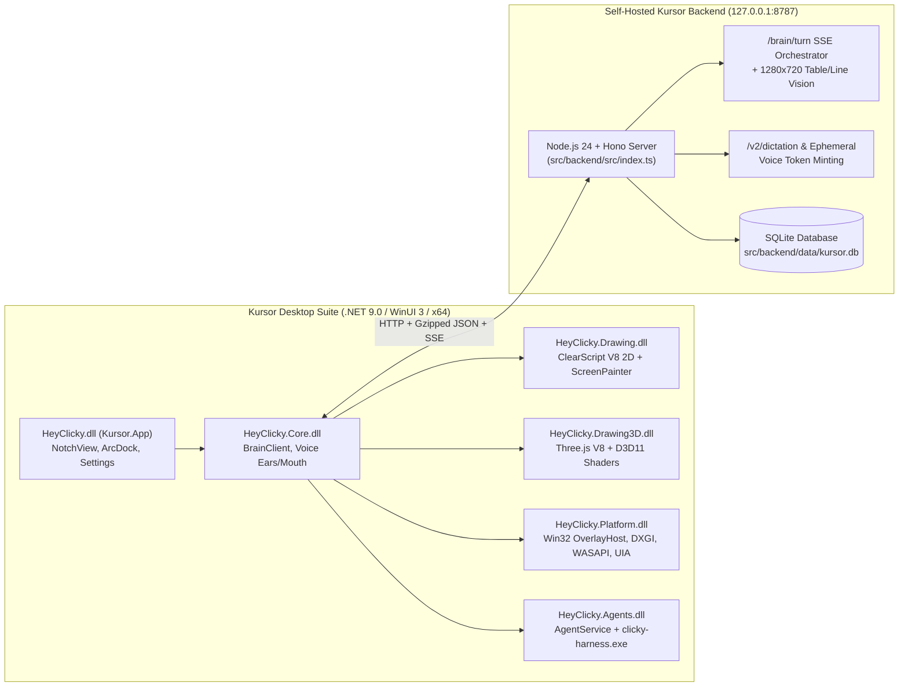

# Kursor — Self-Hosted AI Screen Companion, 2D/3D Screen Artist & Desktop Agent

**Kursor** is a complete, self-hosted reconstruction of **HeyClicky v1.1.5** for Windows 10/11. It combines a native **`.NET 9.0` + WinUI 3 + Direct3D11/DirectComposition + ClearScript V8** desktop overlay suite (`Kursor.sln`, 7 assemblies, 2,102 C# files) with a 100% self-hosted **TypeScript + Hono + SQLite** backend (`src/backend`) running locally on `http://127.0.0.1:8787`.

Zero cloud subscriptions or proprietary HeyClicky servers are required—everything runs locally on your machine using your own LLM and voice API keys.

---

## ✨ Key Features

1. **Top-of-Screen Notch & ArcDock Shell (`Kursor.App`)**
   - Always-accessible animated notch at the top of your primary monitor with a fan-out **ArcDock** for quick voice conversation, screen ink notes, proactive agents, and settings.
2. **Real-Time Voice Conversation ("Ears" & "Mouth") (`Kursor.Core`)**
   - **Push-to-Talk**: Hold **`Ctrl + Alt`** anywhere on Windows to speak to Kursor while it sees your active window and cursor position.
   - **Low-Latency STT ("Ears")**: Supports Deepgram Nova-3 live streaming WebSockets and Gemini Live bidirectional audio.
   - **Expressive TTS ("Mouth")**: Lockstep speech + drawing synchronization via OpenAI Realtime (`gpt-realtime-mini`) or Gemini TTS, releasing ink strokes in exact sync with spoken words.
3. **2D Screen Drawing & Deterministic Exam/Table Solver (`Kursor.Drawing` + `screenLayout.ts`)**
   - Hardware-accelerated click-through overlay across all monitors using Direct2D1, DirectComposition, and an embedded **ClearScript V8** JavaScript engine (`clicky-draw-pieces.js`).
   - Built-in deterministic **1280×720 pixel table/grid detector & blank-line detector** (`src/backend/src/utils/screenLayout.ts`) that snaps checkmarks (`✓`), crosses (`✗`), labels, and handwritten answers directly into table cells and onto dotted worksheet lines.
4. **Interactive Sticky Notes, Study Cards & Screen Ink Notebook (`receipt` / `paper` / `clipping` / `sticky` / `ScreenPainter`)**
   - Spawns draggable, expandable on-screen study cards (`receipt()`, `paper()`, `clipping()`, and `sticky()` in `clicky-draw-pieces.js`, plus `openPage()` for browser URLs) with markdown headings, bullet lists, and math steps.
   - Supports live cursor dragging, full-screen expansion (`□`), and dismissal (`✕`).
5. **Procedural 3D Models on Your Screen (`Kursor.Drawing3D`)**
   - Embedded Three.js r186 kernel (`clicky-three.js`) + custom HLSL Direct3D11 shaders (`FigureRenderer`) capable of building and animating 3D diagrams and interactive figures directly over your desktop.
6. **Laptop Control & Desktop Actions (`ClickyScreenActuator` & `AgentService`)**
   - **Direct Screen Actuation**: Can fly a virtual cursor across your screen (`target` / `hover`), type text into focused apps (`typeText`), copy code/text (`copyText`), and spawn action confirmation pills (`button`).
   - **Autonomous Multi-Step Takeover (`handOff`)**: Delegates multi-step desktop tasks (file organization, app workflows, browser automation, shell/file tools) to the local agent harness (`clicky-harness.exe` / `AgentService`).
7. **System-Wide AI Dictation (`DictationController`)**
   - Speak into any text box across Windows with automatic filler-word removal, grammar cleanup (`/v2/dictation/cleanup`), and Levenshtein auto-learned vocabulary.

---

## 🏗️ Architecture Overview



---

## 🚀 Quick Start (Current Machine)

### 1. Start Kursor (Backend + Desktop App)
Double-click **[`start-kursor.cmd`](file:///C:/dev/heyclicky-clone/start-kursor.cmd)** or run in PowerShell:
```powershell
.\start-kursor.ps1
```
To force-restart a running instance:
```powershell
.\start-kursor.ps1 -Restart
```

### 2. Configure API Keys
Edit [`src/backend/.env`](file:///C:/dev/heyclicky-clone/src/backend/.env) (copied automatically from [`src/backend/.env.example`](file:///C:/dev/heyclicky-clone/src/backend/.env.example)):

| Variable | Purpose | Recommended Provider |
| :--- | :--- | :--- |
| `OPENROUTER_API_KEY` | Primary OneBrain LLM (`google/gemini-2.5-flash` or `anthropic/claude-sonnet-4`) | [OpenRouter](https://openrouter.ai) |
| `KURSOR_BRAIN_MODEL` | Model ID for `/brain/turn` reasoning, screen drawing & actions (`ONEBRAIN_MODEL` is also supported as an alias) | `google/gemini-2.5-flash` |
| `GEMINI_API_KEY` | Gemini Live STT ("Ears"), Gemini TTS, or direct Gemini Brain fallback | [Google AI Studio](https://aistudio.google.com) |
| `OPENAI_API_KEY` | OpenAI Realtime TTS ("Mouth" verbatim voice reader) | [OpenAI Platform](https://platform.openai.com) |
| `DEEPGRAM_API_KEY` | Ultra-low-latency Nova-3 streaming STT ("Ears") | [Deepgram](https://deepgram.com) |
| `GROQ_API_KEY` | Fast Whisper STT & Llama-3.3-70B dictation text cleanup | [GroqCloud](https://console.groq.com) |

---

## ⚡ Windows Autostart (Run Automatically When Computer Starts)

Kursor includes a windowless background autostart launcher ([`scripts/start-kursor-hidden.vbs`](file:///C:/dev/heyclicky-clone/scripts/start-kursor-hidden.vbs)) that starts both the local Node.js backend (`127.0.0.1:8787`) and `HeyClicky.exe` silently at Windows login without flashing any terminal windows.

### Enable Autostart
```powershell
.\scripts\install-autostart.ps1
```
This registers Kursor in:
1. **Windows Registry Startup**: `HKCU\Software\Microsoft\Windows\CurrentVersion\Run\Kursor` (visible in **Task Manager → Startup apps**).
2. **Desktop Shortcut**: Creates `Kursor.lnk` on your Desktop.

### Disable Autostart
```powershell
.\scripts\uninstall-autostart.ps1
```

---

## 📦 Setting Up Kursor on Other Devices (Multi-PC Portability)

You can deploy Kursor to another Windows 10/11 PC in two ways:

### Option A: Portable Zip Package (Recommended — No `.NET SDK` or Visual Studio Needed on Target PC)

1. **Build the Portable Zip on this PC**:
   ```powershell
   # Packages pre-compiled binaries + backend + setup scripts into release/Kursor-Portable-win-x64.zip
   .\scripts\package-portable.ps1

   # Optional: Include your personal src/backend/.env keys inside the zip for your own devices
   .\scripts\package-portable.ps1 -IncludeEnv
   ```
2. **On the New Windows 10/11 PC**:
   - Install **[Node.js v24+](https://nodejs.org/)** (the only prerequisite needed on the target PC).
   - Extract **`release\Kursor-Portable-win-x64.zip`** to any folder (e.g., `C:\Kursor`).
   - Double-click **`setup-kursor.cmd`** (or run `.\setup-kursor.ps1` in PowerShell).
   - `setup-kursor.cmd` will automatically:
     - Install backend npm packages (`src\backend\node_modules`)
     - Create `src\backend\.env` (if not bundled)
     - Configure `%LOCALAPPDATA%\HeyClicky\endpoints.json` & DPAPI `auth.localdev.bin` / `auth.bin` so the client connects to `http://127.0.0.1:8787` with an active local session
     - Register Windows Autostart & create a Desktop shortcut
     - Launch Kursor!

### Option B: Clone Git Repository & Build from Source on Target PC

1. **Prerequisites on Target PC**:
   - [Node.js v24+](https://nodejs.org/)
   - [.NET 9.0 SDK (x64)](https://dotnet.microsoft.com/download/dotnet/9.0) & Windows App SDK runtime
2. **Clone & Run One-Step Setup**:
   ```powershell
   git clone <your-repo-url> C:\dev\heyclicky-clone
   cd C:\dev\heyclicky-clone
   .\setup-kursor.ps1
   ```
3. **Rebuild Desktop Assemblies Anytime After Editing C# or V8 JS**:
   ```powershell
   .\scripts\build-dist.ps1
   ```

---

## 📁 Repository Structure

```text
C:\dev\heyclicky-clone\
├── README.md                        # Complete setup, architecture & usage guide
├── AGENTS.md                        # Instructions for AI coding agents
├── .gitignore                       # Git exclusions (.env, SQLite DBs, bin/obj, dist)
├── setup-kursor.ps1 / .cmd          # One-step installer for new Windows PCs
├── start-kursor.ps1 / .cmd          # Daily launcher (Backend + Desktop App)
├── scripts/
│   ├── build-dist.ps1               # Compiles Kursor.sln (7 projects) & stages dist/kursor-desktop
│   ├── package-portable.ps1         # Creates release/Kursor-Portable-win-x64.zip for other PCs
│   ├── start-kursor-hidden.vbs      # Windowless background launcher for Windows Autostart
│   ├── install-autostart.ps1        # Registers Kursor in Windows Startup + Desktop shortcut
│   └── uninstall-autostart.ps1      # Removes Kursor from Windows Startup
├── docs/
│   ├── INDEX.md                     # Master architectural & reverse-engineering index
│   ├── 01-architecture-overview.md  # Binary inventory, sidecars, native DLLs, AppData schemas
│   ├── 02-api-contracts-and-worker-spec.md # REST/SSE routes & OneBrain protocol
│   ├── 03-voice-ears-mouth-dictation.md    # Deepgram/Gemini STT, Realtime Mouth, Dictation
│   ├── 04-drawing-2d-3d-and-ink-engine.md  # V8 2D/3D procedural engine & D3D11 shaders
│   ├── 05-platform-win32-and-ui-shell.md   # Win32 click-through overlays, WASAPI, DXGI, UIA
│   ├── 06-agents-proactive-and-memory.md   # Codex/H1 agent harness, MCP OAuth, OneBrain memory
│   └── 07-kursor-roadmap.md         # Master engineering roadmap
├── src/
│   ├── backend/                     # Self-Hosted Node.js 24 + Hono + SQLite Backend (port 8787)
│   │   ├── .env.example             # Template for LLM & Voice API keys
│   │   ├── src/index.ts             # Server entry point
│   │   ├── src/routes/              # auth.ts, worker.ts, voice.ts, brain.ts, agents.ts
│   │   └── src/utils/screenLayout.ts# Deterministic 1280x720 table & blank-line detector
│   └── desktop/                     # Reconstructed .NET 9.0 WinUI 3 Desktop Solution
│       ├── Kursor.sln               # Visual Studio 2022 / dotnet CLI solution
│       ├── Kursor.Contracts/        # Shared DTOs & endpoint configuration
│       ├── Kursor.Core/             # OneBrain client, Voice Ears/Mouth, Ink store
│       ├── Kursor.Drawing/          # ClearScript V8 2D drawing engine & ScreenPainter
│       ├── Kursor.Drawing3D/        # ClearScript V8 Three.js 3D engine & D3D11 FigureRenderer
│       ├── Kursor.Platform/         # Win32 overlays, WASAPI audio, DXGI capture, UIA
│       ├── Kursor.Agents/           # Autonomous agent harness & 16 desktop tools
│       └── Kursor.App/              # WinUI 3 Notch, ArcDock, Settings, Dictation & Onboarding
└── reference/
    └── decompiled/                  # Clean reference decompilation of all 7 original assemblies
```
