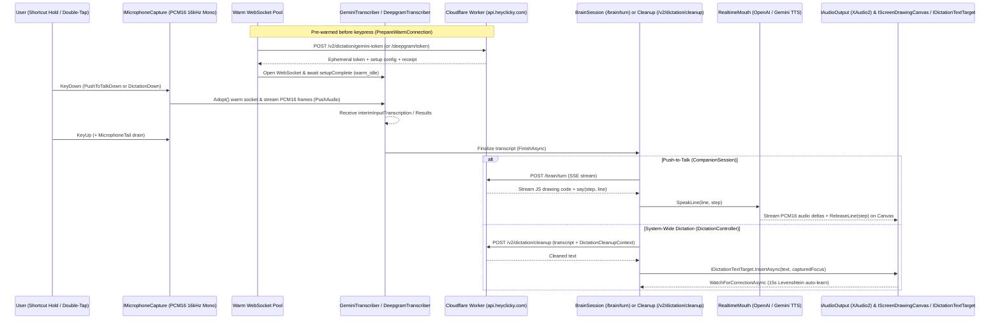

# 03 — Voice Architecture: "Ears" (STT), "Mouth" (TTS) & System-Wide AI Dictation

> [!IMPORTANT]
> This document provides the exhaustive, ground-truth specification of the three voice pillars in **HeyClicky v1.1.5** (`HeyClicky.Core.Voice` and `HeyClicky.Core.Dictation`):
> 1. **The "Ears"** (`GeminiTranscriber` & `DeepgramTranscriber`) — Ultra-low-latency streaming Speech-to-Text with warm WebSocket pooling.
> 2. **The "Mouth"** (`RealtimeMouth`, `GeminiMouthTurns`, `DrawingCaptionTiming`, `TimeStretcher`) — Dual-provider real-time speech synthesis synchronized step-by-step with 2D/3D canvas animations.
> 3. **System-Wide AI Dictation** (`DictationController`, `DictationTranscriptionClient`, `DictationVocabulary`, `DictationCorrectionDetector`) — Context-aware dictation into any Windows application with LLM cleanup and automatic correction learning.

---

## 1. End-to-End Voice & Dictation Architecture



---

## 2. The "Ears": Streaming Speech-to-Text (`HeyClicky.Core.Voice`)

HeyClicky v1.1.5 implements two streaming WebSocket transcription engines (`GeminiTranscriber` and `DeepgramTranscriber`) plus an HTTP batch fallback (`DictationTranscriptionClient` / `EarsTranscribeRequest`).

### 2.1 `GeminiTranscriber` (`HeyClicky.Core.Voice.GeminiTranscriber`)

`GeminiTranscriber` is the primary streaming transcriber for both System-Wide Dictation and Companion Push-to-Talk, backed by Google's **Gemini Live Bidi Constrained API**.

#### WebSocket Endpoint & Token Minting
1. **Token Minting Route**: `POST https://api.heyclicky.com/v2/dictation/gemini-token`
   - **Request Headers**: `Authorization: Bearer <supabase_jwt>`, `x-clicky-usage-context: <context>`
   - **Request JSON**:
     ```json
     {
       "language": "en",
       "keyterms": ["HeyClicky", "Ubaid", "..."],
       "sample_rate": 16000,
       "purpose": "dictation"
     }
     ```
   - **Response (`GeminiTranscriber.MintedSession`)**:
     - `token` (`string`): Ephemeral Gemini constrained access token.
     - `setup` (`JsonElement`): Server-constructed `BidiGenerateContentSetup` payload (model, generationConfig, inputAudioTranscription, systemInstruction with keyterms).
     - `receipt` (`string`): Signed billing/usage receipt echoed later to `/v2/dictation/cleanup`.
   - **Paywall Handling**: If `/v2/dictation/gemini-token` returns HTTP `402 Payment Required`, sets `PaywallReached = true` (`"session ended quietly: dictation word limit (402)"`).
2. **WebSocket Connection URL (`ConnectAsync`)**:
   ```
   wss://generativelanguage.googleapis.com/ws/google.ai.generativelanguage.v1beta.GenerativeService.BidiGenerateContentConstrained?access_token={Uri.EscapeDataString(token)}
   ```
3. **Handshake (`BuildSetupMessage`)**:
   - Immediately upon WebSocket open, sends the `setup` JSON object received from `/v2/dictation/gemini-token`:
     ```json
     {
       "setup": { ... }
     }
     ```
   - Waits for the server message containing `"setupComplete"` before marking the `Opened` `TaskCompletionSource<bool>` as ready.

#### Audio Streaming Format (`BuildAudioMessage`)
- **Input Audio Format**: 16-bit Linear PCM, mono (`16000` Hz default, configurable via `SampleRate`).
- **Silent Tail Frame Injection**: `LoudestWindowLevel(ReadOnlySpan<byte> pcm16, int sampleRate)` monitors signal energy; on `FinishAsync`, flushes any buffered audio and sends trailing silence / end-of-turn markers so Gemini finalizes its transcription buffer.
- **Realtime Input Frame JSON**:
  ```json
  {
    "realtimeInput": {
      "mediaChunks": [
        {
          "mimeType": "audio/pcm;rate=16000",
          "data": "<base64_encoded_pcm16_bytes>"
        }
      ]
    }
  }
  ```

#### Server Message Handling (`HandleMessage`)
`ReceiveLoopAsync` parses incoming UTF-8 JSON frames:
- `setupComplete`: Transitions connection state to ready (`warm_idle` or `press`).
- `serverContent.interimInputTranscription.text`: Updates live partial transcript (`PartialTranscriptSoFar()`).
- `serverContent.inputTranscription.text`: Appends finalized transcript segments.
- `serverContent.turnComplete` / `generationComplete`: Signals completion during `finishing` phase.
- `goAway`: Server-initiated graceful drain warning; triggers warm socket replacement.

#### Lifecycle Phases & 10-Minute Account Refusal Cooldown
- **Connection Phases**:
  - `"warm_connecting"` -> `"warm_idle"` (opened in background via `Start(isWarm: true)`, kept alive by `KeepWarmSocketAliveAsync`)
  - `"press_connecting"` -> `"press"` (opened on demand or promoted from `warm_idle` via `Adopt()`)
  - `"finishing"` (after user releases key, waiting up to timeout for final `inputTranscription` tokens)
- **Account Refusal Cooldown (`IsAccountRefusal` / `CurrentAccountRefusal`)**:
  - If Gemini closes the WebSocket with a policy/account refusal reason, `GeminiTranscriber` caches the refusal timestamp for **10 minutes** (`CurrentAccountRefusal(DateTimeOffset.UtcNow)`), automatically falling back to batch/Deepgram transcription during that window without hammering Gemini.

---

### 2.2 `DeepgramTranscriber` (`HeyClicky.Core.Voice.DeepgramTranscriber`)

`DeepgramTranscriber` provides ultra-low-latency streaming transcription via **Deepgram Nova-3**.

#### Token Minting & WebSocket URL (`BuildListenUrl`)
1. **Token Minting Route**: `POST https://api.heyclicky.com/deepgram/token`
   - Returns `DeepgramTokenResponse(string AccessToken, string Model, string Receipt)` (default model: `"nova-3"`).
2. **WebSocket URL**:
   ```
   wss://api.deepgram.com/v1/listen?model={model}&encoding=linear16&sample_rate={sampleRate}&channels=1&smart_format=true&interim_results=true&language={lang}&filler_words=true&keyterm={term1}&keyterm={term2}...
   ```
   - Subprotocol / Header: `Authorization: Bearer {AccessToken}` (or `Sec-WebSocket-Protocol: token, {AccessToken}`).
   - Note: Multi-language mode passes `language=multi`. Each vocabulary term is appended as a repeated `&keyterm=...` query parameter.

#### Streaming Protocol (`SendLoopAsync`, `KeepAliveLoopAsync`, `ReceiveLoopAsync`)
- **Binary Audio Frames**: Raw `linear16` PCM bytes are sent directly as `WebSocketMessageType.Binary` frames.
- **KeepAlive Loop (`KeepAliveLoopAsync`)**: While in warm-idle mode before `Adopt()`, sends `{"type": "KeepAlive"}` text frames periodically to prevent Deepgram's 10-second idle disconnect.
- **Finalize / CloseStream**: On `FinishAsync`, sends `{"type": "CloseStream"}` and collects remaining `Results` frames (`is_final: true`, `speech_final: true`) in `HandleMessage` before returning `FinalTranscript()`.

---

## 3. The "Mouth": Real-Time Speech Synthesis (`HeyClicky.Core.Voice.RealtimeMouth`)

`HeyClicky.Core.Voice.RealtimeMouth` synthesizes Clicky's spoken responses (`say(step, "...")`) and streams 24 kHz 16-bit mono PCM audio to `IAudioOutput` (`Vortice.XAudio2`). It supports **two distinct real-time providers** selected by the voice prefix in `VoiceCatalog`:

### 3.1 Voice Catalog & Provider Selection (`VoiceCatalog` & `MouthConfig`)

```csharp
namespace HeyClicky.Core.Voice;

public sealed record MouthConfig(
    string VoiceIdentifier,
    double Speed,
    string UsageContext,
    string Language
);
```

- **OpenAI Realtime Voices**: Standard identifiers (e.g., `"marin"`, `"cedar"`, `"alloy"`, `"ash"`, `"ballad"`, `"coral"`, `"echo"`, `"sage"`, `"shimmer"`, `"verse"`). Default in `settings.json`: `"marin"` at `speech_speed: 1.07`.
- **Gemini Expressive Voices (`VoiceCatalog.GeminiPrefix = "gemini:"`)**: Voices prefixed with `"gemini:"` (e.g., `ExpressiveVoices` in `VoiceCatalog`) route through `OpenGeminiSpeech` (`IsGeminiSession == true`).
- **Multi-Language Support**: `VoiceCatalog` defines `MaxPickedLanguages = 5` and maps 100+ ISO language codes and `TagAliases` (`"no" -> "nb"`, `"tl" -> "fil"`, `"iw" -> "he"`, `"in" -> "id"`).

---

### 3.2 Mode A: OpenAI Realtime WebSocket (`gpt-realtime-2.1-mini`)

1. **Token Minting (`MintAsync`)**:
   - Calls `POST https://api.heyclicky.com/realtime/token` with `RealtimeSessionRequest`:
     ```json
     {
       "voice": "marin",
       "speed": 1.07,
       "mouth_provider": "openai",
       "language": "en",
       "languages": ["en"],
       "client_capabilities": ["drawing_2d", "drawing_3d", ...],
       "prompt_context": {
         "connected_integrations": [...],
         "needs_reconnect_integrations": [...],
         "prior_message_count": 12,
         "time_zone": "America/Los_Angeles",
         "current_local_datetime": "2026-11-11T08:00:00-08:00",
         "voice_gender": "female",
         "active_skills": [...],
         "dictation_hold_shortcut": "Ctrl+Win"
       }
     }
     ```
   - `ParseMint` extracts the ephemeral key (`client_secret.value`) and model (`gpt-realtime-2.1-mini`).
2. **WebSocket Connection (`OpenAsync`)**:
   - Connects to:
     ```
     wss://api.openai.com/v1/realtime?model=gpt-realtime-2.1-mini
     ```
   - Headers: `Authorization: Bearer {ephemeralKey}`, `OpenAI-Beta: realtime=v1`.
3. **Speaking a Line (`SpeakLine(string text, int step)` -> `BuildVerbatimResponseCreate`)**:
   - Instead of using OpenAI Realtime as an autonomous conversational agent, `RealtimeMouth` uses it as an **ultra-low-latency neural TTS reader**!
   - For each `say(step, text)` line emitted by OneBrain, `BuildVerbatimResponseCreate(text, step)` sends a `response.create` event with `conversation: "none"` (out-of-band response) and strict verbatim instructions:
     ```json
     {
       "type": "response.create",
       "response": {
         "conversation": "none",
         "modalities": ["audio", "text"],
         "instructions": "# Role and Objective\nYou are the voice of Clicky, a warm, upbeat AI buddy on the user's computer.\nYour ONLY job in this session is to read the user's provided line aloud word-for-word.\n...",
         " metadata": {
           "step": "1"
         },
         "input": [
           {
             "type": "message",
             "role": "user",
             "content": [
               {
                 "type": "input_text",
                 "text": "<exact line to speak>"
               }
             ]
           }
         ]
       }
     }
     ```
4. **Audio Delta Streaming (`HandleServerEvent` & `HandleAudioDelta`)**:
   - Listens for `response.audio.delta` (and `response.output_audio.delta`).
   - Base64-decodes each PCM16 chunk, applies optional local tempo adjustment via `HeyClicky.Core.Voice.TimeStretcher` (`SetPlaybackRate`), and calls `QueueLineAudio(pcmBytes, isFinal)`.
   - Fires `LineAudioChunk` and `LineAudioQueued(int step, double durationSeconds)` events, then enqueues the PCM16 samples into `IAudioOutput.EnqueuePcm16`.
   - On `response.audio.done` / `response.done`, invokes `FinishResponse(completed: true)` and fires `LineGenerated(int step, double totalDurationSeconds)`.

---

### 3.3 Mode B: Gemini TTS Streaming (`gemini-3.8-flash-lite-tts`)

When the selected voice starts with `"gemini:"`:
1. `OpenGeminiSpeech(MouthConfig)` configures `Model = "gemini-3.8-flash-lite-tts"`.
2. `SpeakGeminiLineAsync(string text, int step, GeminiLine line)` coordinates multi-turn synthesis via `HeyClicky.Core.Voice.GeminiMouthTurns`.
3. `HandleGeminiMessage(ReadOnlySpan<byte> payload)` extracts inline PCM audio chunks from `serverContent.modelTurn.parts[].inlineData.data` and streams them through the exact same `QueueLineAudio` -> `IAudioOutput` pipeline.

---

### 3.4 Step-Synced Caption & Canvas Timing (`DrawingCaptionTiming`)

`HeyClicky.Core.Voice.DrawingCaptionTiming` synchronizes three concurrent timelines during a Clicky response:
1. **Audio Playback Queue (`IAudioOutput.QueuedSeconds`)**: Tracks exact remaining audio duration in the XAudio2 buffer.
2. **Canvas Ink Release (`IScreenDrawingCanvas.ReleaseLine(step)` & `SetLineLength(step, seconds)`)**:
   - When `SayLines` parses `say(step, "Click Export in the top right")` alongside JS drawing commands for `step`, the canvas holds the ink strokes for `step` until `RealtimeMouth` begins queueing audio for `step`.
   - `SetLineLength(step, seconds)` scales the stroke/caption animation duration to match the spoken sentence length.
3. **Live Captions (`IScreenDrawingCanvas.ShowLiveCaption(text, duration, progress)`)**: Displays word/sentence captions at the bottom of the screen synchronized with audio playback.
4. **Interruption (`RealtimeMouth.Interrupt()`)**:
   - Immediately flushes `IAudioOutput.Flush()`, cancels any in-flight `Rendering` / `GeminiLine`, sends `{"type": "response.cancel"}` if a response is in flight on the OpenAI socket, and appends `"[App] The user cut this answer off here."` to `BrainSession`.
5. **Idle Socket Teardown (`ArmIdleTeardown` / `IdleTeardownWindow`)**:
   - Keeps the Realtime WebSocket warm between turns while the user is actively interacting, then cleanly closes it (`CloseSocketAsync("idle")`) after `IdleTeardownWindow` elapses at rest.

---

## 4. System-Wide AI Dictation (`HeyClicky.Core.Dictation`)

`HeyClicky.Core.Dictation.DictationController` allows the user to dictate into **any text field in any Windows application** with context-aware LLM formatting and automatic vocabulary learning.

### 4.1 Shortcut State Machine (`DictationHotkeyStateMachine` & `DictationEngagement`)

`DictationController.HandleShortcut(ShortcutAction)` processes global shortcut events from `IShortcutMonitor`:
- **Hold Mode (`HotkeyTrigger.Hold`)**:
  - `ShortcutAction.DictationDown` (default `Ctrl + Win`): Starts recording (`"Dictating"` label in Notch).
  - `ShortcutAction.DictationUp`: Enters `MicrophoneTail` drain timer, then transitions to `"Transcribing"` and finishes the session.
  - **Windows Chord Guard**: If the user presses `Ctrl + Win + <another key>` (a native Windows shortcut such as `Ctrl+Win+Left/Right` to switch virtual desktops), `DictationController` immediately cancels dictation (`"Ctrl+Win+key is a Windows shortcut: dictation cancelled"`).
- **Hands-Free Mode (`HotkeyTrigger.DoubleTap` / `ShortcutAction.HandsFreeDictationToggle`)**:
  - Double-tapping the dictation hotkey locks the session into hands-free mode (`OnLockedHandsFree()`, label `"Dictating (hands-free)"`).
  - Pressing the shortcut again (or `Escape` / `DictationCancel`) ends and delivers the transcription.

---

### 4.2 Active Window & UIAutomation Context Capture (`IDictationTextTarget` & `DictationFocus`)

Within `FocusCaptureBudget` on key-down, `DictationController` calls `IDictationTextTarget.CaptureFocusAsync(ct)` (implemented in `HeyClicky.Platform.dll` via Windows UIAutomation + Win32 `GetGUIThreadInfo`):

```csharp
namespace HeyClicky;

public sealed record DictationFocus(
    object Anchor,
    int ProcessId,
    nint WindowHandle,
    string AppName,
    string SiteHost,
    string Role,
    bool IsSecure,
    bool IsSingleLine,
    string BeforeText,
    string SelectedText,
    string AfterText
);
```

- **Context Extraction (`DictationCleanupContext`)**:
  - `AppName`: Process/application name (e.g., `"Slack"`, `"Code"`, `"chrome"`).
  - `SiteHost`: Extracted browser domain if dictating into a browser tab (e.g., `"mail.google.com"`, `"github.com"`).
  - `BeforeText`: Text immediately preceding the caret.
  - `SelectedText`: Currently highlighted text that dictation will replace.
  - `AfterText`: Text immediately following the caret.
  - `SingleLine`: `true` if the target control is a single-line input box (e.g., search bar, URL bar) so cleanup avoids inserting newlines.
- **Fallback When UIAutomation Has No Text Pattern (`DictationWorkApp`)**:
  - Records `keyDownWorkAppWithoutFocus = target.ForegroundWorkApp()`, which captures `(ProcessId, WindowHandle, AppName, SiteHost, AllowsBlindPaste)` so `BlindPasteAsync` (simulated `Ctrl+V` clipboard paste) can still insert the text on key-up.

---

### 4.3 Warm WebSocket Lifecycle (`WarmConnection`)

To achieve zero-latency start on `DictationDown`:
1. `PrepareWarmConnection()` pre-mints a `/v2/dictation/gemini-token` and opens a `GeminiTranscriber` in the background (`Start(isWarm: true)`).
2. The warm socket stays valid for `WarmConnectionWindow`, keyed by `(languageCode, WordsKey(customWords), usageContext)`.
3. On `StartSession()`, `TakeWarmConnection(lang, words, context)` checks if a matching warm `GeminiTranscriber` is alive:
   - If alive (`usedWarmConnection = true`): Calls `streamer.Adopt()` and logs `"session started (warm socket, language en, N custom words)"`.
   - If cold (`usedWarmConnection = false`): Calls `NewStreamingTranscriber(...)` and logs `"session started (cold, language en, N custom words)"`.
4. Meanwhile, `DictationTranscriptionClient` also buffers every raw PCM16 frame (`client.AppendAudio(frame.Span)`) in memory so that if the streaming WebSocket fails mid-utterance, `RunBatchAsync` can seamlessly fall back to `POST /v2/dictation/transcribe` without losing a single word!

---

### 4.4 LLM Cleanup Pipeline (`DictationTranscriptionClient.CleanUpAsync`)

Once raw STT text is obtained (from `GeminiTranscriber.FinishAsync` or batch `TranscribeAsync`):
1. `DictationTranscriptionClient.CleanUpAsync` sends `POST https://api.heyclicky.com/v2/dictation/cleanup`:
   ```json
   {
     "text": "hey ubaid lets ship the new clicky build tomorrow morning",
     "duration_seconds": 3.45,
     "language": "en",
     "fast_cleanup": true,
     "stt_ms": 118,
     "receipt": "<gemini_or_deepgram_receipt>",
     "known_terms": ["HeyClicky", "Ubaid"],
     "context": {
       "app_name": "Slack",
       "site_host": "app.slack.com",
       "before_text": "Sounds good! ",
       "selected_text": "",
       "after_text": "",
       "single_line": false
     }
   }
   ```
2. The Worker cleans up punctuation, capitalization, spacing relative to `before_text` / `after_text`, homophones matching `known_terms`, and self-corrections, returning the final string.
3. **Delivery (`DeliverAsync`)**:
   - Calls `IDictationTextTarget.InsertAsync(cleanedText, capturedFocus, onProgress)`.
   - If `capturedFocus` was null but `keyDownWorkAppWithoutFocus.AllowsBlindPaste` is true, calls `target.BlindPasteAsync(cleanedText, keyDownWorkAppWithoutFocus)`.
   - If insertion fails (`FocusLost`, `RefusedUnsafeTarget`, `ModifiersHeld`), salvages the transcript to the system clipboard via `CopyTranscriptToClipboardAsync` (`"session failed (...); salvaged N chars to the clipboard"`).
   - Archives the session via `DictationTranscriptArchive` (`%LOCALAPPDATA%\HeyClicky\DictationTranscripts\`).

---

### 4.5 Custom Vocabulary & Automatic Correction Learning (`DictationVocabulary` & `DictationCorrectionDetector`)

#### `DictationVocabulary` (`HeyClicky.Core.Dictation.DictationVocabulary`)
- **Limits**:
  - `MaxTermCount = 50` custom words stored in `settings.json` (`dictation_custom_words`).
  - `MaxTermCharacterCount = 60` characters per term.
  - `MaxContextKeytermCount = 12` additional dynamic terms extracted from the active text field (`ContextKeyterms(string surroundingText)` scans `BeforeText` / `AfterText` for capitalized proper nouns via `StartsCapitalized` and camelCase/ALLCAPS identifiers via `IsAcronymOrIdentifier`).
- **Auto-Seeding**:
  - `AddBuiltInTermsIfNeeded`: Seeds `"HeyClicky"`.
  - `AddAccountNameIfNeeded`: Seeds the signed-in user's display name from `UserProfile.DisplayName`.

#### Automatic Correction Learning (`DictationCorrectionDetector` & `WatchForCorrectionAsync`)
Immediately after inserting dictated text into a field (`StartCorrectionLearning`), `DictationController` spawns `WatchForCorrectionAsync(capturedFocus, insertedText, ct)`:
1. Waits `BaselineDelay`, then polls `IDictationTextTarget.ReadFieldValueAsync(capturedFocus)` every `PollInterval` for up to `ObservationWindow` (ignoring fields larger than `MaxFieldCharacterCount = 20,000` chars).
2. Calls `DictationCorrectionDetector.DetectSingleWordCorrection(insertedText, baselineFieldText, currentFieldText)`:
   - Tokenizes the text (`Tokenize`, trimming `.,;:!?"'()[]{}…`).
   - Checks if the user manually edited **a single word** in the newly dictated span into a `IsDistinctiveLearnableWord` (proper noun, unusual spelling, or technical identifier) whose `NormalizedSimilarity` (via `Levenshtein(oldWord, newWord)`) indicates a spelling/recognition correction rather than a rewrite.
3. When a single-word correction is detected:
   - Calls `DictationVocabulary.AddTerm(settings, learnedWord)`.
   - Publishes `NotchLiveEvent.DictionaryWordLearned(learnedWord)` to the Notch UI (with an Undo button that calls `DictationController.RemoveLearnedWord(word)`).
