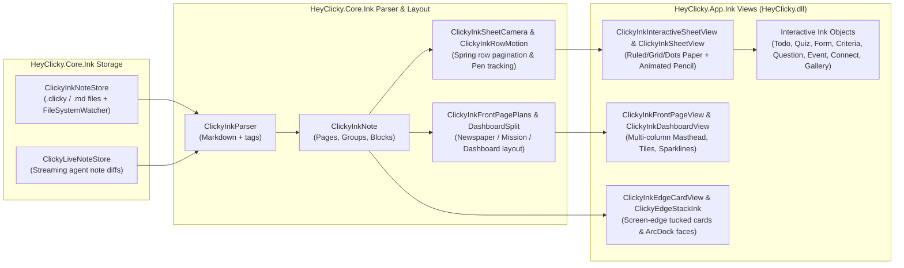

# 04 — 2D/3D Screen-Drawing Engine, ClearScript V8 Bridge & Ink Notebook System

> [!IMPORTANT]
> **Ground-Truth Binary Provenance**: Extracted directly from HeyClicky v1.1.5 (`HeyClicky.Drawing.dll`, `HeyClicky.Drawing3D.dll`, `HeyClicky.Contracts.dll`, `HeyClicky.Core.dll`, `HeyClicky.dll`, and `Assets/Engine/*.js`). Every namespace, type, method signature, P/Invoke import, shader pass, and JavaScript host-bridge protocol documented below matches the shipped PE/CLI metadata and bundled engine scripts verbatim.

---

## 1. Architectural Overview & Conceptual-to-Binary Mapping

HeyClicky's visual communication layer consists of **two distinct but complementary ink/drawing subsystems**:

1. **Live Screen-Drawing & 3D Figure Canvas (`HeyClicky.Drawing.dll` + `HeyClicky.Drawing3D.dll`)**:
   - Executes LLM-generated JavaScript drawing programs (`draw(...)` / `continue_drawing(...)` tool calls or `<code>` streams) inside a sandboxed **ClearScript V8** (`Microsoft.ClearScript.V8` v7.5.1.1) runtime (`HeyClicky.Drawing.Engine.NativeEngine`).
   - Renders 2D vector ink strokes, watercolor washes, hand-lettered text (`ClickyDraw-PatrickHand.ttf` / `ClickyDraw-Barlow-*.ttf`), sticky notes, paper sheets, interactive action buttons, and embedded 3D procedural stages (`HeyClicky.Drawing3D.ThreeStage`) onto a transparent, click-through `Windows.UI.Composition` + **Win2D** (`Microsoft.Graphics.Canvas`) + **Vortice Direct3D11/Direct2D1** popup overlay (`HeyClicky.Drawing.Overlay.OverlayWindow`).
   - Synchronizes stroke reveal, pen-riding cursor trajectories (`PenStrokePath`), live word-by-word captions (`LiveCaption`), and procedural 48 kHz **XAudio2** pen/chalk/marker sound effects (`SoundPlayer`) with real-time TTS audio playback via `DrawingCaptionTiming`.

2. **Persistent Screen Ink Notes, Edge Stack & Notebook System (`HeyClicky.Core.Ink.*` + `HeyClicky.App.Ink.*` + `HeyClicky.Drawing.Overlay.PinnedCards`)**:
   - Allows both the user and background/foreground Clicky agents to maintain persistent Markdown-backed `.clicky` / `.md` ink notes (`ClickyInkNoteStore`, `ClickyLiveNoteStore`), interactive ink widgets (checklists, quizzes, forms, criteria, galleries, dashboards), and edge-tucked cards (`PinnedCards`, `CardHandles`, `ClickyInkEdgeCardView`).

### 1.1 Conceptual Name to Binary Type Mapping

In v1.1.5, several conceptual subsystems were refactored across `HeyClicky.Contracts`, `HeyClicky.Core`, `HeyClicky.Drawing`, and `HeyClicky.dll`. The table below maps conceptual component names to their exact ground-truth binary types:

| Conceptual Component | Exact v1.1.5 Binary Type(s) | Assembly & Namespace | Role |
| :--- | :--- | :--- | :--- |
| `DrawingCommandParser` | `ProgramText`, `SayLines`, `DrawingContinuationDecisions`, `DrawingDisplayChoices` | `HeyClicky.Core.dll` (`HeyClicky.Core.Brain`) | Extracts streaming JS drawing code (`StripSayCall`, `Sanitize`), splits `say("...")` lines, and resolves continuation vs. fresh canvas decisions. |
| `DrawingAction` | `DrawingAction`, `DrawingActionKind`, `DrawingContinuation`, `DrawingFeedResult` | `HeyClicky.Contracts.dll` (`HeyClicky.Contracts`) |Immutable records representing interactive buttons (`Copy`, `OpenUrl`, `SaveFile`, `Reply`) emitted by a drawing and the result of feeding streaming code (`PenStrokes`, `TargetRings`, `SoundEvents`, `Has3D`). |
| `DrawingCaptionTiming` | `DrawingCaptionTiming`, `DrawingCaptionTiming+SayHold`, `DrawingRecord` | `HeyClicky.Core.dll` (`HeyClicky.Core.Voice`) | Maps spoken TTS sentence indices and word/character offsets to `IScreenDrawingCanvas.ReleaseLine(index)` and `SetLineLength(index, seconds)`. |
| `DrawingPromptSection` | `CompanionPromptBuilder`, `PromptResourceLoader`, `OneBrainPrompt` (` BundledResources/clicky-model-instructions.md`) | `HeyClicky.Core.dll` (`HeyClicky.Core.Brain`) | Builds the system prompt instructions teaching the LLM the `clicky-draw-engine.js` DSL (`say()`, `spot()`, `circle()`, `arrow()`, `label()`, `sticky()`, `paper()`, `figure()`, etc.). |
| `ScreenVisual` | `ScreenDrawingCanvas` (`IScreenDrawingCanvas`), `ScreenPainter`, ` ScreenPainter+Node` (`NodeKind`) | `HeyClicky.Drawing.dll` (`HeyClicky.Drawing`, `HeyClicky.Drawing.Painter`) | High-level `IScreenDrawingCanvas` facade and the underlying `Windows.UI.Composition` + Win2D visual tree node graph (`Group`, `Wrapper`, `MaskedContainer`, `Shape`, `Text`, `Wash`, `Dot`, `Window`, `Photo`, `Placeholder`, `Stage3D`). |
| `ClickTargetRing` | `ClickTargetRing`, `ClickTargetLayer` | `HeyClicky.Contracts.dll` & `HeyClicky.Platform.dll` (`HeyClicky.Platform.Overlay`) | Pulsing concentric ring + gel pill label (`AtSeconds`, `X`, `Y`, `Radius`, `ColorHex`, `Label`, `Hold`) for walkthroughs and `spot()` targets. |
| `PenStrokePath` | `PenStrokePath`, `PenRideTrajectory` | `HeyClicky.Contracts.dll` & `HeyClicky.Platform.dll` (`HeyClicky.Platform.Overlay`) | Flattened polyline (`Points`, `AtSeconds`, `DurationSeconds`) emitted by `ScreenPainter` so the companion triangle cursor (`CursorOverlay`) physically rides the tip of the pen while strokes are drawn. |
| `HighlightStroke` | `HighlightStroke`, `HighlightPoint`, `HighlightCompositor`, `HighlightOverlay`, `HighlightLayer` | `HeyClicky.Contracts.dll`, `HeyClicky.Core.Voice`, `HeyClicky.Platform.Overlay` | User-drawn screen highlighter strokes captured during Push-to-Talk or dwell-highlight, composited onto the screenshot (`HighlightCompositor.CompositeOntoScreenshot`) and harvested via UIA (`HighlightTextHarvester`). |
| `InkCanvasController` | `ClickyInkInteractiveSheetView`, `ClickyInkSheetView`, `ClickyInkSheetCamera`, `ClickyInkPen`, `ClickyInkStreamClock` | `HeyClicky.dll` (`HeyClicky.App.Ink`) & `HeyClicky.Core.dll` (`HeyClicky.Core.Ink`) | Drives the live-written paper/notebook ink canvas, camera tracking (`FollowMode.Pen` / `FollowMode.Reading`), pencil motion (`ClickyInkPencilLayers`), and interactive ink blocks. |
| `InkNoteStore` | `ClickyInkNoteStore`, `ClickyLiveNoteStore`, `ArcLiveNotes` | `HeyClicky.Core.dll` (`HeyClicky.Core.Ink`) & `HeyClicky.dll` (`HeyClicky.App.Dock`) | File-backed store (`FileSystemWatcher` + atomic writes) for persistent `.clicky` / `.md` ink notes per agent/job and live streaming note diffs. |
| `InkToolBar` | `CardHandles`, `PinnedCards`, `ActionButtons`, `DrawingSaveOffer` | `HeyClicky.Drawing.dll` (`HeyClicky.Drawing.Overlay`) & `HeyClicky.dll` (`HeyClicky.App.Home`) | Floating overlay chrome providing Move, Resize, Pin/Unpin, Close, Fullscreen Zoom, Download MP4 (`LessonVideoRecorder`), and Save/Clear (`DrawingSaveOffer`) controls for drawn cards and lessons. |

---

## 2. End-to-End Drawing & Ink Architecture Diagram

```mermaid
flowchart TB
    subgraph Brain["HeyClicky.Core.Brain & Voice"]
        LLM["LLM Stream (OneBrain / CompanionSession)"]
        PT["ProgramText & SayLines\n(StripSayCall, Sanitize)"]
        DCT["DrawingCaptionTiming\n(NoteSentenceStarted, NoteResponseDone)"]
    end

    subgraph Contracts["HeyClicky.Contracts"]
        ISDC["IScreenDrawingCanvas"]
        DFR["DrawingFeedResult\n(PenStrokes, TargetRings, SoundEvents, Actions)"]
    end

    subgraph DrawingDLL["HeyClicky.Drawing.dll (Dedicated DrawingThread STA + High-Res WaitableTimer)"]
        SDC["ScreenDrawingCanvas"]
        NE["Engine.NativeEngine\n(ClearScript V8Runtime + V8ScriptEngine)"]
        HB["Engine.NativeEngine+HostBridge\n(__host in JS)"]
        SS["Engine.ScreenshotSampler\n(Luminance / BusyFor / InkFor)"]
        SP["Painter.ScreenPainter\n(Windows.UI.Composition + Win2D)"]
        D3DA["Painter.Drawing3DAdapter\n(StageSwapChain / StageSurface)"]
        OW["Overlay.OverlayWindow\n(WS_EX_LAYERED | WS_EX_TRANSPARENT)"]
        PC["Overlay.PinnedCards & CardHandles\n(Drag, Zoom, Edge Tuck, MP4 Export)"]
        LC["Overlay.LiveCaption & ActionButtons"]
        SND["Audio.SoundPlayer\n(Vortice.XAudio2 48kHz Mixer)"]
        REC["Media.LessonVideoRecorder\n(MediaFoundation H.264/AAC MP4)"]
    end

    subgraph Drawing3DDLL["HeyClicky.Drawing3D.dll"]
        CTK["ClickyThreeKernel\n(Dedicated V8 Thread: clicky-three.js + clicky-three-parts.js)"]
        TS["ThreeStage\n(DComposition Clock, Orbit/Pick, Label Layout)"]
        S3D["Scene3D\n(Node3D, CameraSettings, Motion, Silhouette)"]
        FR["FigureRenderer\n(Vortice D3D11 Multi-Pass: DaVinci Marker & PBR Studio)"]
    end

    subgraph PlatformDLL["HeyClicky.Platform.Overlay"]
        CO["CursorOverlay & PenRideTrajectory\n(Triangle Cursor Rides PenStrokePath)"]
        CTL["ClickTargetLayer\n(Renders ClickTargetRing)"]
    end

    LLM -->|Streaming JS code| PT
    PT -->|Feed(code) / FinishCode()| ISDC
    DCT -->|ReleaseLine(i) / SetLineLength(i, s)| ISDC
    ISDC --> SDC
    SDC --> NE
    NE <-->|__host callbacks & __drainRender| HB
    HB -->|Measure text / SVG path / Screenshot contrast| SS
    NE -->|RenderOps JSON| SP
    SP -->|Stage3D ops| D3DA
    D3DA --> TS
    TS --> S3D
    S3D -->|BuildPart(kind, recipeJson)| CTK
    TS --> FR
    FR -->|IDXGISwapChain1| SP
    SP -->|Composition Visuals| OW
    SP -->|Cards & Windows| PC
    SDC --> LC
    SDC --> SND
    SDC --> REC
    SDC -->|Returns DrawingFeedResult| DFR
    DFR -->|PenStrokes| CO
    DFR -->|TargetRings| CTL
```

---

## 3. Contracts & Core Drawing Coordination (`HeyClicky.Contracts` & `HeyClicky.Core`)

### 3.1 `HeyClicky.Contracts` Drawing & Ink Types

All cross-assembly communication between `HeyClicky.Core`, `HeyClicky.Platform`, `HeyClicky.Drawing`, and `HeyClicky` (UI) uses immutable records and interfaces in `HeyClicky.Contracts.dll`:

| Type | Kind | Properties / Methods | Description |
| :--- | :--- | :--- | :--- |
| `IScreenDrawingCanvas` | Interface | `ActionClicked` (event)<br>`HasVisibleInk`, `HasPinnedCards`, `LastClearedByEscapeAt`<br>`ClearFromEscapeKey()`<br>`Begin(DisplayInfo, byte[] screenshotJpeg, string cursorColorHex, bool showSubtitles, string? keepCardId, DrawingContinuation? continuation)`<br>`Feed(string code) -> DrawingFeedResult`<br>`ReleaseLine(int index)`<br>`SetLineLength(int index, double seconds)`<br>`FinishCode() -> DrawingFeedResult`<br>`Clear()`<br>`KeepNotesOnly() -> bool`<br>`DropPointingMarks() -> (int dropped, int left)`<br>`MarkTiming(int markIndex)`<br>`SetKeepHandler(Func<IntPtr, Task> handler)`<br>`TakeLastFinishedLesson() -> object?`<br>`ExportCardVideoAsync(object card, string outputPath) -> Task<bool>` | Primary contract implemented by `HeyClicky.Drawing.ScreenDrawingCanvas` (and `HeyClicky.Core.Voice.NullScreenDrawingCanvas`). |
| `DrawingFeedResult` | Record | `bool HasVisibleDrawing`<br>`int StatementCount`<br>`IReadOnlyList<ClickTargetRing> TargetRings`<br>`IReadOnlyList<PenStrokePath> PenStrokes`<br>`IReadOnlyList<string> Warnings`<br>`IReadOnlyList<DrawingAction> Actions`<br>`IReadOnlyList<(double AtSeconds, string Sound, double Gain)> SoundEvents`<br>`bool Has3D` | Returned by every `Feed(code)` and `FinishCode()` call on `IScreenDrawingCanvas`. |
| `DrawingAction` | Record | `string Id`, `DrawingActionKind Kind`, `string Label`, `string Value`, `string? Path`, `int Line` | Represents an interactive button created in JS (`button()`, `copyButton()`, `linkButton()`). |
| `DrawingActionKind` | Enum | `Copy = 0`, `OpenUrl = 1`, `SaveFile = 2`, `Reply = 3` | Action executed when the user clicks an overlay action button (`ActionButtons` / `ExternalActions`). |
| `DrawingContinuation` | Record | `int KeptCardCount`, `int DroppedMarkCount`, `string StateSummary` | Passed into `Begin(...)` when continuing an existing drawing on screen (`continue_drawing`). |
| `ClickTargetRing` | Record | `double AtSeconds`, `float X`, `float Y`, `float Radius`, `string ColorHex`, `string? Label`, `bool Hold` | Scheduled ring animation rendered by `HeyClicky.Platform.Overlay.ClickTargetLayer`. |
| `PenStrokePath` | Record | `double AtSeconds`, `double DurationSeconds`, `IReadOnlyList<PointF> Points` | Scheduled polyline path in screen pixels that `CursorOverlay` follows via `PenRideTrajectory`. |
| `HighlightPoint` | Record Struct | `float X`, `float Y` | Screen-space point in a user highlight stroke. |
| `HighlightStroke` | Record | `IReadOnlyList<HighlightPoint> Points`, `string ColorHex` | User-drawn highlight stroke from `HighlightOverlay`. |

### 3.2 `HeyClicky.Core.Brain` Drawing Parser & Continuation Logic

Before LLM-generated JavaScript reaches V8, `HeyClicky.Core.Brain` processes the streaming code through four helper classes:

1. **`ProgramText`**:
   - `Sanitize(string code)`: Strips markdown code fences (```` ```js ```` / ```` ``` ````), normalizes smart quotes/dashes, and cleans trailing incomplete tokens.
   - `StripSayCall(string code)`: Removes `say("...")` statements when extracting pure visual code or inspecting whether a program contains actual drawing statements beyond narration.
2. **`SayLines`**:
   - `Extract(string code) -> IReadOnlyList<string>`: Incrementally parses `say("...")` calls out of streaming JavaScript code (`ReadQuotedString`, `SkipWhitespaceAndComments`, `MatchIdentifier`) so the voice synthesizer (`OpenAIRealtimeVoiceSession` / `GeminiLiveVoiceSession` / TTS) can speak the lines in parallel while `NativeEngine` schedules their visual beats.
3. **`DrawingContinuationDecisions`**:
   - `Decide(bool hasVisibleInk, bool screenChanged, bool isFollowUpQuestion, ...)`: Determines whether a new turn should call `KeepNotesOnly()`, `DropPointingMarks()`, `Continue()` on the existing canvas, or `Clear()` and start a fresh canvas.
4. **`DrawingDisplayChoices`**:
   - Selects which `DisplayInfo` monitor the canvas should target based on the active foreground window, user cursor position, or explicit display reference.

### 3.3 Speech-to-Drawing Synchronization (`DrawingCaptionTiming`)

Located in `HeyClicky.Core.Voice.DrawingCaptionTiming`, this class bridges the real-time voice audio stream and the V8 drawing timeline:

- **How JS Drawings Synchronize with Speech**:
  - In `clicky-draw-engine.js`, every `say("...")` statement increments the current **beat/line index** `k` (`0, 1, 2, ...`).
  - All drawing statements (`circle(...)`, `arrow(...)`, `label(...)`, `figure(...)`, etc.) that follow `say("...")` are tagged with that line index `k` and held in a pending queue until line `k` is actually spoken.
- **`DrawingCaptionTiming` Lifecycle**:
  - Holds references to `IScreenDrawingCanvas canvas` and `DispatcherQueueTimer[] timers`.
  - `AddSayLines(IReadOnlyList<string> lines)`: Registers the extracted `say()` lines (`lines`, `lineCharOffsets`, `releasedLines`, `sayHolds`).
  - `NoteSentenceStarted(int lineIndex, double estimatedDurationSeconds)`:
    - Called as soon as the audio output stream (`VoiceRenderStream`) begins playing sentence `lineIndex` (or via character-offset estimation `EstimateSeconds(text)` when streaming audio deltas).
    - Invokes `canvas.SetLineLength(lineIndex, durationSeconds)` so the JS engine scales the animation duration of all marks in beat `k` to fit the spoken sentence length.
    - Invokes `canvas.ReleaseLine(lineIndex)` (`clickyCanvas.releaseLine(k)` in JS), which immediately triggers the entry animations (`pen`, `pop`, `fade`, `wash`) for beat `k`, updates the word-by-word `LiveCaption` subtitle bar, and releases any `ActionButtons` attached to beat `k`.
  - `ScheduleRemainingLines()` / `NoteResponseDone()`: If the voice turn finishes early or runs in silent/text mode (`ReleaseAllForTextMode()`), schedules fallback timers to release any remaining unreleased lines smoothly.

---

## 4. `HeyClicky.Drawing.dll` — Complete Namespace & Class Breakdown

`HeyClicky.Drawing.dll` (1,473,856 bytes, 293 metadata types) is compiled against .NET 9 (`net9.0-windows10.0.22621.0`) and references:
- `ClearScript.Core` & `ClearScript.V8` (`v7.5.1.1`)
- `Vortice.Direct2D1`, `Vortice.Direct3D11`, `Vortice.DXGI`, `Vortice.DirectX`, `Vortice.XAudio2` (`v3.8.3.0`), `Vortice.Mathematics` (`v2.1.1.0`)
- `Microsoft.Graphics.Canvas.Interop` (Win2D)
- `Microsoft.InteractiveExperiences.Projection` (`Windows.UI.Composition`)
- `HeyClicky.Drawing3D` & `HeyClicky.Contracts`

### 4.1 Root Namespace: `HeyClicky.Drawing`

| Type | Role & Key Members |
| :--- | :--- |
| `DrawingThread` | Dedicated single-threaded apartment (`STA`) + WinRT `DispatcherQueueController` thread (`CreateDispatcherQueueController`) that owns all V8 engines, Win2D devices, DirectComposition visuals, and overlay HWNDs. Uses a high-resolution Win32 waitable timer (`CreateWaitableTimerExW` with `CREATE_WAITABLE_TIMER_HIGH_RESOLUTION`, `SetWaitableTimerEx`) and `PlaybackClock` (`Now()`, `Pause()`, `Resume()`) to drive sub-millisecond timer callbacks without UI thread jitter. |
| `ScreenDrawingCanvas` | Implements `IScreenDrawingCanvas`. Coordinates `DrawingThread`, `OverlayWindow`, `NativeEngine`, `ScreenPainter`, `SoundPlayer`, `LiveCaption`, `DrawingCaption`, `ActionButtons`, `CardHandles`, `PinnedCards`, and `LessonVideoRecorder`. Also manages the global `WH_KEYBOARD_LL` Escape-key hook (`InstallEscapeHook`, `UninstallEscapeHook`, `HookCallback`) to clear drawings or unzoom fullscreen cards when the user presses `Esc`. |
| `SystemComposition` | Low-level COM interop static class bridging WinRT `Windows.UI.Composition` with Win32 HWNDs and Win2D `CanvasDevice`. Contains nested COM interfaces (`ICompositorDesktopInterop`, `ICompositorInterop`, `ICompositionDrawingSurfaceInterop`, `ICanvasResourceWrapperNative`, `ID2D1Device`, `ID2D1DeviceContext`, `ID2D1Bitmap1`, `ID2D1Image`, `IDXGISwapChain1`, `IDCompositionDesktopDevicePartner`) and P/Invokes (`CreateDispatcherQueueController`, `D2D1CreateFactory`, `D3D11CreateDevice`, `CreateDXGIFactory1`, `RoGetActivationFactory`). Provides `CreateDesktopWindowTarget(compositor, hwnd)`, `BeginDraw(surface, rect, out offset)`, `CreateCompositionSurfaceForSwapChain(compositor, swapChain)`, and `ReadSurfaceBgra(device, surface, width, height)`. |
| `GpuPriority` | Elevates GPU scheduling priority for the drawing process via `gdi32.dll!D3DKMTSetProcessSchedulingPriorityClass` and `dxgi.dll!CreateDXGIFactory1`. |
| `NotchVisibleSurfaces` | Tracks bounding rectangles of visible Notch/HUD windows (`NotchRectScreenPx`, `ExtraAvoidRectsScreenPx`) so `NativeEngine` passes an `avoid` array into `clickyCanvas.begin(...)` — preventing LLM drawings from covering the Notch bar. |
| `DrawingTimelineReport` | Deserialized snapshot of `clickyCanvas.timeline()` (`TimelineLine`, `TimelineStatement`, `TimelineFrame`) used for debugging and lesson replay scrubbing. |
| `LessonPlaybackStage` | Standalone Win2D/Composition stage (`RootVisual`, `Play()`, `Pause()`, `Seek(seconds)`, `StepFrame(seconds)`) that replays saved lessons (`LessonPlaybackScript`, `LessonPlaybackFrame`, `LessonPenPose`, `LessonPlaybackSounds`) inside the Home window (`ClickyDrawingWindowView`) or exports them to MP4. |

### 4.2 Engine Namespace: `HeyClicky.Drawing.Engine` (ClearScript V8 & Layout Helpers)

`NativeEngine` hosts the `Microsoft.ClearScript.V8.V8ScriptEngine` instance on `DrawingThread` and loads three bundled JavaScript files from `Assets\Engine\`:

1. **`clicky-draw-engine.js` (259,913 bytes)**: The core `ClickyDraw` (v1.6) layout, constraint solver, hand-drawn rough-stroke generator (`SCREEN_PEN`), watercolor wash generator, and DSL implementation (`say`, `spot`, `circle`, `box`, `arrow`, `line`, `curve`, `label`, `title`, `badge`, `sticky`, `paper`, `window`, `table`, `chart`, `photo`, `figure`, `scene3d`, `move`, `erase`, `highlight`).
2. **`clicky-draw-pieces.js` (66,086 bytes)**: Pre-built reusable icon/diagram pieces injected before user/LLM code.
3. **`clicky-draw-native.js` (50,405 bytes)**: Headless SVG DOM shim (`Element`, `document`, `window`, `performance`, `setTimeout`/`setInterval`, `getBBox`, `getTotalLength`, `getPointAtLength`, CSS `animation` parser) and the global `clickyCanvas` controller that records dirty SVG units, structural wraps, property patches, and motion animations into a compact JSON batch drained by `__drainRender()`.

#### `NativeEngine` & `HostBridge` (`global.__host`) Contract

`NativeEngine` exposes an instance of `NativeEngine+HostBridge` to V8 as `__host`. To avoid marshaling allocations on hot measurement calls, `HostBridge` uses four scalar return registers (`R0`, `R1`, `R2`, `R3` + `Measured()`):

| `HostBridge` (`__host`) Member | JS Call Site in `clicky-draw-native.js` | Native Implementation in `HeyClicky.Drawing.Engine` |
| :--- | :--- | :--- |
| `now()` | `HOST.now()` | Returns `PlaybackClock.Now()` (seconds since drawing start). |
| `schedule(int id, double delaySec)` | `HOST.schedule(id, delay)` | Schedules a high-res timer on `DrawingThread` that calls `engine.Invoke("__fireTimer", id)` and drains any resulting render ops. |
| `cancel(int id)` | `HOST.cancel(id)` | Cancels scheduled timer `id`. |
| `TextWidth(text, font, size, weight, style, tracking)` | `HOST.TextWidth(...)` | Uses `TextShaper` (DirectWrite / Win2D `CanvasTextFormat` + bundled `ClickyDraw-PatrickHand.ttf` & `ClickyDraw-Barlow-*.ttf`) to return exact glyph advance width in `R0`. |
| `TextBox(text, font, size, weight, style, tracking)` | `HOST.TextBox(...)` | Populates `R0..R3` (`x, y, width, height`) with exact DirectWrite ink bounding box. |
| `PathLength(string d)` | `HOST.PathLength(d)` | Parses SVG path `d` via `SvgPath.Parse(device, d)` into a `CanvasGeometry` and calls `ComputePathLength()`. |
| `PathBBox(string d)` | `HOST.PathBBox(d)` | Computes exact geometry bounds `(x, y, w, h)` into `R0..R3`. |
| `PathPoint(string d, double dist)` | `HOST.PathPoint(d, dist)` | Evaluates `ComputePointOnPath(dist, out tangent)` into `R0..R3` (`x, y, tx, ty`). |
| `BusyFor(x, y, w, h)` | `HOST.BusyFor(x, y, w, h)` | Delegates to `ScreenshotSampler.BusyFor(x, y, w, h)`: computes edge/luminance variance in the underlying screenshot region so the JS layout engine places labels over calm areas of the user's screen. |
| `InkFor(x, y, w, h, preferredHex)` | `HOST.InkFor(...)` | Delegates to `ScreenshotSampler.InkFor(...)`: samples background luminance under `(x, y, w, h)` and adjusts or flips the ink color so dark text is never drawn on a dark background (and vice versa). |
| `BackgroundLuminance(x, y, w, h)` | `HOST.BackgroundLuminance(...)` | Returns average perceptual luminance `[0..1]` of the screenshot region. |
| `PhotoFile(query, w, h)` | `HOST.PhotoFile(...)` | Resolves local or fetched photo assets via `PhotoLoader` / `PhotoQueries`. |
| `RaiseCaption(string text, double progress)` | `HOST.RaiseCaption(...)` | Updates `LiveCaption` / `DrawingCaption` subtitle overlay. |
| `RaiseButtonReady(string json)` | `HOST.RaiseButtonReady(...)` | Spawns an interactive Win32 button (`ActionButtons.ShowButton`) once its spoken beat is reached. |
| `RaiseSound(double at, string name, double gain)` | `HOST.RaiseSound(...)` | Queues a procedural or sample-based sound in `SoundPlayer`. |
| `RenderOps(string json)` | `__drainRender()` | Sends the batch of dirty SVG units, structural wraps, patches, and motions to `ScreenPainter.ApplyRenderOps(json)`. |
| `RunFigureTicks(string stageId, object ticks, double dt)` | `clickyCanvas.tick3d(...)` | Runs per-frame JS `tick(t, dt)` closures for 3D figures (with an 8 ms per-tick watchdog that disables slow/throwing ticks after 5 violations) and returns a packed `Float32Array` (14 floats per animated part: `partId, mask, px, py, pz, rx, ry, rz, scale, show, glow, r, g, b`). |

### 4.3 Painter Namespace: `HeyClicky.Drawing.Painter`

`ScreenPainter` consumes the JSON render operations produced by `NativeEngine` (`__drainRender()`) and constructs a retained hardware-accelerated visual tree using `Windows.UI.Composition` and Win2D `CanvasDrawingSession`:

- **Layer Ordering**: Maintains 4 root `ContainerVisual` groups matching the SVG layers in `clicky-draw-native.js`:
  1. `under` (watercolor washes, paper/sticky card backdrops, shadows via `CompositionShadows`)
  2. `main` (vector shapes, strokes, boxes, arrows, photos, 3D stages)
  3. `hl` (highlights and emphasis rings)
  4. `words` (DirectWrite shaped text runs via `TextShaper`)
- **Node Types (`ScreenPainter+NodeKind`)**:
  - `Group`, `Wrapper`, `MaskedContainer`, `Shape`, `Text`, `Wash`, `Dot`, `Window`, `Photo`, `Placeholder`, `Stage3D`.
- **Animated Pen Reveal (`PenMask` & `PenStroke`)**:
  - When the JS engine animates a stroke with `animation: "pen 0.62s cubic-bezier(...) both"`, `ScreenPainter` creates a `CompositionMaskBrush` or animated stroke-dashoffset surface (`PenMask`) driven by `ScreenPenMath` (`CubicBezier`, `SamplePath`, `ComputePenPoses`).
  - Simultaneously emits a `PenStrokePath` (`AtSeconds`, `DurationSeconds`, `Points`) so `CursorOverlay` flies the Clicky cursor to the start of the stroke and rides the pen tip across the screen.
- **3D Stage Bridging (`Drawing3DAdapter`)**:
  - When `ScreenPainter` encounters a `Stage3D` node (`figure()` or `scene3d()`), it forwards the stage creation and part/camera/motion commands to `Drawing3DAdapter`.
  - `Drawing3DAdapter` creates a `HeyClicky.Drawing3D.ThreeStage` backed by a DXGI composition swap chain (`ICompositorInterop.CreateCompositionSurfaceForSwapChain`) and mounts its `CompositionSurfaceBrush` directly inside the 2D card or screen visual tree.

### 4.4 Overlay Namespace: `HeyClicky.Drawing.Overlay`

| Type | Role & Implementation Details |
| :--- | :--- |
| `OverlayWindow` | Creates the full-monitor borderless click-through Win32 popup window (`CreateWindowExW` with `WS_POPUP \| WS_CLIPCHILDREN` and `WS_EX_TOPMOST \| WS_EX_TRANSPARENT \| WS_EX_TOOLWINDOW \| WS_EX_LAYERED \| WS_EX_NOREDIRECTIONBITMAP \| WS_EX_NOACTIVATE`). Calls `SetWindowDisplayAffinity(hwnd, WDA_EXCLUDEFROMCAPTURE)` (`0x11`) so Clicky's own screen captures never see its drawings unless recording a lesson. Hosts the root `DesktopWindowTarget` from `SystemComposition`. |
| `CardHandles` | Creates interactive hit-testable Win32 child/popup regions (`HandleWindow`) over drawn cards (`paper()`, `sticky()`, `window()`, `figure()`). Supports **drag-to-move** (`clickyCanvas.moveCard`), **corner resize**, **close button** (`clickyCanvas.closeCard`), **fullscreen zoom** (`clickyCanvas.zoomCard`), **pin/tuck to screen edge** (`PinnedCards`), and **MP4 video download** (`DownloadPhase`). Renders custom procedural hand cursors via `GrabCursors` (SDF palm + finger capsules). |
| `PinnedCards` | Manages drawn cards that survive after the main screen drawing clears (`Card`, `Viewer`). Supports **edge-tucking** (sliding a card off the left/right screen edge with a peek tab), **expanding on hover/click**, and **flying into the Notch** (`FlyIntoNotch`). |
| `ActionButtons` | Creates interactive pill buttons (`ButtonWindow`, `ButtonSpec`) positioned via `clickyCanvas.buttonSpot({ box, gap, avoid })` so buttons never overlap drawn text. Handles `DrawingActionKind` (`Copy`, `OpenUrl`, `SaveFile`, `Reply`) via `ExternalActions`. |
| `LiveCaption` & `DrawingCaption` | Renders the translucent dark blurred subtitle pill at the bottom of the display (`LiveCaption`), animating each word (`Word`, `WordState`) with spring physics as `DrawingCaptionTiming` advances through the spoken sentence. |

### 4.5 Audio & Media Namespaces: `HeyClicky.Drawing.Audio` & `HeyClicky.Drawing.Media`

- **`SoundPlayer` (`HeyClicky.Drawing.Audio`)**:
  - Uses `Vortice.XAudio2` (`IXAudio2`, `IXAudio2MasteringVoice`, `IXAudio2SourceVoice`) at **48,000 Hz** to mix both one-shot UI/drawing earcons (`Assets\Sounds\*.wav`: `badge-pop-1..3`, `boing-1..2`, `build-3d-1..4`, `button-appear-1..2`, `copy-tick-1..2`, `ding-1..2`, `gel-pop-1..4`, `highlighter-1..3`, `nope-1..2`, `page-clear-1..2`, `paper-place-1..3`, `pen-flick-1..3`, `photo-drop-1..3`, `slide-1..3`, `sparkle-1..2`, `stamp-1..2`, `sticky-press-1..3`, `tada-1..2`, `tape-1..3`, `target-ping-1..2`, `type-keys-1..2`, `whoosh-1..2`) and **continuous velocity-modulated loop beds** (`eraser-bed-1..2`, `handwriting-bed-1..2`, `pen-screen-bed-1`, `pencil-paper-bed-1..2`).
  - While a pen stroke is actively drawing, `SoundPlayer` modulates the pitch (`SetFrequencyRatio`) and volume envelope of the active loop bed based on the instantaneous bezier derivative (`StrokeSpeed`) of the pen tip.
- **`LessonVideoRecorder` & `Mp4VideoWriter` (`HeyClicky.Drawing.Media`)**:
  - Uses Windows **Media Foundation** (`mfplat.dll`, `mfreadwrite.dll`: `MFStartup`, `MFCreateSinkWriterFromURL`, `MFCreateMediaType`, `MFCreateMemoryBuffer`, `MFCreateSample`) to encode 60 fps H.264 video + 48 kHz AAC audio (`Mp4Soundtrack`) into `.mp4` files when the user clicks the download button on a 3D figure or lesson card (`KnownFolders.GetDownloadsPath()`).

---

## 5. `HeyClicky.Drawing3D.dll` — 3D Procedural Engine, Shaders & Primitives

`HeyClicky.Drawing3D.dll` (798,016 bytes, 116 metadata types) powers the `figure({...})` and `scene3d({...})` commands inside drawings. It combines a background **ClearScript V8 geometry kernel** (`ClickyThreeKernel`) with a custom **Direct3D 11 multi-pass renderer** (`FigureRenderer`) supporting two distinct art styles: **`StageLook.Illustrated` (DaVinci ink-and-marker sketch)** and **`StageLook.Studio` (PBR lit studio model with baked IBL and AgX tone mapping)**.

### 5.1 `ClickyThreeKernel` & `clicky-three-parts.js` (Procedural Geometry in V8)

- **`ClickyThreeKernel`** runs on its own background thread (`kernelThread`) with a dedicated `V8ScriptEngine` and an LRU geometry cache (`CacheByteBudget` = 64 MB).
- On startup, it loads:
  1. `Assets\Engine\clicky-three.js` (429,525 bytes): A custom esbuild bundle of **Three.js r186** (`globalThis.ClickyThreeLib`) exporting core math, curves (`CatmullRomCurve3`, `CubicBezierCurve3`, `QuadraticBezierCurve3`, `SplineCurve`, `ArcCurve`, `EllipseCurve`), and geometry generators (`BoxGeometry`, `RoundedBoxGeometry`, `CylinderGeometry`, `ConeGeometry`, `SphereGeometry`, `TorusGeometry`, `TorusKnotGeometry`, `CapsuleGeometry`, `TubeGeometry`, `LatheGeometry`, `ExtrudeGeometry`, `ParametricGeometry`, `ConvexGeometry`, `PolyhedronGeometry`, `SimplexNoise`, `mergeVertices`, `toCreasedNormals`).
  2. `Assets\Engine\clicky-three-parts.js` (41,390 bytes): Defines `globalThis.clickyThreeBuild(kind, recipeJSON)`.
- **Supported 3D Part Kinds (`SHAPES` in `clicky-three-parts.js` & `Geometry` in C#)**:

| Part `kind` | Recipe Parameters | Geometry Construction Details |
| :--- | :--- | :--- |
| `box` | `size: [w,h,d]`, `r` / `bevel` | `RoundedBoxGeometry(w, h, d, 3, r)` when `r > 0.0005`, else `BoxGeometry`. |
| `cyl` / `cylinder` | `r`, `top`, `h`, `seg`, `arc`, `open`, `bevel`, `axis` | Bevelled lathe of rounded profile (`roundOutline`) or `CylinderGeometry`, rotated to `axis`. |
| `cone` | `r`, `h`, `seg`, `bevel`, `axis` | Bevelled lathe profile or `ConeGeometry`. |
| `tube` | `r`, `inner`, `h`, `bevel`, `arc`, `axis` | Hollow pipe/cylinder wall via lathe of closed rectangular ring profile with 4 rounded corners. |
| `arrow` | `points: [[x,y,z],...]`, `r`, `head`, `headR` | 3D flow arrow along a centripetal `CatmullRomCurve3` (`TubeGeometry` shaft + oriented `ConeGeometry` head + spherical tail cap). |
| `lathe` | `profile: [[r,y],...]`, `seg`, `arc`, `axis` | `LatheGeometry` around `axis`. |
| `sphere` | `r`, `seg`, `dome`, `axis` | `SphereGeometry` (hemisphere when `dome: true`). |
| `torus` | `r`, `tube`, `arc`, `axis` | `TorusGeometry` oriented with hole along `axis` (default `y`). |
| `capsule` | `r`, `h`, `axis` | `CapsuleGeometry(r, h, 8, 24)`. |
| `pipe` | `points: [[x,y,z],...]`, `r`, `seg`, `closed` | `TubeGeometry` along a centripetal `CatmullRomCurve3`. |
| `spring` | `r`, `h`, `coils`, `wire`, `axis` | Helical `TubeGeometry` (`coils * 40` segments, up to 2,400 segments). |
| `gear` | `teeth`, `r`, `tooth`, `w`, `hole`, `bevel`, `axis` | Spur gear profile with `teeth` involute-like steps, optional axle `hole`, extruded with bevels via `ExtrudeGeometry`. |
| `extrude` | `shape: [[x,y],...]` or SVG `d`, `holes`, `depth`, `bevel`, `axis` | Full SVG path parser (`M L H V C S Q T A Z`) or polygon list extruded with `ExtrudeGeometry`. |
| `blob` | `balls: [[x,y,z,r],...]`, `sticks: [[x1,y1,z1,x2,y2,z2,r1,r2],...]`, `blend` OR `r`, `detail`, `lumps`, `seed` | **Metaball / SDF smooth-union (`softShape`)** meshed via **octree-accelerated Surface Nets (`surfaceNets`)** with analytic tetrahedral gradient normals; or noise-displaced `IcosahedronGeometry`. |
| `poly` | `r`, `faces` (`4, 6, 8, 12, 20`), `detail`, `axis` | Platonic/faceted solids (`Tetrahedron`, `Box`, `Octahedron`, `Dodecahedron`, `Icosahedron`). |
| `surface` | `grid: [[[x,y,z],...],...]` | Parametric grid mesh with auto-computed UV coordinates and vertex normals. |

- **Post-Processing Modifiers on Every Part**:
  - **`thick` (`solidify(g, thickness)`)**: Equivalent to Blender's *Solidify* modifier — welds seam vertices, computes area-weighted normals, pushes an inner wall inward by `thick`, flips inner winding, and stitches a closed rim across all boundary edges.
  - **`stretch: [sx, sy, sz]` & `mirror: [mx, my, mz]`**: Non-uniform scaling and mirroring (automatically calling `rewind(g)` when `sx * sy * sz < 0` so back-face culling stays valid).
  - **Vertex Cap & Framing Samples**: Enforces `MAX_VERTICES = 120,000` and returns `{ positions: Float32Array, normals: Float32Array, uvs: Float32Array, indices: Uint32Array, samples: Float32Array(600) }` to `ClickyThreeKernel.BuildPart`.

### 5.2 `ThreeStage`, `Scene3D`, and `FigureRenderer` (D3D11 Pipeline)

- **`Scene3D` (`HeyClicky.Drawing3D`)**:
  - Maintains the hierarchical scene graph of `Node3D` parts (`PartId`, `Mesh`, `Transform`, `Color`, `Roughness`, `Metallic`, `Opacity`, `CutPlane`, `Repeats`, `Motion`), `CameraSettings` (`Azimuth`, `Elevation`, `Distance`, `Target`, `Fov`), and `Label` callouts.
  - **Auto-Framing & Silhouette Projection**: Projects the 600 `FramingSamples` of every visible part into camera space (`ProjectSilhouette`) to automatically center and fit the 3D model inside the stage viewport without clipping, and places 2D callout labels (`StageLabel`, `Fitting`, `Slot`) around the exterior silhouette so leader lines never cross the model.
  - **Declarative & Procedural Motions (`Scene3D+Motion`)**: Supports built-in declarative motions (`orbit`, `path`, `bob`, `zoom`, `pulse`, `spin`, `turn`) as well as per-frame V8 `tick3d` closures (`ApplyTickPoses`).
- **`FigureRenderer` & `Pipelines` (`HeyClicky.Drawing3D`)**:
  - Compiles HLSL shaders at runtime via `Vortice.D3DCompiler` (`Shaders.cs`) into `Pipelines`:

| Shader / Pipeline | Entry Points (`Shaders.cs`) | Rendering Role |
| :--- | :--- | :--- |
| **DaVinci Illustrated Pass** (`StageLook.Illustrated`) | `davinci_vertex`, `davinci_fragment`, `davinci_outline_vertex`, `davinci_outline_fragment`, `davinci_ink_and_seam_fragment` | Renders warm marker-style cel/hatch shading (`EncodeMarker`), inverted-hull silhouette outlines, and screen-space depth/object-ID discontinuity ink seams (`EncodeInkOutline`). |
| **PBR Studio Pass** (`StageLook.Studio`) | `studio_bake_environment` (`cs_5_0`), `studio_bake_irradiance` (`cs_5_0`), `studio_shadow_vertex`, `studio_shadow_cut_fragment`, `studio_vertex`, `studio_fragment`, `studio_occlusion_fragment`, `studio_occlusion_blur_fragment`, `studio_ground_vertex`, `studio_ground_fragment` | Computes procedural studio environment + irradiance cubemaps on startup (`EnsureStudioEnvironment`), renders a directional shadow map with cross-section cut-plane clipping, evaluates half-resolution screen-space ambient occlusion (`EncodeStudio`) with bilateral blur, renders a soft shadow-catching ground plane, and applies **AgX tone mapping**. |
| **Stage Overlay & Label Sheets** | `stage_overlay_vertex`, `stage_overlay_fragment`, `stage_sheet_vertex`, `stage_sheet_fragment` | Renders SDF capsule leader lines, anchor dots, and DirectWrite-shaped callout label plates (`LabelWords`) directly over the resolved MSAA color buffer. |

---

## 6. Persistent Screen Ink Notes & Notebook System (`HeyClicky.Core.Ink` & `HeyClicky.App.Ink`)

In addition to ephemeral screen drawings, HeyClicky includes a complete **Ink Notebook & Live Note Engine** split between `HeyClicky.Core.Ink` (model, parser, layout, storage) and `HeyClicky.App.Ink` (WinUI 3 + Win2D rendering views).



### 6.1 Core Ink Model & Parser (`HeyClicky.Core.Ink`)

| Type | Role & Key Capabilities |
| :--- | :--- |
| `ClickyInkNoteStore` | Watches a workspace or agent note directory via `FileSystemWatcher` (`Watched`), debounces external/agent file writes, and maintains the canonical `ClickyInkNote` state (`Load`, `Save`, `ApplyEdit`). |
| `ClickyLiveNoteStore` | Tracks in-flight notes actively being written by an agent (`Note(Text, IsBeingWritten, SavedAt)`), computing character-by-character diffs (`ClickyInkDiff`, `ClickyInkEditMemory`) so the UI animates a virtual pencil writing new lines and striking out removed lines in real time. |
| `ClickyInkParser` | Parses extended Markdown + custom Clicky Ink blocks into a structured `ClickyInkNote` (`ClickyInkPage`, `ClickyInkGroup`, `ClickyInkBlock`). Supports headings, callouts, tables (`ClickyInkTableLayout`), code blocks (`ClickyInkCodeHighlight`), figures/sketches (`ClickyInkSketchModel` with `Box`, `Circle`, `Line`, `Arrow`, `Path`, `Text`, `Icon`, `Dot`, `Badge`), sparklines/charts (`ClickyInkChartGeometry`), pipelines (`ClickyInkPipelineGeometry`), and interactive blocks. |
| `ClickyInkPen` & `ClickyInkWords` | Splits text lines into three zones around the active writing position (`Before`, `PenGlyph`, `After`). `ClickyInkPen` computes the 2D trajectory, lift, and tap motion of the animated pencil tip as words appear or get struck through (`AddBeingWritten`, `AddStruck`). |
| `ClickyInkSheetCamera` & `ClickyInkRowMotion` | Computes smooth spring-driven vertical scrolling (`FollowMode.Pen` vs. `FollowMode.Reading`) and row height transitions (`Moving`, `Settled`, `NotYet`) as a note grows. |
| `ClickyInkDashboardSplit` & `ClickyInkFrontPagePlans` | Automatically lays out structured agent notes into newspaper-style multi-column "Front Page" or "Mission Dashboard" views (`Columns`, `Wide`, `Masthead`, `Headline`, `Stats`, `Tiles`). |

### 6.2 WinUI 3 / Win2D Ink Views & Interactive Widgets (`HeyClicky.App.Ink`)

| Type | Role & Key Capabilities |
| :--- | :--- |
| `InkPaperSheet`, `ClickyPaperTextures`, `ClickyInkPaper` | Procedural paper renderer generating tactile paper stocks (`Sky`, `Butter`, `Mint`, `Periwinkle`, `Peach`, `Blush`, `Kraft`, `Cream`), ruled/grid/dot lines (`ClickyInkPageLines`), masking tape strips (`Tape`), rubber stamps (`PaperStampView`), and torn/deckled edges. |
| `ClickyInkSheetView` & `ClickyInkInteractiveSheetView` | Full notebook page view with animated handwriting reveal (`InkTextView`), live pencil sprite (`ClickyInkPencilLayers` with `Tapping` and `Resting` states), and embedded interactive blocks. |
| `ClickyInkFrontPageView` & `ClickyInkDashboardView` | Renders high-density agent briefing sheets with mastheads, live status lights (`LiveLight`), stat tiles (`ClickyInkTiles`), and change summaries. |
| `ClickyInkEdgeCardView`, `ClickyCardFace`, `ClickyNoteFace` | Compact ink card faces rendered inside the `ArcDock` and screen-edge stacks (`ClickyEdgeStackInkPresentation`: `Rest`, `Fanned`, `Pulled`). Supports `CardHeadline` (`Big`, `Count`, `Sentence`, `Message`) and `CardDetail` (`Sparkline`, `Rows`, `Bullets`, `Waiting`). |
| **Interactive Ink Widgets** | - `ClickyInkTodo`: Interactive checkboxes with animated ink checkmarks and `ProgressStrip`.<br>- `ClickyInkQuiz`: Multiple-choice quiz cards with grading (`Grades`, `Revealed`) and score stamps.<br>- `ClickyInkForm`: Multi-field input forms that serialize answers back to the agent thread.<br>- `ClickyInkQuestionAnswers`: Quick-reply choice pills inside a note.<br>- `ClickyInkCriteria`: Editable requirement/criteria rows.<br>- `ClickyInkEvent`: Calendar event cards with one-click add.<br>- `ClickyInkConnect`: Inline OAuth/integration connection cards (`Opening`, `WaitingForSignIn`, `Checking`, `Connected`, `Failed`).<br>- `ClickyInkGalleryTile`: Image gallery grid with hover zoom and lightbox preview. |
