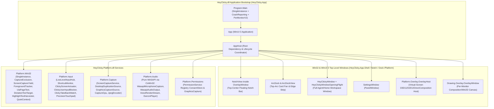
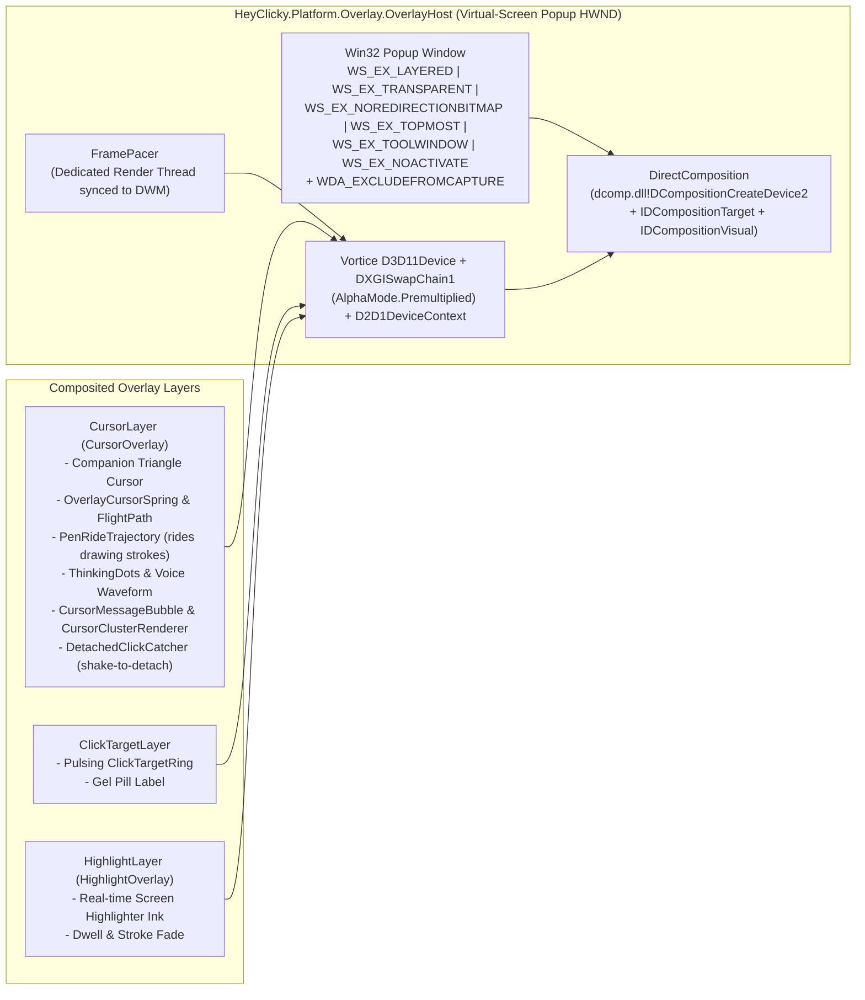
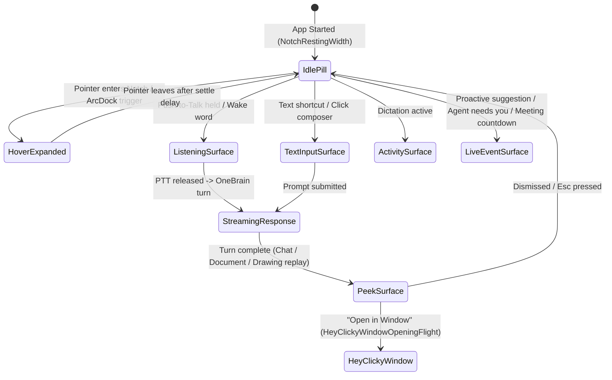

# 05 — Platform Win32 Services, Multi-Monitor Overlays & WinUI 3 Shell (`HeyClicky.Platform.dll` & `HeyClicky.dll`)

> [!IMPORTANT]
> **Ground-Truth Binary Provenance**: Extracted directly from HeyClicky v1.1.5 (`HeyClicky.Platform.dll`, `HeyClicky.dll`, `HeyClicky.Core.dll`, and `HeyClicky.Contracts.dll`). All namespaces, classes, Win32 P/Invokes, COM interfaces, window styles, and UI state machines documented below match the shipped v1.1.5 binaries verbatim.

---

## 1. High-Level Architecture of `HeyClicky.Platform.dll` & `HeyClicky.dll`

---

## 2. `HeyClicky.Platform.dll` — Complete Namespace & Class Reference

`HeyClicky.Platform.dll` (1,559,872 bytes, 594 metadata types including CsWin32 projections) provides all OS-level integration for Windows 10/11 (`net9.0-windows10.0.22621.0`).

### 2.1 `HeyClicky.Platform.Win32` — System Integration, UI Automation & Text Injection

| Class | Key Methods & P/Invokes | Ground-Truth Behavior |
| :--- | :--- | :--- |
| `SingleInstance` | `TryAcquirePrimary(string[] args, Action<string[]> onForwardedArgs)` `PrimaryRecord` (memory-mapped struct) | Uses a named mutex + memory-mapped file (`PrimaryRecord` with `ProcessId`, `MainWindowHwnd`) + named pipe server (`ListenLoopAsync`) so secondary launches forward deep links (`heyclicky://`), `.clicky` file paths, or CLI flags to the running instance and call `AllowSetForegroundWindow`. |
| `ProtocolRegistration` | `EnsureRegistered(string scheme, string exePath)` | Registers `heyclicky://` URI handler in `HKCU\Software\Classes\heyclicky` for Google OAuth, Stripe billing checkout return, and deep links. |
| `FileOpenRegistration` | `EnsureRegistered(string exePath)` | Registers `.clicky` file association and icon in `HKCU\Software\Classes` and notifies Shell via `SHChangeNotify`. |
| `LaunchAtLogin` | `IsEnabled()`, `SetEnabled(bool)` | Manages `HKCU\Software\Microsoft\Windows\CurrentVersion\Run\HeyClicky`. |
| `CaptureExclusion` | `Apply(IntPtr hwnd, bool exclude)` (`user32.dll!SetWindowDisplayAffinity`) | Applies `WDA_EXCLUDEFROMCAPTURE` (`0x00000011`) to all Clicky overlay/Notch windows so Clicky's own screenshots (`ScreenCaptureService`) see through Clicky's UI straight to the user's apps. |
| `ScreenCaptureYield` | `Start()`, `OnWinEvent(...)`, `CloakAll(bool)` (`dwmapi.dll!DwmSetWindowAttribute(DWMWA_CLOAK)`) | Watches `SetWinEventHook` for Windows Snipping Tool (`ScreenClippingHost.exe` / `SnippingTool.exe`) or system screenshot overlays; immediately cloaks (`DWMWA_CLOAK = 13`) Clicky's overlays while the user takes a screenshot and uncloaks afterward. |
| `ScreenDrawingStaleWatch` | `Start()`, `CheckForeground()` | Monitors foreground window/scroll/bounds changes (`EVENT_SYSTEM_FOREGROUND`, `EVENT_OBJECT_LOCATIONCHANGE`) to notify `ScreenDrawingCanvas` when the underlying app moved or scrolled so pointing marks (`dropPointing` / `keepNotesOnly`) are erased. |
| `DisplayEnumerator` | `GetDisplays()`, `GetDisplayUnderCursor()` | Enumerates physical and logical monitors via `EnumDisplayMonitors`, `GetMonitorInfoW`, and `GetDpiForMonitor` (`MDT_EFFECTIVE_DPI`), returning `DisplayInfo(Index, DeviceName, BoundsPx, WorkAreaPx, ScaleFactor, IsPrimary)`. |
| `DpiAwarenessScope` | `EnterPerMonitorV2()` | Enforces `DPI_AWARENESS_CONTEXT_PER_MONITOR_AWARE_V2` across window creation and coordinate queries. |
| `ForegroundApp` & `ForegroundTracker` | `Current()`, `History()`, `SetWinEventHook(EVENT_SYSTEM_FOREGROUND)` | Tracks the active HWND, process name (`QueryFullProcessImageNameW`), window title (`GetWindowTextW`), and parsed browser/app context (`ForegroundAppInfo`). |
| `UIAutomationHelpers` & `UiaPageText` | `ReadFocusedWindowText(int maxChars)`, `FindBrowserUrlBar(IUIAutomationElement)` | Uses COM `CUIAutomation8` (`IUIAutomation`, `IUIAutomationElement`, `IUIAutomationValuePattern`, `IUIAutomationTextPattern`, `IUIAutomationTreeWalker`) on a background thread with strict timeouts to extract the active browser URL, tab title, and visible document text (`WindowsPageReader` in `HeyClicky.Core.Platform` wraps this to produce `PageContext`). |
| `HighlightTextHarvester` | `HarvestUnderStrokesAsync(IReadOnlyList<HighlightStroke> strokes)` | Samples screen points along user-drawn highlighter strokes, queries `IUIAutomation.ElementFromPoint`, extracts bounding text/names via `TextPattern` / `ValuePattern` / `LegacyIAccessiblePattern`, and returns the highlighted text snippet to attach to the user's voice/text prompt. |
| `DictationTextTarget` & `TextInsertion` | `CaptureFocus()`, `ReadSurroundingContext()`, `InsertTextAsync(string text)` | Captures the focused UIA element before dictation begins (`SurroundingContext`: text before/after caret). To insert text reliably across Win32, WPF, Electron, and browser editors, `TextInsertion` runs a dedicated STA clipboard thread: snapshots all current `IDataObject` clipboard formats (`SnapshotClipboard`), sets the dictated UTF-16 text on the clipboard, synthesizes `Ctrl+V` via `SendInput`, verifies text landing via UIA, and restores the user's original clipboard (`RestoreClipboard`). |
| `QuietContext` | `GetQuietReason()` | Queries `shell32.dll!SHQueryUserNotificationState` (`QUNS_BUSY`, `QUNS_PRESENTATION_MODE`, `QUNS_RUNNING_D3D_FULL_SCREEN`), queries Windows Notification Facility (`ntdll.dll!RtlQueryWnfStateData` for `WNF_SHEL_QUIETHOURS_ACTIVE_PROFILE_CHANGED` / Focus Assist), and checks `HKCU\...\CapabilityAccessManager\ConsentStore\microphone\NonPackaged` for active mic usage by other apps (e.g., Zoom/Teams calls) to suppress proactive chimes and paywalls. |
| `GpuScheduling` | `ElevateProcessGpuPriority()` | Calls `gdi32.dll!D3DKMTSetProcessSchedulingPriorityClass` to prevent DWM/compositor starvation when heavy 3D games or browsers are active. |

---

### 2.2 `HeyClicky.Platform.Overlay` — Multi-Monitor DirectComposition & Companion Cursor Overlays

In addition to `HeyClicky.Drawing.Overlay.OverlayWindow` (which renders the JS canvas), `HeyClicky.Platform.Overlay` runs a persistent, ultra-low-latency **Virtual-Screen DirectComposition Overlay (`OverlayHost`)** spanning all monitors (`SM_XVIRTUALSCREEN`, `SM_YVIRTUALSCREEN`, `SM_CXVIRTUALSCREEN`, `SM_CYVIRTUALSCREEN`).

| Class | Role & Mechanics |
| :--- | :--- |
| `OverlayHost` | Creates a single top-most click-through window covering the entire multi-monitor virtual desktop. Initializes `D3D11CreateDevice(D3D11_CREATE_DEVICE_BGRA_SUPPORT)`, creates a premultiplied-alpha composition swap chain (`CreateSwapChainForComposition`), binds it to the HWND via `dcomp.dll!DCompositionCreateDevice2` (`IDCompositionDesktopDevice`), and drives rendering via `FramePacer` only when at least one layer is dirty/animating (zero GPU usage when idle). |
| `CursorOverlay` & `CursorLayer` | Implements `ICursorOverlay`. Renders the signature floating Clicky triangle companion next to the user's hardware cursor. - **Spring Physics (`OverlayCursorSpring`)**: Smoothly trails the OS cursor with velocity-dependent tilt and lag. - **Autonomous Flights (`OverlayCursorFlightPath`)**: Flies along cubic-bezier arcs to point at UI targets (`PointAtAsync(screenPx, label)`). - **Pen Riding (`PenRideTrajectory`)**: When `ScreenDrawingCanvas` emits `PenStrokePath`s, the Clicky cursor detaches from the user's mouse, flies to the start of each stroke, and traces the exact bezier curve in sync with the ink reveal. - **Shake-to-Detach (`DetachedClickCatcher`)**: Detects rapid back-and-forth mouse shaking (`ModesEndToEnd.Shake`), detaching Clicky to park at the corner or Notch until clicked. - **Visual States**: Renders voice level waveforms, `ThinkingDots`, speech/status bubbles (`CursorMessageBubble`), and multi-agent squad clusters (`CursorClusterRenderer`). |
| `ClickTargetLayer` | Renders `ClickTargetRing` animations (expanding concentric rings + shadowed gel label pill) used during interactive walkthroughs and `spot()` calls. |
| `HighlightOverlay` & `HighlightLayer` | Implements `IHighlightOverlay`. While Push-to-Talk is held (and `ScreenHighlightEnabled` is true), tracks pointer movement (`PointerMoveFeed`), renders glowing translucent marker strokes over the screen, and returns the completed `HighlightStroke` list when PTT ends. |

---

### 2.3 `HeyClicky.Platform.Input` — Global Hooks, Hotkeys & Computer-Use Actuator

| Class | Role & Mechanics |
| :--- | :--- |
| `LowLevelInputHub` | Centralizes `SetWindowsHookExW(WH_KEYBOARD_LL)` and RawInput (`RegisterRawInputDevices` for mouse/touchpad `WM_INPUT`) on a dedicated high-priority message pump thread. Includes a watchdog timer that detects if Windows silently dropped the low-level hook (e.g., after UAC or sleep) and automatically reinstalls it. |
| `ShortcutMonitor` | Implements `IShortcutMonitor` on top of `LowLevelInputHub`. Tracks 4 configurable shortcut slots (`PushToTalk`, `TextMode`, `Dictation`, `HandsFreeDictation`). Supports modifier-hold (e.g., `Ctrl+Win`, `Right Alt`), **double-tap Control** (`DoubleTapMs`), **AltGr** disambiguation on international keyboards, and **Start Menu masking** (injecting a dummy non-printable keyup when `LWin` is part of a chord so Windows does not pop open the Start Menu on release). |
| `ClickyScreenActuator` | Executes synthetic mouse and keyboard actions during **Clicky Drive (Computer Use)**: - **Smooth Mouse Glides**: Interpolates cursor movement along humanized ease-in-out trajectories via `SendInput` (`MOUSEEVENTF_MOVE \| MOUSEEVENTF_ABSOLUTE \| MOUSEEVENTF_VIRTUALDESK`). - **Provenance Tagging**: Stamps every `MOUSEINPUT.dwExtraInfo` and `KEYBDINPUT.dwExtraInfo` with `HeyClickyInjectedInputSignature` so `LowLevelInputHub` and `ClickyTakeBackWatch` distinguish Clicky's own synthetic actions from physical user input. - **Stranded-Key Watchdog**: Tracks held modifiers (`Shift`, `Ctrl`, `Alt`, `Win`) and guarantees release even if an agent turn is cancelled mid-chord. |
| `ClickyUserInputBlocker` & `ClickyTakeBackWatch` | While Clicky is actively driving the PC (`ClickyTakeOverController`), `ClickyTakeBackWatch` monitors physical mouse deltas and keystrokes (ignoring inputs carrying `HeyClickyInjectedInputSignature`). Moving the physical mouse or pressing `Esc` immediately pauses or aborts Clicky Drive (`TakeBackReason`) and hands control back to the user. |
| `PrecisionTouchpad` | Parses raw HID digitizer reports (`hid.dll!HidP_GetCaps`, `HidP_GetValueCaps`, `HidP_GetUsageValue`, `GetRawInputData`) to support smooth two-finger trackpad swipes on the `ArcDock` card deck (`DeckScrollGestures`). |

---

### 2.4 `HeyClicky.Platform.Capture` — DXGI Desktop Duplication & WGC Screen Capture

`ScreenCaptureService` implements `IScreenCaptureService` using a two-tier hardware capture pipeline with GPU downscaling and WIC JPEG encoding:

1. **Primary Fast Path — `DesktopDuplicationSource`**:
   - Uses `IDXGIOutput1.DuplicateOutput` (`IDXGIOutputDuplication.AcquireNextFrame`) to capture the desktop texture directly in GPU VRAM with zero DWM yellow border and sub-2ms latency.
   - Automatically handles `DXGI_ERROR_ACCESS_LOST` (display mode switch, fullscreen transition, UAC prompt) by recreating the duplication interface or falling back to WGC.
2. **Fallback Path — `GraphicsCaptureSource`**:
   - Uses WinRT `Windows.Graphics.Capture` (`IGraphicsCaptureItemInterop.CreateForMonitor`, `Direct3D11CaptureFramePool.CreateFreeThreaded`, `GraphicsCaptureSession`).
   - Sets `IsBorderRequired = false` (when `GraphicsCaptureAccess` permission is granted) and `IsCursorCaptureEnabled = false`.
3. **GPU Downscaling & Rotation (`CaptureGpu`)**:
   - Uses a shared D3D11/D2D1 context to crop, rotate (for portrait monitors), and downscale the full-resolution desktop texture to `maxDimension` on the GPU before copying to a CPU `D3D11_USAGE_STAGING` texture.
4. **Fast WIC Encoding (`JpegEncoder`)**:
   - Encodes the staging BGRA buffer into a JPEG byte array using `IWICImagingFactory` (`GUID_ContainerFormatJpeg`) at configurable `jpegQuality`, returning `ScreenCaptureFrame(DisplayInfo, JpegBytes, WidthPx, HeightPx, CapturedAt)`.

---

### 2.5 `HeyClicky.Platform.Audio` — Pure WASAPI Audio Engine (No NAudio)

> [!NOTE]
> Although conceptually similar to NAudio, `HeyClicky.Platform.dll` does **not** depend on `NAudio.dll`. Instead, it implements a custom, zero-allocation **pure WASAPI COM engine** using `Windows.Win32.Media.Audio` (CsWin32 projections of `IMMDeviceEnumerator`, `IMMDevice`, `IAudioClient`, `IAudioCaptureClient`, `IAudioRenderClient`, `IAudioEndpointVolume`, and `IMMNotificationClient`).

| Class | Role & Mechanics |
| :--- | :--- |
| `AudioTopologyMonitor` | Implements `IMMNotificationClient` (`OnDefaultDeviceChanged`, `OnDeviceStateChanged`, `OnDeviceAdded`, `OnDeviceRemoved`) to enumerate input/output endpoints and notify the app when headphones or microphones are plugged/unplugged. |
| `WasapiMicrophoneCapture` | Implements `IMicrophoneCapture`. Captures shared-mode low-latency PCM audio in event-driven mode (`IAudioClient.Initialize` with `AUDCLNT_STREAMFLAGS_EVENTCALLBACK | AUDCLNT_STREAMFLAGS_AUTOCONVERTPCM`), resamples/converts to 16-bit mono PCM (`16 kHz` or `24 kHz`), computes RMS/peak `Level`, detects silent/stalled drivers (auto-rebuilding the stream), and automatically fails over from broken Bluetooth Hands-Free AG endpoints to the built-in microphone. |
| `WasapiAudioOutput` & `VoiceRenderStream` | Implements `IAudioOutput`. `VoiceRenderStream` manages jitter pre-buffering, exact sample-accurate playback clock tracking (`PlayedSeconds` via `IAudioClock.GetPosition` — critical for `DrawingCaptionTiming`), underrun recovery, and a wall-clock fallback consumer when the machine has no active audio output device so voice turns and drawings still progress normally. |
| `EarconPlayer` | 48 kHz stereo polyphonic mixer that preloads `Assets\Earcons\*.wav` (`agent-close`, `agent-done`, `agent-launch`, `agent-needs-you`, `clicky-question`, `clicky-surprised`, `clicky-text-close`, `clicky-text-open`, `clicky-text-receive`, `clicky-text-send`, `connection-question`, `hatching`, `home-reveal`, `reveal-boot`, `skill-down`, `skill-up`, `tapback-thumbs-up`) and mixes them through a soft-clipping limiter. |
| `MicrophoneStartCue` | Plays the subtle start/stop listening cue without bleeding into the microphone capture buffer. |
| `SystemAudioOutputVolume` & `SystemVolume` | Reads and adjusts master endpoint volume and mute state via `IAudioEndpointVolume` (used by `MutedExemption` / speaker checks during onboarding). |

---

## 3. `HeyClicky.dll` — WinUI 3 Front-End Shell, Windows & UI Flows

`HeyClicky.dll` (11,296,064 bytes, 1,105 metadata types) is the main executable assembly (`HeyClicky.exe` is the native apphost). Nearly all UI in `HeyClicky.dll` is built **programmatically in C#** using WinUI 3 (`Microsoft.UI.Xaml.Controls`), `Windows.UI.Composition`, and custom spring animation primitives (`HeyClicky.App.Design.SwiftSpring`, `SpringCurve`, `SpringValue`, `NotchSprings`) rather than static XAML files.

### 3.1 Application Bootstrap & Wiring (`HeyClicky.App`, `HeyClicky.App.Shell`, `HeyClicky.App.Wiring`)

- **`Program.Main`**:
  1. Initializes `CrashReporting` (`SentryCrashReporter`, `SetUnhandledExceptionFilter` minidump writer, `ReportingSynchronizationContext`).
  2. Acquires `SingleInstance` primary lock (or forwards CLI args/URI to primary and exits).
  3. Sets `DPI_AWARENESS_CONTEXT_PER_MONITOR_AWARE_V2`.
  4. Starts WinUI 3 `Application.Start(_ => new App())`.
- **`AppHost`**:
  - The central orchestrator that wires together `JsonAppSettings`, `AuthService`, `BillingClient` / `BillingUi`, `ScreenCaptureService`, `WasapiMicrophoneCapture`, `WasapiAudioOutput`, `OverlayHost` (`CursorOverlay`, `HighlightOverlay`), `ScreenDrawingCanvas`, `OneBrain` (`BrainSession`), `CompanionSession`, `DictationController`, `AgentRuntimeService` (`clicky-harness.exe`), `ArcDock`, `NotchView`, `HeyClickyWindow`, `SettingsWindow`, `ProactiveCoordinator`, `ClickyTakeOverController`, `TrayIcon`, `TaskbarButton`, and `HotkeyRouter`.
- **Base Window Classes (`HeyClicky.App.Shell`)**:
  - **`OverlayWindow`**: Base WinUI 3 `Window` configured as a borderless, transparent, per-pixel alpha layered window (`WS_POPUP`, `WS_EX_LAYERED | WS_EX_NOREDIRECTIONBITMAP | WS_EX_TOOLWINDOW | WS_EX_TOPMOST`) with custom `WM_NCHITTEST` hit-testing (`SetInteractiveRects` / `SetPassthrough`) and `DwmExtendFrameIntoClientArea` (`MARGINS(-1)`). Used by `NotchView`, `PaywallWindow`, `TakeOverOverlay`, etc.
  - **`PanelWindow`**: Standard WinUI 3 top-level window with custom dark/light titlebar (`ExtendsContentIntoTitleBar = true`), minimum size enforcement via `WindowSubclass`, and `WDA_EXCLUDEFROMCAPTURE` support. Used by `SettingsWindow` and `HeyClickyWindow`.
  - **`TrayIcon` & `TrayMenuPopup`**: Raw Win32 `Shell_NotifyIconW` (`NOTIFYICONDATAW`) system tray icon with custom-drawn popup menu (`Open Clicky`, `Settings`, `Tutorials`, `Quit`).
  - **`TaskbarButton`**: Creates a lightweight proxy HWND registered with `ITaskbarList` so clicking the HeyClicky icon pinned on the Windows Taskbar opens/focuses `HeyClickyWindow` or expands the Notch even when all main windows are hidden.

---

### 3.2 The Floating Notch Bar UI (`HeyClicky.Core.Notch` & `HeyClicky.App.Notch`)

The signature top-center **Notch Bar** is a hardware-accelerated morphing black pill (`NotchSystemShape` + `NotchSystemLayer`) docked flush against the top edge of the active monitor.

| Component | Classes (`HeyClicky.App.Notch.*` & `HeyClicky.Core.Notch.*`) | Key Responsibilities |
| :--- | :--- | :--- |
| **State & Presenter** | `NotchPresenter`, `NotchPresentation`, `NotchMode`, `NotchLiveEvent`, `NotchSizeTable`, `NotchGeometry` | Computes target `(Width, Height, CornerRadius)` for every `NotchMode` and `SizeContext` (`TextInputExtraLines`, `ResponseFinishedStreaming`, `PeekSize`, `AgentDriving`). |
| **Morphing Shape & Glow** | `NotchView`, `NotchSystemLayer`, `NotchSystemShape`, `NotchShoulderPath`, `NotchCornerGlow`, `NotchWorkingSweep` | Renders the concave top "shoulder" fillets (`NotchShoulderPath`, `ShoulderRadius`) that make the pill appear physically attached to the top bezel of the monitor, plus animated conic/radial edge glow (`NotchCornerGlow+Style`: `Wave`, `Orbit`, `Pulse`) and `NotchWorkingSweep` shimmer when an agent or brain turn is thinking. |
| **Header & Tabs** | `NotchTabs`, `NotchUpdates`, `NotchAgentStrip` | Renders the top tab bar (`Home`, active `Clicky` agents, `Updates` badge) inside the expanded Notch. |
| **Notch Surfaces (`HeyClicky.App.Notch.Surfaces`)** | - `ListeningSurface`: Live mic waveform, user transcript preview, and active screen-highlight indicator. - `TextInputSurface` / `NotchChatComposer`: Multi-line text prompt box with file/screenshot attachment chips (`NotchAttachmentChip`) and model/agent routing. - `ResponseSurface`: Streaming Markdown response with inline code copy, gallery thumbnails, and follow-up input. - `ActivitySurface` & `DictationClipboardSurface`: Compact HUD shown during voice dictation (`Listening`, `Transcribing`, `Copied to clipboard`). - `MicrophoneDisconnectedSurface` & `PermissionPromptSurface`: Inline recovery cards when mic/screen permissions or hardware fail. - `TutorialInviteSurface`: Invite/Resume banner for interactive onboarding tutorials. | Swapped inside `NotchView` using `NotchSprings` (`Open`, `Close`, `Content`, `TextInputOpen`). |
| **Notch Peek & Chat (`HeyClicky.App.Notch.Peek`)** | `NotchPeekSurface`, `NotchChatTranscriptView`, `ChatHandOffRow`, `ChatStamp`, `ClickyDrawingWindowView`, `NotchDocumentRenderers` | Displays rich multi-turn conversation history, agent handoff cards (`ChatHandOffRow`), inline Markdown/Spreadsheet previews (`NotchDocumentRenderer`), and interactive lesson replays (`ClickyDrawingWindowView` with `BeatScrubber`, `SpokenCaption`, and MP4 `DownloadButton`) directly inside the expanded Notch. |

---

### 3.3 Top-Arc Card Deck (`HeyClicky.App.Dock`) & Home Workspace Window (`HeyClicky.App.Notch.Window` / `HeyClicky.App.Home`)

1. **`ArcDock` & `ArcDockView` (`HeyClicky.App.Dock`)**:
   - When the user hovers over the Notch or swipes with two fingers on a Precision Touchpad (`DeckScrollGestures`), `ArcDock` fans out a curved arc of tactile paper cards (`ArcCardView`, `TopArcLayout`) hanging below the Notch.
   - Each `ArcCardView` represents a Squad Agent (`ClickySlug`), an active/completed background job (`JobId`), or a proactive suggestion (`ArcCardState`: `Queued`, `Working`, `NeedsYou`, `Failed`, `Stopped`, `New`, `Done`, `Idle`, `Pinning`, `Suggested`).
   - Cards render on textured paper stocks (`PaperStock`: `Sky`, `Butter`, `Mint`, `Periwinkle`, `Peach`, `Blush`, `Kraft`, `Cream`) with live checklist progress (`PlanRows`, `PlanTickBox`, `GelTrackView`), live ink notes (`ArcLiveNotes`), file output stacks (`FileCardStack`), and action footers (`FooterRequestRow`, `CardFooterRequest` for `ComputerUse`, `ExtraUsage`, `ConnectChrome`, `Ready`).
2. **`HeyClickyWindow` & `HeyClickyWindowOpeningFlight` (`HeyClicky.App.Notch.Window` & `HeyClicky.App.Home`)**:
   - Clicking "Expand / Open in Window" on the Notch or an `ArcCardView` triggers `HeyClickyWindowOpeningFlight`: a custom DirectComposition flight window that smoothly morphs the card/Notch bounds from the top of the screen into the full desktop `HeyClickyWindow`.
   - `HeyClickyWindow` provides a two/three-pane workspace:
     - **Left Sidebar (`SidebarEntry`)**: Lists all docked Clicky agents, active jobs, routines, and saved lessons (`LessonService` / `LessonStore`).
     - **Center Chat & Work Pane**: Full conversation transcript, live agent work cards (`ChatWorkCard`, `ChatPlanFold`), and interactive Ink sheets (`ClickyInkInteractiveSheetView`).
     - **Right Resizable Document/Artifact Pane (`DocumentResizeHandle`, `HeyClicky.App.Documents`)**: Native high-performance viewers for **Markdown** (`MarkdownViewerContent`, `MarkdownViewerTextView`, `MarkdownViewerTableView` with live `MarkdownViewerFileWatcher`) and **Excel/CSV Spreadsheets** (`SpreadsheetDocumentView`, `SpreadsheetPreview`, `SpreadsheetGridView`, `SpreadsheetGridRenderer` with frozen panes, formula bar, cell selection statistics, and column/row resizing).

---

### 3.4 All Remaining UI Screens & Flows

#### 3.4.1 Onboarding & Interactive Tutorials (`HeyClicky.Core.Onboarding` & `HeyClicky.App.Onboarding`)
HeyClicky features a multi-stage cinematic onboarding pipeline:
1. **`IntroWindow` (`PreSignInIntroViewModel`)**:
   - 5-step pre-sign-in flow (`IntroWindow+Step`: `WhatIsClicky`, `WhereHeardAbout`, `PickLanguage`, `OpenClicky`, `Hatched`) with video playback (`Assets\Video\onboarding-intro-v2-windows.mp4`), discovery channel survey, language selection, Google OAuth sign-in, and the "hatching" earcon (`hatching.wav`) + companion cursor birth animation.
2. **`NotchOnboardingCardViewModel` & `OnboardingCardSurface`**:
   - Guides the user through granting Microphone and Screen Capture permissions inside the Notch (`PermissionService`).
3. **`TutorialWindow` (`OnboardingTutorialViewModel` & `DrawnOnboardingTour`)**:
   - 10-step interactive voice + screen-drawing tutorial (`TutorialWindow+Step`):
     1. `MicCheck` (`AudioCheckCard`)
     2. `SpeakerCheck`
     3. `VoiceHello` (First Push-to-Talk greeting with `CursorCompanion`)
     4. `ClickyInterview` (`InterviewStage`, `InterviewThoughtBubbles`, `SquadPicker`, `StarterCast` — interviews the user about their role/tools and assembles their custom agent squad)
     5. `DrawDemo` (`DrawnOnboardingTour` — Clicky draws directly on the tutorial canvas to demonstrate visual answers)
     6. `DrawToAsk` (User highlights on screen with `HighlightOverlay` while speaking)
     7. `ClickyDrive` (`OnboardingDriveDemo` — safe sandboxed demo where Clicky moves the mouse and clicks UI targets)
     8. `TextMode` (Demonstrates keyboard text mode)
     9. `Dictation` (Demonstrates voice-to-text dictation into a text field)
     10. `Finale` (`DrawnOnboardingFinalePrefetch` + `HomeTour` beats introducing the `ArcDock` and morning brief).

#### 3.4.2 Settings Window (`HeyClicky.App.Settings`)
Hosted in `SettingsWindow` (`PanelWindow`) with `SettingsContent` organized into **12 navigation pages (`SettingsWindow+Page`)**:
1. **`Account`**: User profile, email, sign-out, and 3-step account deletion (`DeletionStep`: `Reason`, `TypeToConfirm`, `Farewell`).
2. **`General`**: Launch at login (`LaunchAtLogin`), exclude from screen capture (`CaptureExclusion`), library/dock mode, theme appearance.
3. **`Referral`**: Interactive referral earnings calculator (`ReferralEstimatorCard`) with sample avatars (`Assets\Referral\referral-sample-*.png`) and referral link sharing.
4. **`Voice`**: Voice model & persona selector with instant local preview playback (`Assets\VoicePreviews\gemini-voice-preview-*.mp3` and `realtime-voice-preview-*.mp3`).
5. **`Microphone`**: Input device selector (`AudioTopologyMonitor`), live input level meter, and mute-exemption toggle.
6. **`Dictation`**: Dictation language, custom vocabulary words, and auto-paste preferences.
7. **`Shortcuts`**: Interactive `ShortcutRecorder` for the 4 global hotkeys (`PushToTalk`, `TextMode`, `Dictation`, `HandsFreeDictation`).
8. **`Cursor`**: Companion cursor color picker (`CursorRed`, `CursorBlue`, `CursorYellow`, `CursorGreen`, custom hex), docked/floating behavior, and `ShakeToDetachEnabled`.
9. **`Agents`**: Manage the Clicky Squad (`ClickyRoster`, `PortraitView` cloud-face traits), browser extension setup (`ChromeSetupFlow`), and default workspace folder.
10. **`Routines`**: Manage scheduled recurring agent jobs (`RoutineSettingsRow`, cadence, run-now, delete).
11. **`Integrations`**: Connect built-in OAuth/skill integrations (`Gmail`, `Outlook`, `Linear`, `Jira`, `HubSpot`, `Salesforce`, `ClickUp`, `Dropbox`, `Notion`, `GitHub`, `Slack`, etc.) and custom MCP servers (`CustomConnectorStore`, `ConnectorDraft` supporting stdio commands and remote HTTP/SSE URLs with headers/OAuth).
12. **`Developer`**: Diagnostics, `OneBrainStats` token/latency inspector, `DemoRunner` / `DocumentGallery` / `EndToEnd` test harness triggers, and log bundle export.

#### 3.4.3 Dictation HUD (`HeyClicky.Core.Dictation` & `HeyClicky.App.Notch.Surfaces`)
- Driven by `DictationController` (running on its own `ActorContext` thread with `WarmConnection` pre-warming to the transcription WebSocket).
- When the user holds `Dictation` or toggles `HandsFreeDictation`:
  1. `DictationTextTarget.CaptureFocus()` snapshots the active text field and surrounding text before the caret.
  2. `NotchPresenter` switches to `ActivitySurface` (showing live audio level and streaming partial transcript).
  3. On release, the finalized text is injected into the target window via `TextInsertion.InsertTextAsync(text)` (clipboard snapshot -> `Ctrl+V` -> UIA verification -> clipboard restore).
  4. If no editable text field is focused, `DictationClipboardSurface` appears in the Notch confirming the dictated text was copied to the clipboard.

#### 3.4.4 Proactive Suggestion Cards & Good Morning Brief (`HeyClicky.Core.Proactive`, `HeyClicky.App.Proactive`, `HeyClicky.App.OneBrain`)
- **`ProactiveCoordinator`**: Evaluates context triggers while respecting `QuietContext` (fullscreen apps, calls, Focus Assist):
  - **`MorningSuggestionsSurface` & `GoodMorningBrief`**: Curates daily briefing cards (`SavedResearch`, `SavedCard`, `Evidence`) into the Notch and `ArcDock`.
  - **`IntegrationSuggestionSurface`**: Detects when the user visits a supported web app or desktop tool (e.g., Linear, Jira, Gmail) and offers a non-intrusive Notch card to connect the corresponding integration skill.
  - **`MeetingCountdownSurface`**: Displays an upcoming calendar meeting countdown pill in the Notch with one-click meeting join or prep note generation.

#### 3.4.5 Clicky Drive / Computer-Use Takeover UI (`HeyClicky.App.Drive` & `HeyClicky.App.Browser`)
- **`ClickyTakeOverController`**: Coordinates autonomous screen-driving turns (`computer_use` / `mac_step` tools) for both foreground Brain sessions (`DriveForApp`) and background agents (`DriveForAgent`, `AgentDriveConsent`):
  - **`TakeOverConsentCard`**: Prompts the user for approval before driving (`Present(goal, line, accent, onAccept, onDecline, ...)`), with voice-spoken confirmation support (`offerAnsweredBySpeaking`) and an "Always allow" option.
  - **`TakeOverOverlay`**: Renders a full-screen colored accent edge glow (`AddEdgeGlow`) around the active monitor plus a top status pill (`AddPill`) showing the current action step, a "Move mouse or press Esc to take back" hint (`SetWaitingForUserMouse`), and `UploadApprovalCard` when an agent requests to upload local files to a website.
  - **`ChromeSetupFlow` & `ChromeAutoInstall` (`HeyClicky.App.Browser`)**: Guides or autonomously drives Chrome/Edge/Brave to install the bundled Clicky Browser Extension (`ClickyBrowserExtensionID.txt`, `ClickyBrowserHost.exe` native messaging host).

#### 3.4.6 Paywall & Billing UI (`HeyClicky.Core.Billing` & `HeyClicky.App.Billing`)
- **`BillingUi`, `PaywallWindow`, `PaywallCard`**:
  - When a user hits free-tier message/agent limits or opens plan settings, `BillingUi` checks `QuietContext` (`WaitsOutQuiet` — never interrupting an active call or presentation) and presents `PaywallWindow` (`OverlayWindow`).
  - `PaywallCard` renders monthly/yearly interval toggles (`IntervalToggle`), tiered plan cards (`PlanOptionCard`, `FreeOptionCard`), referral discount banners (`ReferralBanner`), and video headers (`Assets\Video\paywall-intro-v2.mp4`).
  - Clicking a plan calls `BillingClient` to create a Stripe Checkout session, opens the browser, and listens for the `heyclicky://` return deep link (`HandleCheckoutComplete`) to celebrate the upgrade (`OnPaidPlanStarted`) and refresh entitlements.
