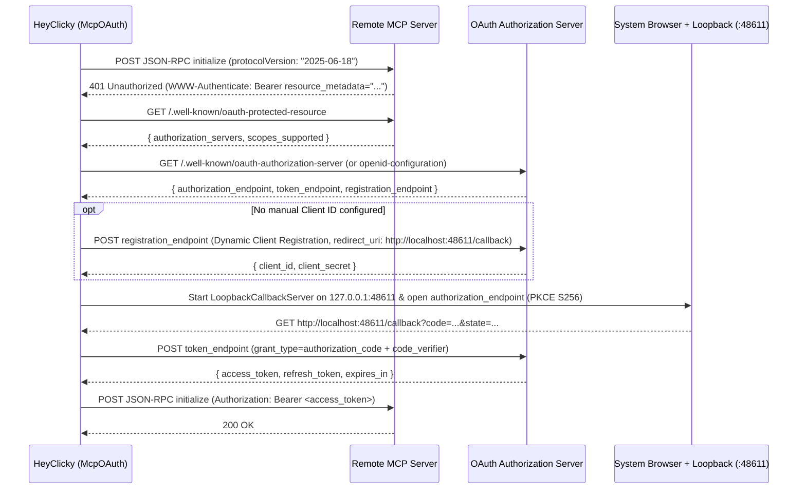

# 06 — Agents, Proactive Intelligence, MCP OAuth & Memory

This document covers the architecture and implementation details of HeyClicky v1.1.5's local and cloud agent execution engine (`HeyClicky.Agents.dll`), background jobs and scheduled routines, Composio & Custom MCP OAuth connectors, proactive screen monitoring and suggestion cards, and the `OneBrain` companion session & memory system.

---

## 1. Decompiled Reference Map

All 7 managed `.NET 9.0` assemblies from `%LOCALAPPDATA%\HeyClickyApp\current\` have been decompiled via `ilspycmd -p` into structured C# projects under `C:\dev\heyclicky-clone\reference\decompiled\`:

| Assembly | Decompiled Project Directory | File Count | Role |
|---|---|---|---|
| `HeyClicky.Contracts.dll` | [HeyClicky.Contracts](file:///C:/dev/heyclicky-clone/reference/decompiled/HeyClicky.Contracts) | 56 | Shared DTOs, IPC contracts, and protocol models |
| `HeyClicky.Core.dll` | [HeyClicky.Core](file:///C:/dev/heyclicky-clone/reference/decompiled/HeyClicky.Core) | 565 | `OneBrain` client/session, `ProactiveAgentsClient`, `McpOAuth`, `AgentTools`, `WorkerTools` |
| `HeyClicky.Agents.dll` | [HeyClicky.Agents](file:///C:/dev/heyclicky-clone/reference/decompiled/HeyClicky.Agents) | 123 | `AgentService`, `AgentHarnessRunnerRuntime`, `CodexHomeManager`, `ClickyJobStore`, `RoutineScheduler` |
| `HeyClicky.Drawing.dll` | [HeyClicky.Drawing](file:///C:/dev/heyclicky-clone/reference/decompiled/HeyClicky.Drawing) | 86 | 2D screen annotation & drawing primitives |
| `HeyClicky.Drawing3D.dll` | [HeyClicky.Drawing3D](file:///C:/dev/heyclicky-clone/reference/decompiled/HeyClicky.Drawing3D) | 42 | 3D mascot/overlay rendering |
| `HeyClicky.Platform.dll` | [HeyClicky.Platform](file:///C:/dev/heyclicky-clone/reference/decompiled/HeyClicky.Platform) | 346 | Win32 hooks, `ForegroundAppInfo`, `QuietContext`, UI Automation browser URL reader |
| `HeyClicky.dll` | [HeyClicky.App](file:///C:/dev/heyclicky-clone/reference/decompiled/HeyClicky.App) | 880 | WPF/Win32 application shell, `ProactiveCoordinator`, `ConnectorAuth`, `BrainContext`, UI |

---

## 2. Local Codex & H1 Agent Harness (`HeyClicky.Agents.dll`)

### 2.1 Architecture Overview

HeyClicky's background agent runtime is orchestrated by [`AgentService`](file:///C:/dev/heyclicky-clone/reference/decompiled/HeyClicky.Agents/HeyClicky.Agents/AgentService.cs), which supports two runtime backends under [`HeyClicky.Agents.Harness`](file:///C:/dev/heyclicky-clone/reference/decompiled/HeyClicky.Agents/HeyClicky.Agents.Harness/AgentHarness.cs):

1. **H1 / Multi-Harness Runner (`clicky-harness.exe` — Default)**:
   - Managed by [`AgentHarnessRunnerRuntime`](file:///C:/dev/heyclicky-clone/reference/decompiled/HeyClicky.Agents/HeyClicky.Agents.Harness/AgentHarnessRunnerRuntime.cs) and [`AgentHarnessRunnerProcess`](file:///C:/dev/heyclicky-clone/reference/decompiled/HeyClicky.Agents/HeyClicky.Agents.Harness/AgentHarnessRunnerProcess.cs).
   - Default harness is `AgentHarness.H1` (`"h1"`), with support for 26 additional harness types (`Pi`, `ClaudeCode`, `Hermes`, `OpenCode`, `OpenHands`, `Goose`, `Cline`, `Aider`, `Crush`, `QwenCode`, `GeminiCli`, `Droid`, `Kilroy`, `NanoClaudeCode`, `OpenDev`, `Plandex`, `Forge`, `Sweep`, `ContinueCli`, `ClawCode`, `Omp`, `Amp`, `KimiCli`, `Autohand`, `Kiwi`, and legacy `Codex`).
   - Supports two execution places ([`AgentHarnessPlace`](file:///C:/dev/heyclicky-clone/reference/decompiled/HeyClicky.Agents/HeyClicky.Agents.Harness/AgentHarnessPlace.cs)):
     - `Mac` (wire value `"mac"`, displayed on Windows as `"On this PC"`) — executes tools locally on the user's machine.
     - `Cloud` (wire value `"cloud"`, displayed as `"In the cloud"`) — executes inside a cloud sandbox while still able to invoke a local `deviceHelper` callback.
   - Thread ID prefixes ([`AgentHarnessPreferences.ThreadIdPrefix`](file:///C:/dev/heyclicky-clone/reference/decompiled/HeyClicky.Agents/HeyClicky.Agents.Harness/AgentHarnessPreferences.cs)):
     - `"h1:"` for `H1` + `Mac` (`On this PC`)
     - `"h1-cloud:"` for `H1` + `Cloud`
     - `"harness:<name>:"` or `"harness:<name>-cloud:"` for non-H1 harnesses
2. **Legacy Codex App-Server (`codex.exe app-server`)**:
   - Managed by [`CodexSession`](file:///C:/dev/heyclicky-clone/reference/decompiled/HeyClicky.Agents/HeyClicky.Agents.Codex/CodexSession.cs) and [`CodexServerProcess`](file:///C:/dev/heyclicky-clone/reference/decompiled/HeyClicky.Agents/HeyClicky.Agents.Codex/CodexServerProcess.cs).
   - Spawns `codex.exe app-server` with `CODEX_HOME=%LOCALAPPDATA%\HeyClicky\codex-home` and communicates over newline-delimited JSON-RPC 2.0 on `stdin`/`stdout`.

### 2.2 Harness Models

[`AgentHarnessModel`](file:///C:/dev/heyclicky-clone/reference/decompiled/HeyClicky.Agents/HeyClicky.Agents.Harness/AgentHarnessModel.cs) defines the model catalog exposed to the harness runner and proxied by the Worker (`https://api.heyclicky.com`):

| Enum Variant | Wire Model ID | Display Title | Subtitle |
|---|---|---|---|
| `Standard` | `gpt-6-luna` | **Luna 6** | Balanced speed and reasoning |
| `Astra` | `gpt-6-astra` | **Astra 6** | Deep reasoning for complex tasks |
| `Sol` | `gpt-6.1-sol` | **Sol 6.1** | Fast, everyday tasks |
| `Terra` | `gpt-6.1-terra` | **Terra 6.1** | Heavy multi-step workflows |
| `Fable` | `claude-fable-5-1` | **Fable 5.1** | Writing and synthesis |
| `ClaudeOpus` | `claude-opus-5-5` | **Claude Opus 5.5** | Anthropic's flagship model |
| `ClaudeSonnet` | `claude-sonnet-5-5` | **Claude Sonnet 5.5** | Fast coding & agentic tool use |
| `ClaudeHaiku` | `claude-haiku-5-5` | **Claude Haiku 5.5** | Lightweight, low-latency |

### 2.3 `clicky-harness.exe` Subprocess & Loopback HTTP Protocol

[`AgentHarnessRunnerProcess`](file:///C:/dev/heyclicky-clone/reference/decompiled/HeyClicky.Agents/HeyClicky.Agents.Harness/AgentHarnessRunnerProcess.cs) resolves the harness binary from:
- `%LOCALAPPDATA%\HeyClickyApp\current\HarnessRuntime\clicky-harness.exe` (a standalone compiled Bun/Node executable ~63.6 MB), or
- Falls back to a local Node.js (`>= 22`) installation running `agent-harness/runner.mjs`.

**Startup & Handshake**:
1. Generates a 32-byte random secret token formatted as 64 lowercase hex characters.
2. Launches `clicky-harness.exe` with working directory `%LOCALAPPDATA%\HeyClicky\agents\AgentHarness` and environment variables:
   - `CLICKY_HARNESS_TOKEN=<64-hex-token>`
   - `CLICKY_HARNESS_STATE=%LOCALAPPDATA%\HeyClicky\agents\AgentHarness`
   - `CLICKY_H1_STATE_DIR=%LOCALAPPDATA%\HeyClicky\agents\AgentHarness\h1-local`
3. Assigns the child process to `KillOnCloseJob.Shared` (a Win32 Job Object with `JOB_OBJECT_LIMIT_KILL_ON_JOB_CLOSE`) so it never orphans if HeyClicky crashes.
4. Reads the first line of `stdout` (15-second timeout), which must be JSON `{"port": <tcpPort>}`.
5. All subsequent communication happens over `http://127.0.0.1:<port>` with header `Authorization: Bearer <CLICKY_HARNESS_TOKEN>`.

**Loopback HTTP Endpoints** ([`AgentHarnessRunnerRuntime`](file:///C:/dev/heyclicky-clone/reference/decompiled/HeyClicky.Agents/HeyClicky.Agents.Harness/AgentHarnessRunnerRuntime.cs)):

| Endpoint | Method | Payload / Query | Description |
|---|---|---|---|
| `/turn` | `POST` | `{ job, harness, place, model, workspace, instructions, mcp, skills, userSkills, leaseMetadata, deviceHelper, worker: { base, sessionToken }, text, images, planTool, note }` | Starts or resumes an agent turn on thread `job` |
| `/events` | `GET` | `?job=<id>&after=<seq>&wait=20000` | Long-polls sequenced runtime events (`commentary`, `thinking`, `plan`, `tool`, `batch`, `answer`, `stats`, `turn_end`, `note`, `apps_unreachable`, `compacted`, `tools_listed`, `log`) |
| `/steer` | `POST` | `{ job, text, informational, images }` | Injects a live mid-turn user message or informational note into a running turn |
| `/cancel` | `POST` | `{ job }` | Aborts the active turn for `job` |

**On-Disk Harness State (`%LOCALAPPDATA%\HeyClicky\agents\AgentHarness\`)**:
- `h1-local\<threadId>\`:
  - `job.json` — Thread metadata (`id`, `harness`, `place`, `model`, `workspace`, `createdAt`, `updatedAt`)
  - `turns.json` — Array of completed/running turn summaries
  - `events.jsonl` — Full sequenced event log streamed to the UI
  - `steps.jsonl` — Tool invocation & reasoning step audit trail
  - `blobs\` — Binary attachments/screenshots captured during tool execution
- `h1-mac\<threadId>\`:
  - `h1.json` — Complete LLM conversation history (`messages`, `system`, `model`, `workspace`)
  - `h1-rounds.jsonl` — Per-round token usage, cache hit stats, and latency telemetry

### 2.4 `CodexHomeManager`, `clicky-model-instructions.md` & Skills Sync

Before each turn, [`CodexHomeManager.SyncInstructionsAndSkills`](file:///C:/dev/heyclicky-clone/reference/decompiled/HeyClicky.Agents/HeyClicky.Agents.Codex/CodexHomeManager.cs) synchronizes `%LOCALAPPDATA%\HeyClicky\codex-home\`:

1. **System Instructions (`clicky-model-instructions.md`)**:
   - Reads `BundledResources\clicky-model-instructions.md` and runs [`WindowsInstructionAdapter.Adapt()`](file:///C:/dev/heyclicky-clone/reference/decompiled/HeyClicky.Agents/HeyClicky.Agents.Codex/WindowsInstructionAdapter.cs) to convert macOS assumptions into Windows equivalents:
     - Replaces `"user's Mac"` -> `"user's Windows PC"`, `"AppleScript"` -> `"PowerShell / COM automation"`, `mdfind` -> `Get-ChildItem -Recurse` / `Select-String`, `~/Library/Application Support/Google/Chrome` -> `%LOCALAPPDATA%\Google\Chrome\User Data`.
     - Appends a **Windows environment notes** block instructing the agent to use PowerShell or Git Bash, `Start-Process` instead of `open`, and `%USERPROFILE%` / `%LOCALAPPDATA%`.
   - Dynamically appends a `## Connected apps` section containing:
     - Connected Composio toolkits (`gmail`, `googlecalendar`, `notion`, `linear`, etc.) and instructions to call `COMPOSIO_SEARCH_TOOLS` first.
     - Multi-account toolkit disambiguation rules (`multi_account_toolkits`) when a user has connected multiple accounts (e.g., personal + work Gmail).
     - Connected local **Obsidian** vault path (`obsidian_vault_path`) with instructions to inspect `.obsidian/` and edit `.md` files directly.
     - Connected **Custom MCP connectors** (`custom_connector_names`) with instructions to call their direct MCP tools first.
2. **Skills Synchronization (`codex-home\skills\` and `codex-home\power-up-skills\`)**:
   - Always copies bundled core skills (`clicky-browser`, `vercel-deploy`) from `BundledResources\skills\` into `%LOCALAPPDATA%\HeyClicky\codex-home\skills\`.
   - Removes blocked default Codex skills (`imagegen`, `openai-docs`, `plugin-creator`, `review-agent`, `skill-creator`, `skill-installer`, `nano-banana-slides`).
   - Copies integration-specific skills from `BundledResources\integration-skills\{clickup,dropbox,gmail,googledocs,googletasks,hubspot,jira,linear,microsoft_teams,outlook,salesforce}` into `%LOCALAPPDATA%\HeyClicky\codex-home\power-up-skills\` **only** when that Composio toolkit is currently connected.
3. **Config Generation (`codex-home\config.toml`)**:
   - Configures `model_provider = "clicky"`, `base_url = "https://api.heyclicky.com/agent/codex"`, `approval_policy = "never"`, `sandbox_mode = "danger-full-access"`, and registers `[mcp_servers.composio]` plus any user-defined `[mcp_servers.<custom>]` entries.

### 2.5 Turn Lifecycle, Leases & Structured Final Reply Tags

When [`AgentService.RunTurnAsync`](file:///C:/dev/heyclicky-clone/reference/decompiled/HeyClicky.Agents/HeyClicky.Agents/AgentService.cs) runs a turn:

1. **Session Token & Lease Acquisition ([`AgentWorkerApi`](file:///C:/dev/heyclicky-clone/reference/decompiled/HeyClicky.Agents/HeyClicky.Agents.Worker/AgentWorkerApi.cs))**:
   - Calls `POST /agent/session-token` (`AgentSessionToken`, 15-minute TTL, refreshed 2 minutes before expiry).
   - Calls `POST /agent/record-agent-launch` with `{ session_id, source, client_turn_id }` to obtain an `AgentTurnLease` (`lease_id`, `turn_id`).
2. **Mid-Turn Lease Polling & Extra-Usage Approval**:
   - Every 3 seconds (`LeasePollInterval`), polls `GET /agent/turn-lease/{leaseId}/status`.
   - If the server sets `requires_extra_effort = true` (long-running or high-cost turn), `AgentService` pauses the turn with `TurnOutcome.ExtraEffortRequired` and transitions the session to `SessionPhase.NeedsExtraUsageApproval`.
   - If the user approves (via UI or voice tool `sessions_answer_request`), calls `POST /agent/turn-lease/{leaseId}/continue` and resumes the turn.
   - If the user stops a turn within 6 seconds (`EarlyStopRefundWindow`), calls `POST /agent/turn-lease/{leaseId}/refund-early-stop`.
3. **Structured Output Parsing ([`StructuredFinalReply.Parse`](file:///C:/dev/heyclicky-clone/reference/decompiled/HeyClicky.Agents/HeyClicky.Agents.Prompt/StructuredFinalReply.cs))**:
   - Extracts structured XML tags from the agent's final reply:
     - `<ANSWER>{"spoken_summary": "...", "markdown": "..."}</ANSWER>`
     - `
...
` and `<DONE_TITLE>...</DONE_TITLE>`
     - `<ARTIFACTS>[{"path": "...", "title": "...", "kind": "..."}]</ARTIFACTS>`
     - `<NEXT_ACTIONS>[{"label": "...", "prompt": "..."}]</NEXT_ACTIONS>`
     - `<ROUTINE>{"action": "set|pause|resume|delete", "interval_minutes": 60, "prompt": "..."}</ROUTINE>`
     - `<COMPUTER_USE_REQUEST>{"app": "...", "reason": "..."}</COMPUTER_USE_REQUEST>`
     - `<WAIT_FOR>{"step": "...", "done_when_url_contains": "..."}</WAIT_FOR>`
     - `<LEARNED>{"title": "...", "how_to": "..."}</LEARNED>`
4. **Lease Completion & Message Logging**:
   - Calls `POST /agent/turn-lease/{leaseId}/complete` with token/tool telemetry and logs messages to `POST /agent-messages`.

---

## 3. Background Agent Jobs, Routines & Notifications

### 3.1 Jobs Storage & Work Folders (`ClickyJobStore`, `ClickyWorkFolderFiles`)

[`ClickyJobStore`](file:///C:/dev/heyclicky-clone/reference/decompiled/HeyClicky.Agents/HeyClicky.Agents.Clickys/ClickyJobStore.cs) manages up to 80 background [`ClickyJob`](file:///C:/dev/heyclicky-clone/reference/decompiled/HeyClicky.Agents/HeyClicky.Agents.Clickys/ClickyJob.cs) records persisted in `%LOCALAPPDATA%\HeyClicky\agents\defaults.json` under the key `"clicky.jobs.v1"`.

Each Job has an isolated workspace directory on disk managed by [`ClickyWorkFolderFiles`](file:///C:/dev/heyclicky-clone/reference/decompiled/HeyClicky.Agents/HeyClicky.Agents.Clickys/ClickyWorkFolderFiles.cs):
- **Root folder**: `%LOCALAPPDATA%\HeyClicky\Clickys\jobs\<slug>-<10charJobId>\`
  - `output\` — User-facing deliverables and generated files
  - `tmp\` — Scratch files for intermediate scripts/downloads
  - `report.md` — Latest markdown report written by the job
  - `.clicky\owner` — 16-hex-character SHA-256 stamp of the owning `userId` (prevents cross-account leakage if the user switches accounts)
  - `.clicky\memory.md` — Persistent job-level notes across runs
  - `.clicky\previous-note.md` — Summary from the prior execution
- **Master Index**: `%LOCALAPPDATA%\HeyClicky\Clickys\jobs\WORK.md` — Auto-generated markdown table indexing all jobs, their schedules, statuses, and output folder paths.

### 3.2 Browser URL Step Watcher (`ClickyJobStepWatcher`)

When a job needs the user to complete an interactive browser step (such as logging into a site or completing 2FA) and emits `<WAIT_FOR>{"step": "Log in to Jira", "done_when_url_contains": "atlassian.net/jira"}</WAIT_FOR>`:
- [`ClickyJobStepWatcher`](file:///C:/dev/heyclicky-clone/reference/decompiled/HeyClicky.Agents/HeyClicky.Agents.Clickys/ClickyJobStepWatcher.cs) enters `WaitingForUserStep` and polls the frontmost browser's active tab URL every **2.5 seconds** (`CheckInterval = 2.5s`, up to `MaximumWait = 6 hours`).
- As soon as the foreground browser URL matches `done_when_url_contains`, `ClickyJobStepWatcher` automatically resumes the paused job turn.

### 3.3 Companion Agent Tools (`HeyClicky.Core.Tools.AgentTools`)

[`AgentTools`](file:///C:/dev/heyclicky-clone/reference/decompiled/HeyClicky.Core/HeyClicky.Core.Tools/AgentTools.cs) exposes **16 tools** to the `OneBrain` voice/text companion so the user can spawn, steer, inspect, and schedule background agents hands-free:

| Tool Name | Purpose |
|---|---|
| `sessions_spawn` | Launches a new background agent task or job (`task`, `clicky_slug`, `job_id`, `include_Screenshot`) |
| `sessions_send` | Sends a follow-up instruction or steers a running/completed agent session |
| `session_status` | Queries live status, progress, and recent tool steps of one or all sessions |
| `sessions_interrupt` | Cancels/stops a currently running agent session |
| `sessions_yield` | Waits for a running session to finish before replying |
| `sessions_answer_request` | Answers a pending permission/setup prompt (`chrome_setup`, `extra_usage`, `computer_use`) |
| `clicky_memory` | Reads a Clicky's `AGENTS.md` + recent messages, or a Job's `runs` + `latest_reply` |
| `clicky_artifacts` | Lists artifacts produced by a session or job |
| `open_artifact` | Opens a generated file/URL in its default application |
| `reveal_artifact` | Highlights a generated file in Windows Explorer |
| `open_agent_dashboard` | Opens the HeyClicky Agent / Jobs dashboard window |
| `skip_onboarding_interview` | Skips the initial Clicky onboarding flow |
| `save_drawing` | Saves the user's on-screen annotation drawing |
| `show_result` | Displays a session's rich result card on screen |
| `routines` | Lists, creates, updates, pauses, resumes, or deletes recurring scheduled routines |
| `find_jobs` | Searches existing background jobs by title, status, or keyword |

### 3.4 Local Scheduled Routines (`RoutineScheduler`, `RoutinesTool`, `ClickyRoutine`)

[`RoutineScheduler`](file:///C:/dev/heyclicky-clone/reference/decompiled/HeyClicky.Agents/HeyClicky.Agents.Routines/RoutineScheduler.cs) runs recurring local agent tasks persisted in `%LOCALAPPDATA%\HeyClicky\agents\routines.json` (wrapped by [`ClickyRoutine`](file:///C:/dev/heyclicky-clone/reference/decompiled/HeyClicky.Agents/HeyClicky.Agents.Routines/ClickyRoutine.cs) and exposed via [`RoutinesTool`](file:///C:/dev/heyclicky-clone/reference/decompiled/HeyClicky.Agents/HeyClicky.Agents.Routines/RoutinesTool.cs)):

- **Schedule Parameters**:
  - `IntervalMinutes`: `2` (`MinIntervalMinutes`) to `10080` (`MaxIntervalMinutes`, 7 days).
  - Optional time-of-day pinning (`ScheduledMinuteOfDay`, `0..1439`) and weekday mask (`ScheduledWeekdays`, ISO 1=Mon..7=Sun).
- **Polling & Power Management**:
  - Polls every **30 seconds** (`PollInterval = 30s`).
  - Integrates with `RoutineWakeGate` (system power resume notifications) and waits a **3-minute settle delay** (`OverdueSettleDelay = 3m`) after waking from sleep before firing overdue routines so Wi-Fi and tokens reconnect cleanly.
  - Holds a Windows execution state wake lock via `RoutineKeepAwake` while a scheduled routine turn is actively executing.
- **Retry & Circuit Breaker**:
  - Retries failed routine runs after **300 seconds** (`FailureRetryDelaySeconds = 300`).
  - Automatically pauses a routine after **3 consecutive failures** (`MaxConsecutiveFailures = 3`).
- **Job Migration**:
  - `MoveClickyRoutinesOntoJobs` automatically migrates legacy Clicky-bound routines onto `ClickyJob` instances.

### 3.5 Cloud Remote Tasks (`/agent/cron/*`) & Notification Delivery (`AgentBackendClient`)

In addition to local routines, HeyClicky supports cloud-hosted scheduled TypeScript tasks ("Remote Tasks"):
- [`AgentBackendClient`](file:///C:/dev/heyclicky-clone/reference/decompiled/HeyClicky.Core/HeyClicky.Core.Proactive/AgentBackendClient.cs) polls `GET /agent/notifications?limit=20` every **60 seconds** (`PollInterval = 60s`) when `RemoteTasksEnabled` is active.
- Unread notifications (`AgentNotificationItem`) are surfaced as cards in [`ProactiveCoordinator`](file:///C:/dev/heyclicky-clone/reference/decompiled/HeyClicky.App/HeyClicky.App.Proactive/ProactiveCoordinator.cs) and marked read via `POST /agent/notifications/{id}/read` or `POST /agent/notifications/read-all`.
- When a cloud cron notification arrives (or fails), the client can inspect the task via `GET /agent/cron/{cronId}` (`RemoteCronDetails`, which includes the task's TypeScript `source`, `schedule_text`, `timezone`, and `recent_runs`).
- Users can repair a failing remote task with one click (`ProactiveCoordinator.FixRemoteTask`), or modify a remote task's schedule/code via voice (`ToggleRemoteTaskVoiceModification`) or text (`StartRemoteTaskTextModification`).

---

## 4. Composio MCP OAuth & Connectors

### 4.1 Composio Managed Integrations (`AgentIntegrationsApi`, `ComposioMcpConfiguration`)

HeyClicky integrates with 100+ SaaS tools through Composio's managed MCP proxy, orchestrated via [`AgentWorkerApi`](file:///C:/dev/heyclicky-clone/reference/decompiled/HeyClicky.Agents/HeyClicky.Agents.Worker/AgentWorkerApi.cs) and [`AgentIntegrationsApi`](file:///C:/dev/heyclicky-clone/reference/decompiled/HeyClicky.Agents/HeyClicky.Agents.Integrations/AgentIntegrationsApi.cs):

1. **Catalog & Connection Lifecycle**:
   - `GET /agent/integrations?limit=1000` returns the user's integration catalog (`connected`, `available`, `connected_accounts` for multi-account support).
   - `POST /agent/integrations/{toolkit}/connect` (with `{ add_account: bool }`) initiates OAuth and returns a `redirect_url` opened in the user's default browser.
   - `POST /agent/integrations/{toolkit}/disconnect` (with optional `connection_id`) revokes a connection.
   - `POST /agent/integrations/{toolkit}/accounts/{connectionId}/label` assigns a human-readable label (e.g., `"Work"`, `"Personal"`) to a specific account in a multi-account toolkit.
2. **Per-Turn Composio MCP Session (`ComposioMcpConfiguration`)**:
   - Before starting an agent turn, `AgentService.PrepareRuntimeLockedAsync` calls `POST /agent/composio/session`.
   - Returns [`ComposioMcpConfiguration`](file:///C:/dev/heyclicky-clone/reference/decompiled/HeyClicky.Agents/HeyClicky.Agents.Integrations/ComposioMcpConfiguration.cs): `{ enabled, proxy_url, toolkits, multi_account_toolkits }`.
   - `AgentHarnessRunnerRuntime` passes `proxy_url` + Bearer `sessionToken` to `clicky-harness.exe` under `mcp.composio`.

### 4.2 Custom MCP Connectors & RFC-Compliant OAuth PKCE (`McpOAuth`, `ConnectorAuth`)

Users can register custom `stdio` or `remote` (HTTP/SSE) MCP servers stored in `%LOCALAPPDATA%\HeyClicky\custom-connectors.json` via [`CustomConnectorStore`](file:///C:/dev/heyclicky-clone/reference/decompiled/HeyClicky.App/HeyClicky.App.Settings/CustomConnectorStore.cs) (with tokens/secrets encrypted at rest using Windows DPAPI `ProtectedData`).

For remote MCP servers requiring OAuth, [`McpOAuth`](file:///C:/dev/heyclicky-clone/reference/decompiled/HeyClicky.Core/HeyClicky.Core.Connectors/McpOAuth.cs) and [`McpOAuthDiscovery`](file:///C:/dev/heyclicky-clone/reference/decompiled/HeyClicky.Core/HeyClicky.Core.Connectors/McpOAuthDiscovery.cs) implement the full **MCP `2025-06-18` Authorization Specification**:

- **Token Refresh**: [`ConnectorAuth.RefreshConnectorCredentialsIfNeededAsync`](file:///C:/dev/heyclicky-clone/reference/decompiled/HeyClicky.App/HeyClicky.App.Settings/ConnectorAuth.cs) checks token expiry before every turn and refreshes tokens within a **5-minute margin** (`McpOAuth.RefreshMargin = 5m`).

### 4.3 First-Class Integrations: Gmail, Google Calendar, Notion, Linear, Obsidian & Spotify

| Integration | Connection Mechanism | Special Runtime Wiring |
|---|---|---|
| **Gmail** (`gmail`) | Composio OAuth | Installs `BundledResources\integration-skills\gmail\SKILL.md` into `codex-home\power-up-skills\gmail\`; supports multi-account labeling |
| **Google Calendar** (`googlecalendar`) | Composio OAuth + Worker Realtime API | Direct low-latency companion tools in [`WorkerTools`](file:///C:/dev/heyclicky-clone/reference/decompiled/HeyClicky.Core/HeyClicky.Core.Tools/WorkerTools.cs): `google_calendar_find_events` (`POST /agent/realtime/google-calendar/events`) and `google_calendar_create_event` (`POST /agent/realtime/google-calendar/events/create`). Also drives [`UpcomingMeetingsClient`](file:///C:/dev/heyclicky-clone/reference/decompiled/HeyClicky.Core/HeyClicky.Core.Proactive/UpcomingMeetingsClient.cs) (`GET /me/calendar/upcoming`) for live notch meeting countdown banners (`NotchLiveEvent.MeetingCountdown`) |
| **Notion** (`notion`) | Composio OAuth | Exposed via Composio MCP session + foreground URL/app detection (`notion.so`) in `IntegrationSuggestionRules` |
| **Linear** (`linear`) | Composio OAuth | Installs `BundledResources\integration-skills\linear\SKILL.md` into `codex-home\power-up-skills\linear\` + foreground detection (`linear.app`) |
| **Obsidian** (`obsidian`) | Local Vault Discovery ([`ObsidianVault`](file:///C:/dev/heyclicky-clone/reference/decompiled/HeyClicky.App/HeyClicky.App.Settings/ObsidianVault.cs)) | **No cloud OAuth required.** Reads `%APPDATA%\obsidian\obsidian.json` (and searches `%USERPROFILE%\Documents`, `Desktop`, `OneDrive`, `iCloudDrive`) to locate `.obsidian` vaults, stores `ObsidianVaultPath` in `settings.json`, and injects the vault path directly into `clicky-model-instructions.md` |
| **Spotify** (`spotify`) | Worker Realtime Search + Local URI Launch | Handled by `play_on_spotify` in [`WorkerTools`](file:///C:/dev/heyclicky-clone/reference/decompiled/HeyClicky.Core/HeyClicky.Core.Tools/WorkerTools.cs): calls `POST /agent/realtime/spotify/search`, verifies the 22-char base62 track ID, and opens `spotify:track:<id>` if `%APPDATA%\Spotify\Spotify.exe` or Windows Store `SpotifyAB.SpotifyMusic_*` is installed (falling back to `https://open.spotify.com/track/<id>`). Also triggers `NotchLiveEvent.SpotifyVoiceTip` after 7.5s of foreground dwell |

---

## 5. Proactive Intelligence, Screen State Monitoring & Suggestion Cards

### 5.1 Screen State, Foreground Window & Quiet Context Detection (`HeyClicky.Platform.Win32`)

[`ProactiveCoordinator`](file:///C:/dev/heyclicky-clone/reference/decompiled/HeyClicky.App/HeyClicky.App.Proactive/ProactiveCoordinator.cs) continuously monitors the user's screen state and activity using two Win32 platform services:

1. **[`ForegroundAppInfo`](file:///C:/dev/heyclicky-clone/reference/decompiled/HeyClicky.Platform/HeyClicky.Platform.Win32/ForegroundAppInfo.cs)**:
   - Calls `GetForegroundWindow()` and resolves the root owner via `GetAncestor(GA_ROOTOWNER)`.
   - Reads the executable path via `OpenProcess(PROCESS_QUERY_LIMITED_INFORMATION)` + `QueryFullProcessImageName` and window title via `GetWindowText`.
   - If the process is a known browser (`chrome`, `msedge`, `brave`, `opera`, `vivaldi`, `arc`, `chromium`, `thorium`, `firefox`), invokes [`UIAutomationHelpers.ReadBrowserAddress`](file:///C:/dev/heyclicky-clone/reference/decompiled/HeyClicky.Platform/HeyClicky.Platform.Win32/UIAutomationHelpers.cs) to extract the active tab's URL without requiring a browser extension.
2. **[`QuietContext`](file:///C:/dev/heyclicky-clone/reference/decompiled/HeyClicky.Platform/HeyClicky.Platform.Win32/QuietContext.cs)** & **Multi-Monitor Selection**:
   - **Monitor Selection & Fullscreen Detection**: Uses `MonitorFromWindow(hwnd, MONITOR_DEFAULTTONEAREST)` and `GetMonitorInfo` to compare the foreground window's `RECT` against `rcMonitor`. `QuietContext.FullscreenForegroundMonitor()` identifies which `HMONITOR` currently has a fullscreen app/game/video, and `SHQueryUserNotificationState` checks for `QUNS_RUNNING_D3D_FULL_SCREEN` or `QUNS_PRESENTATION_MODE`.
   - **Windows Focus Assist / Do Not Disturb**: Queries the undocumented Windows Notification Facility state `WNF_SHEL_QUIETHOURS_ACTIVE_PROFILE_CHANGED` (`0x0D83063EA3BF1C75`) via `ntdll!NtQueryWnfStateData` (profile `!= 0` means Priority Only or Alarms Only is active).
   - **Active Microphone Call Detection**: Inspects `HKCU\Software\Microsoft\Windows\CurrentVersion\CapabilityAccessManager\ConsentStore\microphone` (including `NonPackaged` subkeys) for any app other than HeyClicky with `LastUsedTimeStart != 0 && LastUsedTimeStop == 0` so proactive voice/cards never interrupt a Zoom/Teams/Meet call.
   - **User Idle Time**: Calls `GetLastInputInfo()` (`SecondsSinceLastUserInput`) to ensure proactive sweeps and morning greetings only fire when the user is actively at the keyboard/mouse (`ActiveRecency = 30s`).

### 5.2 Foreground App & URL Integration Suggestions (`IntegrationSuggestionRules`)

Every **2.5 seconds** (`PollInterval = 2.5s`), `ProactiveCoordinator.SampleForegroundActivity()` feeds `ForegroundAppInfo.ReadCurrent()` into [`IntegrationSuggestionRules`](file:///C:/dev/heyclicky-clone/reference/decompiled/HeyClicky.Core/HeyClicky.Core.Proactive/IntegrationSuggestionRules.cs):
- Matches the foreground process name, browser host (`HostSpecificity`), URL path prefix (`/document`, `/spreadsheets`, `/presentation`, `/jira`, `/wiki`), and window title against 20 high-priority apps and 89 catalog integrations.
- Accumulates dwell time while the user remains in that app/site. Once dwell reaches **10 seconds** (`DwellThreshold = 10s`, or **7.5 seconds** for Spotify), if the toolkit is not yet connected, not snoozed (`NotNowSnooze = 48 hours`), and under the daily cap (`MaximumPromptsPerDay = 3`), displays a live notch banner (`NotchLiveEvent.IntegrationSuggestion`) for **18 seconds** offering a one-click OAuth connect.

### 5.3 Proactive Agent Sweeps & `ProactiveSuggestionCard` Lifecycle (`ProactiveAgentsClient`, `ProactiveStore`)

[`ProactiveAgentsClient`](file:///C:/dev/heyclicky-clone/reference/decompiled/HeyClicky.Core/HeyClicky.Core.Proactive/ProactiveAgentsClient.cs) and [`ProactiveCoordinator`](file:///C:/dev/heyclicky-clone/reference/decompiled/HeyClicky.App/HeyClicky.App.Proactive/ProactiveCoordinator.cs) drive scheduled background sweeps that generate actionable [`ProactiveSuggestionCard`](file:///C:/dev/heyclicky-clone/reference/decompiled/HeyClicky.Core/HeyClicky.Core.Proactive/ProactiveSuggestionCard.cs) notifications:

1. **Cadence & Slot Evaluation ([`ProactiveCadenceRules`](file:///C:/dev/heyclicky-clone/reference/decompiled/HeyClicky.Core/HeyClicky.Core.Proactive/ProactiveCadenceRules.cs))**:
   - Evaluated every **30 seconds** (`SlotsPollInterval = 30s`) when the user has interacted with the PC within the last 30 seconds.
   - Default cadence is `Daily` at **06:00 local time** (with options for `ThreeTimes` at `06:00, 12:00, 18:00` or `FiveTimes` at `06:00, 09:00, 12:00, 15:00, 18:00`).
2. **Job Submission & Polling (`ProactiveAgentsClient`)**:
   - Calls `POST /proactive-agents/jobs` with [`ProactiveRequestInputs`](file:///C:/dev/heyclicky-clone/reference/decompiled/HeyClicky.Core/HeyClicky.Core.Proactive/ProactiveRequestInputs.cs):
     - `connected_integrations`, `check_reason` (`"morning_briefing"`, `"scheduled_slot"`, `"manual_refresh"`, `"post_connect:<toolkit>"`), `recent_agent_suggestions` (up to 40 recent entries for deduplication), `local_day`, `jobs: true`, `routines`, `clickys`, and `custom_connectors`.
   - Polls `GET /proactive-agents/jobs/{jobId}` every **4 seconds** for the first 15 minutes (`JobFastPollWindow`), then every **30 seconds** up to 6 hours (`JobReceiptLifetime`).
3. **Card Delivery, Morning Greeting & Cross-Device Sync**:
   - Completed sweeps return up to 5 `suggested_agents`, converted into [`ProactiveSuggestionCard`](file:///C:/dev/heyclicky-clone/reference/decompiled/HeyClicky.Core/HeyClicky.Core.Proactive/ProactiveSuggestionCard.cs) items (`Id`, `ServerSuggestionId`, `Title`, `Description`, `AgentPrompt`, `ClickySlug`, `NewClicky`, `Routine`, `IntegrationName`, `ExpiresAt = CreatedAt + 24h`) and persisted per-account in `%LOCALAPPDATA%\HeyClicky\proactive.json` via [`ProactiveStore`](file:///C:/dev/heyclicky-clone/reference/decompiled/HeyClicky.Core/HeyClicky.Core.Proactive/ProactiveStore.cs).
   - **Morning Greeting**: When fresh morning cards are ready and the user is active (and not in `QuietContext`), `ProactiveCoordinator` claims the cross-device invitation lock via `POST /proactive-agents/invitation-claim`, waits 10 seconds (`MorningGreetingPolicy.ArmDelay`), speaks a cursor greeting via `SayAtCursorAsync`, and opens the `NotchLiveEvent.MorningSuggestions` stack.
   - **Cross-Device Resolution Sync**: Polls `POST /proactive-agents/suggestions/statuses` every **60 seconds** and reports local card transitions (`presented`, `viewed`, `approved`, `denied`, `expired`, `replaced`) via `POST /proactive-agents/resolution`.
   - **Approval / Adjustment**: Clicking **Approve** launches the card's `AgentPrompt` as a `ClickyJob` (and registers its `ClickyRoutine` if `Routine` is attached); clicking **Adjust** (`BeginAdjusting`) lets the user refine the prompt by voice or text before execution.

---

## 6. OneBrain Companion & Local + Cloud Memory

### 6.1 `OneBrain` Session Management (`BrainSession`, `BrainClient`, `BrainContext`)

[`BrainSession`](file:///C:/dev/heyclicky-clone/reference/decompiled/HeyClicky.Core/HeyClicky.Core.Brain/BrainSession.cs) and [`BrainClient`](file:///C:/dev/heyclicky-clone/reference/decompiled/HeyClicky.Core/HeyClicky.Core.Brain/BrainClient.cs) power HeyClicky's real-time multimodal voice/text assistant ("OneBrain"):

- **Streaming Turn Protocol (`POST /brain/turn`)**:
  - Sends the conversation `thread` (`List<JsonNode>`), system context (`BrainSystemContext`), and tool definitions (`WorkerTools` + `AgentTools` + `TodoTools`) compressed with gzip (`BrainRequestCompression`) to `POST /brain/turn`.
  - Streams back Server-Sent Events parsed by `BrainSseParser` (`text_delta`, `thinking_delta`, `tool_call`, `done`).
- **Screenshot Management & Prewarming**:
  - Attaches active window/screen captures (or uploads via `clicky_file` reference) and caps in-memory thread screenshots at **48** (`MaximumScreenshotsInThread = 48`), trimming to the newest **32** (`ScreenshotsKeptAfterTrim = 32`).
  - When the user presses the push-to-talk hotkey (`NoteKeyDown`), fires `POST /brain/prewarm` (`BrainPrewarmPolicy`) to warm the server-side prompt cache before the user finishes speaking.
- **Background Thread Compaction (`POST /brain/compact`)**:
  - When the serialized thread exceeds `BrainCompactionPolicy` thresholds, `CompactThreadIfLarge` asynchronously compacts older turns via `POST /brain/compact` without blocking the UI.
- **Session Rotation & Memory Extraction (`POST /brain/session-end`)**:
  - After **2 hours of inactivity** (`IdleBeforeNewSession = 2h`), `BrainSession` rotates to a new `SessionId` and posts the finished thread to `POST /brain/session-end` (`EndSessionOnWorker`) so the Worker can asynchronously consolidate long-term user memories.
- **Local `OneBrain` Storage (`%LOCALAPPDATA%\HeyClicky\OneBrain\<accountId>\`)**:
  - `threads\<SessionId>.json` — Active and recent serialized threads (stripped of base64 screenshots, retained for **14 days**, max 25 files loaded on startup).
  - `<SessionId>.jsonl` — Append-only per-turn audit log (`user`, `assistant`, `tool_calls`, `latency_ms`).

### 6.2 Cloud + Local User Memory (`/me/memory`, `UserMemoryCache`)

HeyClicky maintains a two-tier user memory architecture combining a cloud markdown profile with a local fault-tolerant disk cache and per-job/per-Clicky markdown files:

1. **Cloud Memory Endpoints ([`WorkerClient`](file:///C:/dev/heyclicky-clone/reference/decompiled/HeyClicky.Core/HeyClicky.Core.Services/WorkerClient.cs) & [`AgentWorkerApi`](file:///C:/dev/heyclicky-clone/reference/decompiled/HeyClicky.Agents/HeyClicky.Agents.Worker/AgentWorkerApi.cs))**:
   - `GET /me/memory` — Fetches `{ has_profile: bool, markdown: string }` containing the user's consolidated profile, preferences, people, and recurring workflows.
   - `POST /me/memory/save` — Invoked by the companion's `save_memory` tool (`WorkerTools.SaveMemoryAsync`) with `{ memory: "..." }` whenever the user states a durable preference or personal fact.
   - `POST /me/memory/import` — Imports external memory/context into the user's cloud profile.
2. **Local Disk Cache ([`UserMemoryCache`](file:///C:/dev/heyclicky-clone/reference/decompiled/HeyClicky.Agents/HeyClicky.Agents.Prompt/UserMemoryCache.cs))**:
   - Located at `%LOCALAPPDATA%\HeyClicky\agents\user-memory\<userId>.md`.
   - Every time `AgentService` fetches a non-empty profile from `GET /me/memory` (4-second timeout), `UserMemoryCache.Resolve` atomically writes `<userId>.md.tmp` and moves it to `<userId>.md`.
   - If the cloud request times out or fails offline, `UserMemoryCache.Resolve` transparently falls back to the cached local `<userId>.md` and [`TurnPromptBuilder`](file:///C:/dev/heyclicky-clone/reference/decompiled/HeyClicky.Agents/HeyClicky.Agents.Prompt/TurnPromptBuilder.cs) injects it into the agent turn inside `<user_memory>...</user_memory>`.
3. **Per-Clicky & Per-Job Memory (`AGENTS.md`, `.clicky\memory.md`, `LearnedHowTos`)**:
   - **Clicky `AGENTS.md`**: Each persistent Clicky persona stores durable instructions and learned context in `%LOCALAPPDATA%\HeyClicky\Clickys\<slug>\AGENTS.md`.
   - **Job `.clicky\memory.md`**: Each background Job stores run-to-run state in `%LOCALAPPDATA%\HeyClicky\Clickys\jobs\<folder>\.clicky\memory.md`.
   - **`clicky_memory` Companion Tool**: Allows `OneBrain` to read up to 6,000 chars of a Clicky's `AGENTS.md` (plus its last 20 messages) or up to 12,000 chars of a Job's latest report and run history.
   - **Procedural Memory (`ClickyLearnedHowTos`)**: When a Job outputs `<LEARNED>{"title": "...", "how_to": "..."}</LEARNED>`, HeyClicky persists the reusable recipe and injects matching how-tos into future agent turns.
