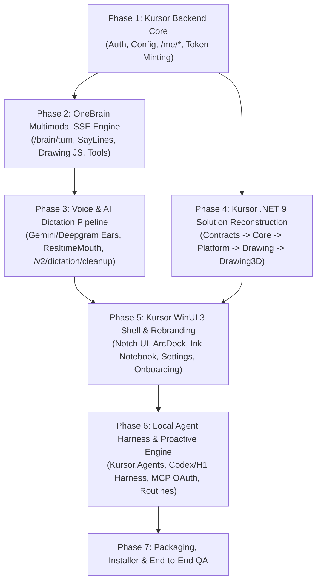

# 07 — Kursor Master Engineering Roadmap

> **Goal**: Build **Kursor**, a 100% functional, self-hosted, rebranded working copy of **HeyClicky v1.1.5** (Frontend Desktop App + Cloud/Local Worker Backend) with zero external reliance on `api.heyclicky.com`.

---

## 1. Strategic Architectural Recommendation: How We Should Build Kursor

Because we now have:
1. **All 7 `.NET 9.0` assemblies decompiled into 2,096 clean C# files** under [`reference/decompiled/`](file:///C:/dev/heyclicky-clone/reference/decompiled/) (and reconstructed into **2,096 project `.cs` files + 1 shared root polyfill = 2,097 `.cs` files** in [`src/desktop/`](file:///C:/dev/heyclicky-clone/src/desktop/)),
2. **All bundled JavaScript engines & shaders** (`Assets/Engine/clicky-draw-*.js`, `clicky-three*.js`, fonts, audio earcons, and sidecars) in [`C:/Users/ubaid/AppData/Local/HeyClickyApp/current/`](file:///C:/Users/ubaid/AppData/Local/HeyClickyApp/current/),
3. **All runtime prompts, schemas, and skills** in [`C:/Users/ubaid/AppData/Local/HeyClicky/`](file:///C:/Users/ubaid/AppData/Local/HeyClicky/), and
4. **Complete ground-truth specifications** in [`docs/01`](file:///C:/dev/heyclicky-clone/docs/01-architecture-overview.md) through [`docs/06`](file:///C:/dev/heyclicky-clone/docs/06-agents-proactive-and-memory.md) plus the **Full-Spectrum Audit & Remediation suite** in [`docs/audit/`](file:///C:/dev/heyclicky-clone/docs/audit/),

there are **two ways** to approach the desktop frontend, plus **one clear path** for the backend:

### Recommendation: The "Reconstruct + Custom Kursor Worker" Strategy (Fastest & Highest Fidelity)
Instead of rewriting 19,000+ methods of complex Win32/DirectComposition/Direct3D11/Vortice/ClearScript/WASAPI code from scratch in Electron or Tauri (which would lose the hardware-accelerated 2D/3D shader pipeline, low-level Win32 input hooks, and WASAPI audio engine), **we should build Kursor in two parallel tracks**:

1. **Track A — Kursor Backend (`kursor-worker` / Node/TypeScript or Cloudflare Worker / Hono)**:
   - Implement a clean, self-hosted TypeScript backend (using Hono / Bun or Node.js / Cloudflare Workers) that implements the exact REST & SSE endpoints documented in [`02-api-contracts-and-worker-spec.md`](file:///C:/dev/heyclicky-clone/docs/02-api-contracts-and-worker-spec.md).
   - Point the client at our Kursor Backend immediately using the built-in `endpoints.json` / `KURSOR_WORKER_BASE_URL` mechanism so we can test every feature live against the working binary from Day 1.
2. **Track B — Kursor Desktop Client (`kursor-desktop` in `.NET 9.0` + `WinUI 3`)**:
   - Port/reconstruct the 7 decompiled projects in [`reference/decompiled/`](file:///C:/dev/heyclicky-clone/reference/decompiled/) into a clean, compilable `.NET 9.0` solution (`Kursor.sln`) under `src/desktop/`:
     - `Kursor.Contracts`
     - `Kursor.Core`
     - `Kursor.Platform`
     - `Kursor.Drawing`
     - `Kursor.Drawing3D`
     - `Kursor.Agents`
     - `Kursor.App`
   - Rebrand all namespaces, UI strings, window classes, custom URL protocol (`kursor://`), file association (`.kursor`), and data directories (`%LOCALAPPDATA%\Kursor\`) from `HeyClicky` to `Kursor`.

---

## 2. Phased Implementation Roadmap

---

### Phase 1: Kursor Backend Foundation (`src/backend/`) — ✅ COMPLETED
**Objective**: Stand up a local/cloud TypeScript API server (`kursor-worker`) that satisfies boot, authentication, configuration, plan checks, and ephemeral voice token minting.

- [x] **1.1 Scaffold `src/backend`** (Hono + TypeScript + `node:sqlite`):
  - Implemented middleware for `X-Clicky-*` / `X-Kursor-*` client headers and Bearer JWT auth (`src/backend/src/middleware/auth.ts`).
  - Supported gzip request decompression (`Content-Encoding: gzip` from `BrainRequestCompression` in `src/backend/src/middleware/gzip.ts`).
- [x] **1.2 Boot, Config & Plan Endpoints** (`src/backend/src/routes/worker.ts`):
  - `GET /config` & `GET /app-config` — Serves `AppConfigResponse` seeded from [`app-config.json`](file:///C:/Users/ubaid/AppData/Local/HeyClicky/app-config.json).
  - `GET /config/runtime-models` & `GET /runtime/model-policy` — Serves runtime model routing policy (OpenRouter Brain, Deepgram Ears, OpenAI Realtime Mouth, Groq Dictation cleanup).
  - `GET /plan` & `GET /me/plan` — Returns an unlocked `max` `PlanSnapshot` DTO (`can_use_voice: true`, `can_use_dictation: true`, `can_use_agents: true`, `999999` usage buckets).
  - `POST /devices/register` (`POST /me/devices`) & `GET /devices` (`GET /me/devices`) — Device registration persisted in SQLite (`src/backend/data/kursor.db`).
- [x] **1.3 Auth & Ephemeral Token Minting** (`src/backend/src/routes/auth.ts` & `src/backend/src/routes/voice.ts`):
  - Unified `/auth/v1/*` Supabase Auth mock (`/auth/v1/authorize`, `/auth/v1/token`, `/auth/v1/user`, `/auth/v1/logout`) returning valid 3-part JWTs.
  - `POST /v2/dictation/gemini-token` & `POST /brain/ears/token` — Mints Gemini Live API session (`BidiGenerateContentSetup`).
  - `POST /deepgram/token` & `POST /v2/dictation/deepgram-token` — Mints Deepgram Nova-3 streaming token.
  - `POST /realtime/token` & `POST /agent/realtime/session` — Mints OpenAI Realtime ephemeral `client_secret` (with Gemini Speech fallback).
- [x] **1.4 Verification**:
  - Verified with `src/backend/src/test-phase1.ts` (**18/18 test suites passing, 0 TypeScript errors**).

---

### Phase 2: OneBrain Multimodal SSE Engine (`src/backend/src/routes/brain.ts`) — ✅ COMPLETED
**Objective**: Implement the core multimodal streaming brain (`/brain/turn`, `/brain/compact`, `/brain/prewarm`, `/brain/session-end`) and memory endpoints.

- [x] **2.1 Multimodal Turn Handler (`POST /brain/turn`)** (`src/backend/src/routes/brain.ts`):
  - Parses gzip-decompressed JSON payloads containing multi-monitor JPEGs (`ScreenCaptureFrame`), cursor coordinates, `PageContext`, conversation history, and user transcript.
  - Injects system prompt (`clicky-model-instructions.md` + user memory layer) and routes primarily through **OpenRouter** (`OPENROUTER_API_KEY` + `KURSOR_BRAIN_MODEL || "anthropic/claude-sonnet-4.6"`), with fallback to OpenAI, Gemini, Groq, and an interactive offline fallback.
  - Streams OneBrain SSE events (`meta`, `status`, `text` with `say(step, "...")` & V8 2D/3D drawing code, `tool_call`, `computer_calls`, `items`, `done`).
- [x] **2.2 Session Compaction & Lifecycle** (`src/backend/src/routes/brain.ts` & `worker.ts`):
  - `POST /brain/compact` — Summarizes long sessions and returns `BrainCompactReply`.
  - `POST /brain/prewarm` & `POST /brain/session-end` — Session lifecycle hooks persisted in SQLite.
  - `GET /memory` & `PUT /memory` (`/me/memory/save`) — Cloud/local SQLite memory persistence.
  - `POST /search/web` & `POST /search/images` — Zero-extra-key DuckDuckGo + Wikipedia + Wikimedia Commons search.

---

### Phase 3: Voice ("Ears" & "Mouth") & AI Dictation Backend — ✅ COMPLETED
**Objective**: Complete end-to-end voice conversation and Wispr-style system-wide AI dictation.

- [x] **3.1 Dictation Context Cleanup (`POST /v2/dictation/cleanup`)** (`src/backend/src/routes/voice.ts`):
  - Accepts `DictationCleanupContext` (`text`, `app_name`, `site_host`, `before_text`, `selected_text`, `after_text`, `known_terms`).
  - Runs ultra-low-latency LLM cleanup via Groq (`llama-3.3-70b-versatile`), falling back to OpenRouter / Gemini / local punctuation heuristics.
  - Also implemented `POST /v2/dictation/transcribe` & `POST /brain/ears/transcribe` via Groq Whisper (`whisper-large-v3-turbo`) / Deepgram / OpenAI.
- [x] **3.2 Realtime & Gemini Speech TTS Routes** (`src/backend/src/routes/voice.ts`):
  - Implemented `/realtime/token`, `/agent/realtime/session`, `/agent/realtime/warmup`, and `/agent/realtime/speak`.

---

### Phase 4: Reconstruct Compilable `.NET 9.0` Core & Engine Libraries (`src/desktop/`) — ✅ COMPLETED
**Objective**: Turn the decompiled C# projects in [`reference/decompiled/`](file:///C:/dev/heyclicky-clone/reference/decompiled/) into a clean, compilable `.NET 9.0` solution (`Kursor.sln`, 2,096 project `.cs` files + 1 root polyfill = 2,097 `.cs` files).

- [x] **4.1 `Kursor.Contracts`** (`src/desktop/Kursor.Contracts/` — 55 files):
  - Cleaned up `InlineArray` and `ReadOnly*` polyfills; updated `AppPaths.cs` and `ClickyEndpoints.cs` to default to `http://127.0.0.1:8787` and `%LOCALAPPDATA%\Kursor`. Compiles with **0 Errors**.
- [x] **4.2 `Kursor.Drawing` & `Kursor.Drawing3D`** (`src/desktop/Kursor.Drawing/` [85 files] & `src/desktop/Kursor.Drawing3D/` [41 files]):
  - Wired `Microsoft.ClearScript.V8`, `Vortice.*`, `Microsoft.Graphics.Win2D`, and bundled `Assets/Engine/clicky-three.js` + `Assets/Engine/parts/*.js`. Both compile with **0 Errors**.
- [x] **4.3 `Kursor.Platform`** (`src/desktop/Kursor.Platform/` — 345 files):
  - Fixed `[UnmanagedCallersOnly]` Win32 hook pointers, CsWin32 handle formatting, and raw input spans. Compiles with **0 Errors**.
- [x] **4.4 `Kursor.Core`** (`src/desktop/Kursor.Core/` — 564 files):
  - Reconstructed all 564 files (`BrainClient`, `WorkerClient`, `RealtimeMouth`, `GeminiTranscriber`, `DeepgramTranscriber`, `ClickyInkNoteStore`, `ProactiveAgentsClient`, `AppBundleConfiguration`, and [`TrayTooltip.cs`](file:///C:/dev/heyclicky-clone/src/desktop/Kursor.Core/HeyClicky.Core.Notch/TrayTooltip.cs) in `src/desktop/Kursor.Core/HeyClicky.Core.Notch/TrayTooltip.cs`). Compiles with **0 Errors**.

---

### Phase 5: Reconstruct `Kursor.Agents` & `Kursor.App` (WinUI 3 Frontend) — ✅ COMPLETED
**Objective**: Reconstruct the local agent engine and the WinUI 3 shell (`NotchView`, `ArcDock`, `Ink` interactive sheets, `Dictation` HUD, `Settings`, `Onboarding`).

- [x] **5.1 `Kursor.Agents`** (`src/desktop/Kursor.Agents/` — 122 files):
  - Reconstructed `AgentService`, `AgentHarnessRunnerProcess`, `CodexSession`, `ClickyJobStore`, `RoutineScheduler`, `McpOAuth`, and the 16 `AgentTools`. Compiles with **0 Errors**.
- [x] **5.2 `Kursor.App` (WinUI 3 Shell — 884 files)** (`src/desktop/Kursor.App/`):
  - Reconstructed all 884 files (`NotchView`, `ArcDock`, `HeyClickyWindow`, `ClickyInkSheetView` / `ClickyInkInteractiveSheetView`, `SettingsWindow`, `Onboarding`, `TakeOverOverlay`).
  - Configured automatic local Kursor Pro/Max session seeding (`SupabaseAuthService.cs`), billing enforcement bypass (`BillingStateService.cs`), onboarding bypass (`OnboardingProgress.cs` & `JsonAppSettings.cs`), and **Kursor** runtime/UI branding ([`TrayTooltip.cs`](file:///C:/dev/heyclicky-clone/src/desktop/Kursor.Core/HeyClicky.Core.Notch/TrayTooltip.cs) in `Kursor.Core`, [`TrayIcon.cs`](file:///C:/dev/heyclicky-clone/src/desktop/Kursor.App/HeyClicky.App.Shell/TrayIcon.cs), `AppHost.cs`, `NotchView.cs`, `PaywallWindow.cs`, `TakeOverOverlay.cs`, `OneBrainStatsPanel.cs`, `SettingsHost.cs`, `SettingsContent.cs`). Note: internal C# `namespace HeyClicky.*` identifiers are retained for binary/serialization compatibility (`Tier 3B`). Compiles with **0 Errors, 0 `SYSLIB1032` Warnings**.

---

### Phase 6 & 7: Proactive Agents, MCP Connectors, Packaging & Full-Spectrum Audit Remediation — ✅ COMPLETED
**Objective**: Wire backend routes for proactive suggestions, Composio/MCP OAuth, and background routines, package a self-contained runnable distribution, and complete the Full-Spectrum Audit & Wave 1/2 Remediation.

- [x] **6.1 Backend Agent, Proactive, Calendar & Tool Routes** (`src/backend/src/routes/agents.ts`):
  - Implemented `/proactive/jobs` (`/proactive-agents/jobs`), `/proactive/cards/*`, `/agents/notifications/*`, `/agents/crons/*`, `/agent/record-agent-launch`, `/agent/turn-lease/*`, `/connectors/*` (`/agent/integrations`), `/agent/composio/session`, `/calendar/upcoming`, and `/tools/*` (`/tools/spotify/search`).
  - Verified with `src/backend/src/test-phase2.ts` (**25 / 25 total backend test suites passing (`100%`)**).
- [x] **7.1 Distribution Packaging & One-Command Launcher**:
  - Created [`scripts/build-dist.ps1`](file:///C:/dev/heyclicky-clone/scripts/build-dist.ps1) to build all 7 `.NET 9.0` projects in `Kursor.sln`, stage all native/WinUI/V8/shader/sidecar dependencies into [`dist/kursor-desktop/`](file:///C:/dev/heyclicky-clone/dist/kursor-desktop/), and write `%LOCALAPPDATA%\Kursor\endpoints.json`.
  - Created [`start-kursor.ps1`](file:///C:/dev/heyclicky-clone/start-kursor.ps1) to start the Kursor Backend (`http://127.0.0.1:8787`) and launch the unlocked Kursor Desktop application.
- [x] **7.2 Full-Spectrum Audit & Wave 1/2 Remediation (`docs/audit/`)**:
  - Executed 11-workstream audit across all 2,097 desktop `.cs` files, backend routes, V8 scripts, and PowerShell packaging scripts ([`docs/audit/FINDINGS.md`](file:///C:/dev/heyclicky-clone/docs/audit/FINDINGS.md), [`docs/audit/FIX_PLAN.md`](file:///C:/dev/heyclicky-clone/docs/audit/FIX_PLAN.md)).
  - Completed **Wave 1 (Tier 1 & Tier 2)** and **Wave 2 (Tier 2 & Tier 3A/3B)** remediations: zero `api.heyclicky.com` production leaks, unified `%LOCALAPPDATA%\Kursor` (`AppPaths.Root`) and `kursor://` + `heyclicky://` URI scheme support, eliminated all `SYSLIB1032` source-generator warnings, separated `legacy-ui-settings.json` from `settings.json`, hardened `async void` UI paths, and aligned all documentation in `docs/01..07` and `docs/INDEX.md`.

---

## 3. Locked-In Architectural Decisions (from `/grill-me`)

1. **Desktop Client (`src/desktop/Kursor.sln`)**:
   - Reconstruct & rebrand the `.NET 9.0 + WinUI 3 + Direct3D11/V8` C# codebase from [`reference/decompiled/`](file:///C:/dev/heyclicky-clone/reference/decompiled/) for an exact 1:1 native copy (`Kursor.Contracts`, `Kursor.Core`, `Kursor.Platform`, `Kursor.Drawing`, `Kursor.Drawing3D`, `Kursor.Agents`, `Kursor.App`).
2. **Backend Stack (`src/backend/`)**:
   - **Node.js 24 + Hono + TypeScript (`@hono/node-server` + `tsx` + SQLite `node:sqlite` / `better-sqlite3`)** running on a single port (`http://127.0.0.1:8787` by default) configured via `.env`.
3. **Authentication & Paywalls**:
   - **Unified Single-Port Server (`http://127.0.0.1:8787`)** that handles both Worker routes and mocked `/auth/v1/*` Supabase routes, auto-accepts any token, pre-seeds a local Pro/Max Unlimited user session, and bypasses all login/paywall friction.
4. **LLM & Voice Routing Strategy**:
   - **Primary Brain Router (`/brain/turn`, `/brain/compact`)**: **OpenRouter** (`OPENROUTER_API_KEY`) as the primary unified router (routing to `anthropic/claude-sonnet-4.6`, `openai/gpt-5.4`, `google/gemini-3-flash-preview`, etc., configurable via `KURSOR_BRAIN_MODEL` in `.env`), with direct fallback to OpenAI/Gemini API keys if configured.
   - **Voice Providers ("Ears" STT & "Mouth" TTS)**: Support all 3 in the backend (`POST /deepgram/token`, `POST /v2/dictation/gemini-token`, `POST /realtime/token`), defaulting **Ears** to **Deepgram Nova-3** (with Gemini Live STT fallback) and **Mouth** to **OpenAI Realtime** (with Gemini TTS fallback) based on keys present in `.env`.
   - **Dictation Cleanup (`POST /v2/dictation/cleanup`)**: **Groq** (`GROQ_API_KEY`) primary for ultra-low-latency formatting, with OpenRouter / Gemini Flash-Lite fallback.
   - **Web & Image Search (`POST /search/web`, `POST /search/images`)**: Zero-extra-key default using DuckDuckGo HTML/Image search + Wikimedia Commons + OpenRouter `:online` search, with optional support for `TAVILY_API_KEY` / `BRAVE_API_KEY` / `SERPER_API_KEY` in `.env`.
5. **Configured AI Provider Keys**:
   - `OPENROUTER_API_KEY` (Primary Brain router)
   - `OPENAI_API_KEY` (OpenAI Realtime Mouth & direct OpenAI fallback)
   - `GEMINI_API_KEY` (Gemini Live STT Ears & Gemini TTS fallback)
   - `DEEPGRAM_API_KEY` (Primary Deepgram Nova-3 STT Ears)
   - `GROQ_API_KEY` (Primary fast Dictation cleanup)
