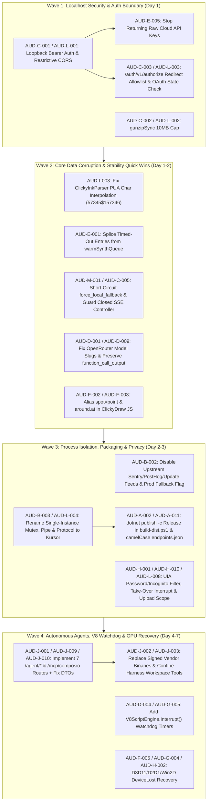

# Kursor Full-Spectrum Audit — Prioritized Remediation Roadmap (`FIX_PLAN.md`)

> **Scope:** Complete, dependency-ordered engineering remediation plan covering all **139 verified findings** (`7` Critical, `44` High, `71` Medium, `17` Low) from [`docs/audit/FINDINGS.md`](file:///C:/dev/heyclicky-clone/docs/audit/FINDINGS.md) and [`docs/audit/findings.json`](file:///C:/dev/heyclicky-clone/docs/audit/findings.json).
> **Release Gate:** All **Tier 1 (High-Impact Quick Wins)** and **Tier 2 (Must-Fix-Before-Release P0/P1 Blockers)** items (**51 Critical/High findings**) must pass automated regression verification via [`tests/audit/run-audit.ps1`](file:///C:/dev/heyclicky-clone/tests/audit/run-audit.ps1) before Kursor can transition from **`NO-GO`** to **`SHIP WITH FIXES`**.

---

## 1. Remediation Summary & Effort Matrix

| Remediation Tier | Description | Finding Count | Effort `S` (< 2h) | Effort `M` (2h–1d) | Effort `L` (1d–5d) | Release Gate Status |
|---|---|---:|---:|---:|---:|---|
| **Tier 1: High-Impact Quick Wins (`P0`/`P1`, Effort `S`)** | Immediate surgical code fixes that eliminate Critical/High crashes, data corruption, and security leaks in under 2 hours each | **17** | 17 | 0 | 0 | **BLOCKING RELEASE** |
| **Tier 2: Must-Fix-Before-Release (`P0`/`P1`, Effort `M`/`L`)** | Structural security boundaries, missing `/agent/*` harness routes, GPU device-loss recovery, and legal/IP binary replacements | **34** | 0 | 33 | 1 | **BLOCKING RELEASE** |
| **Tier 3A: Medium Quick Wins (`P2`, Effort `S`)** | Fast contract, prompt, cleanup, and script hygiene fixes | **64** | 64 | 0 | 0 | Recommended Pre-Release |
| **Tier 3B: Post-P0/P1 Hardening, Rebranding & Polish (`P2`/`P3`)** | Full namespace/path rebrand (`HeyClicky` -> `Kursor`), SQLite compaction, UI polish, and documentation sync | **24** | 14 | 9 | 1 | Post-Blocker / Milestone 2 |
| **Total Across All Tiers** | **100% of Verified Findings (`WS-A`..`WS-N`)** | **139** | **95** | **42** | **2** | — |

---

## 2. Critical-Path Dependency Graph



---

## 3. Tier 1: High-Impact Quick Wins (`Critical` & `High`, Effort `S`)

These **17 findings** are high-severity bugs with small, self-contained code changes (< 2 hours each) that immediately eliminate data corruption, crashes, and security exposures:

| # | ID | WS | Severity | Effort | Dependencies | Target Location(s) | Concrete Fix & Verification |
|---:|---|---|---|---|---|---|---|
| 1 | **`AUD-E-001`** | `WS-E` | **Critical** | `S` | Independent | `src/backend/src/routes/voice.ts:251-311, 385-408` | **Warm Windows SAPI TTS 7000ms Timeout Fails to Evict Queue Entry, Desynchronizing All Subsequent Caller Audio Responses and Spawning Duplicate PowerShell Processes** — 1. Attach a monotonically increasing requestId to every warmSynthQueue item and protocol line (`${id}\t${b64Input}` -> `${id}\t${b64Output}`). 2. In the timeout handler, mark the entry as timedOut = true and remove it from warmSynthQueue if not yet dispatched. 3. In rl.on('line'), match the returned id before resolving; if the id already timed out, discard the line and call pumpWarmSynthQueue(). |
| 2 | **`AUD-L-001`** | `WS-L` | **Critical** | `S` | None (Root Auth/CORS gate) | `src/backend/src/index.ts:19-21; src/backend/src/middleware/auth.ts:34-88; src/backend/src/routes/voice.ts:34-216; src/backend/src/routes/worker.ts:555-605; src/backend/src/routes/agents.ts:910-917` | **Wildcard CORS (`*`) Combined with Zero-Auth Default User Middleware Exposes Master API Keys and User Data to Any Website** — 1) Replace `cors()` in `src/backend/src/index.ts:19` with a strict CORS policy that rejects any request carrying an `Origin` header (or restricts `Origin` to an explicit allowlist) and adds `Vary: Origin`. 2) In `clientHeadersAndAuthMiddleware` (`src/backend/src/middleware/auth.ts:34-88`), require a valid `Authorization: Bearer <token>` or `apikey` header for non-health routes instead of falling back to `DEFAULT_USER_ID` on unauthenticated requests. |
| 3 | **`AUD-C-002`** | `WS-C` | **High** | `S` | `AUD-L-002` | `src/backend/src/middleware/gzip.ts:15-21` | **Unbounded Synchronous gunzipSync in gzipMiddleware Enables Decompression Magnification DoS / OOM** — Check `rawBuffer.byteLength <= MAX_COMPRESSED_BYTES` before decompression and pass `{ maxOutputLength: MAX_UNCOMPRESSED_BYTES }` to `gunzipSync`, returning HTTP 413 when exceeded. |
| 4 | **`AUD-C-003`** | `WS-C` | **High** | `S` | `AUD-L-003` | `src/backend/src/routes/auth.ts:74-121` | **Unvalidated Open Redirect with Minted Access Token on GET /auth/v1/authorize and Unsafe href Scheme in GET /auth/start** — Parse `redirect_to` with `new URL()` and reject any URL whose protocol/hostname is not `http://127.0.0.1`, `http://localhost`, `heyclicky:`, or `kursor:` with HTTP 400 `invalid_redirect_uri`. |
| 5 | **`AUD-C-005`** | `WS-C` | **High** | `S` | `AUD-D-001`, `AUD-M-001` | `src/backend/src/routes/brain.ts:1021-1045` | **POST /brain/turn Unconditionally Calls Live Upstream LLMs Before Checking force_local_fallback** — Change `src/backend/src/routes/brain.ts:1021` to `const upstream = body.force_local_fallback ? null : await tryCallUpstreamLlm(mode, systemPrompt, userText, screenshotBase64, incomingThread, body.tools);`. |
| 6 | **`AUD-C-006`** | `WS-C` | **High** | `S` | Independent | `src/backend/src/test-phase1.ts:155, src/backend/src/routes/voice.ts:263-320` | **Existing Backend Test Suite (npm test) Fails on test-phase1.ts:155 and Hangs Indefinitely Due to Unreferenced PowerShell TTS Child Process** — In `src/backend/src/routes/voice.ts:263-310`, call `warmSynthProc.unref()`, `warmSynthProc.stdin?.unref?.()`, and `warmSynthProc.stdout?.unref?.()`, or spawn lazily. In `src/backend/src/test-phase1.ts:155`, assert against `process.env.MOUTH_PRIMARY_PROVIDER \|\| 'openai-realtime'`. |
| 7 | **`AUD-C-007`** | `WS-C` | **High** | `S` | Independent | `src/backend/src/middleware/auth.ts:44-60, src/backend/src/routes/worker.ts:209-340, src/desktop/Kursor.Core/HeyClicky.Core.Net/ClickyClientHeadersHandler.cs:54-58, src/desktop/Kursor.Core/HeyClicky.Core.Worker/RegisteredDevice.cs:1-51` | **C# Desktop Client Header Names and Device Registration DTOs (POST/GET /me/devices) Mismatch Backend Implementation** — Update `src/backend/src/middleware/auth.ts:44-60` to read `x-clicky-device`, `x-clicky-platform`, and `x-clicky-app-version`, and update `src/backend/src/routes/worker.ts:209-340` to read `body.display_name` and include `id`, `display_name`, `is_this_device`, `model`, `os_version`, `app_build`, and `capabilities` in the response. |
| 8 | **`AUD-C-008`** | `WS-C` | **High** | `S` | Independent | `src/backend/src/routes/worker.ts:407-501, src/desktop/Kursor.Core/HeyClicky.Core.Worker/StarterPlanClicky.cs:1-36, src/desktop/Kursor.Core/HeyClicky.Core.Worker/StarterPlanSuggestion.cs:1-36` | **POST /onboarding/starter-plan Response Schema Mismatches C# StarterPlanClicky and StarterPlanSuggestion DTOs** — Include the full C# DTO property sets in `buildStarterPlanResponse` in `src/backend/src/routes/worker.ts:407-485`. |
| 9 | **`AUD-D-001`** | `WS-D` | **High** | `S` | `AUD-C-005` | `src/backend/src/routes/brain.ts:433, 578-601, 660-668, 691-705, 958-962` | **OpenRouter :free Fallback Array Contains 4 Retired 404 Models, baidu/ernie-5.5-flash-preview:free Is Unreachable Dead Code, ONEBRAIN_MODEL Env Is Ignored, and Vision Eye Failure Skips groq-120b** — 1. Honor `process.env.ONEBRAIN_MODEL` in `defaultModel` (`brain.ts:958-962`) and provider selection (`brain.ts:598-601`). 2. Update the OpenRouter `:free` retry array (`brain.ts:699-705`) to include `"baidu/ernie-5.5-flash-preview:free"` and `"openrouter/free"`, removing retired 404 slugs. 3. Track whether `runGroqVisionEye` was attempted and failed so `groq-qwen-vision` does not make a 3rd identical request to `qwen/qwen3.8-27b`, and allow `groq-120b` to run using `extracted.screenLayout.layoutPromptNote` when vision OCR fails. 4. Forward `payload.tools` when using tool-capable OpenRouter/Groq models. |
| 10 | **`AUD-D-003`** | `WS-D` | **High** | `S` | Independent | `src/backend/src/utils/screenLayout.ts:690-698` | **Greedy Multiline Regex in snapProgramToScreenLayout Case B Wipes Out Subsequent Beats and check() Calls or Leaves Dangling SyntaxErrors** — Replace the regex at `screenLayout.ts:694-697` with a balanced-parenthesis statement matcher that tracks string quotes (`"`, `'`, `` ` ``), escape characters (`\`), and single/multi-line comments before matching the closing `)` and optional `;`. |
| 11 | **`AUD-E-002`** | `WS-E` | **High** | `S` | Independent | `src/desktop/Kursor.Core/HeyClicky.Core.Voice/GeminiTranscriber.cs:26, 356-360, 515; src/desktop/Kursor.Core/HeyClicky.Core.Dictation/DictationController.cs:499-504, 562-571; src/backend/src/routes/voice.ts:53-84, 648-827` | **End-to-End Desktop Dictation Completely Bypasses /v2/dictation/cleanup and Gemini Live Streaming Always Fails due to Constrained Endpoint Token Mismatch** — 1. In DictationController.RunBatchAsync (DictationController.cs:562-571), capture FocusContext before transcribing and pass the raw transcript through await batchClient.CleanUpAsync(text, focusContext, code, ct) before calling DeliverAsync. 2. In GeminiTranscriber.cs, if accessToken starts with 'AIza', connect to BidiGenerateContent?key=<accessToken> instead of BidiGenerateContentConstrained?access_token=. |
| 12 | **`AUD-E-003`** | `WS-E` | **High** | `S` | Independent | `src/backend/src/routes/voice.ts:690, 823-826; src/desktop/Kursor.Core/HeyClicky.Core.Dictation/DictationController.cs:562-571; src/desktop/Kursor.Core/HeyClicky.Core.Voice/CompanionSession.cs:1577-1595` | **/v2/dictation/transcribe and /brain/ears/transcribe Return HTTP 200 with Hardcoded Dummy Text ('Hello from Kursor local dictation transcription.') on Short/Corrupt Audio or Provider Failure** — Replace lines 823-826 of src/backend/src/routes/voice.ts: return HTTP 400 when audioBuffer.byteLength <= 44 or RIFF header is invalid, and return HTTP 503 { text: '', transcript: '', provider: 'none', error: 'All STT providers failed or no API keys configured' } when all providers fail. |
| 13 | **`AUD-E-004`** | `WS-E` | **High** | `S` | Independent | `src/desktop/Kursor.Platform/HeyClicky.Platform.Win32/TextInsertion.cs:86-174, 439-447; src/desktop/Kursor.Platform/HeyClicky.Platform.Win32/DictationTextTarget.cs:473-478; src/desktop/Kursor.Platform/HeyClicky.Platform.Input/ShortcutMonitor.cs:807-831, 878` | **UIPI Silent Failure on Elevated Foreground Windows Causes TextInsertion to Report Success and Overwrite the Clipboard, Permanently Destroying the Dictated Transcript** — 1. In DictationTextTarget.TryInsertCoreAsync (or TextInsertion.PasteTextVerifyingLandingAsync), check ForegroundIntegrity.IsForegroundElevated() and the return count of PInvoke.SendInput. 2. When elevated or when verifyLanding reports 'not_observed', skip RestoreClipboard(snapshot) so the dictated text stays on the clipboard, and surface the clipboard-fallback notification to the user. |
| 14 | **`AUD-E-005`** | `WS-E` | **High** | `S` | `AUD-C-001` / `AUD-L-001` | `src/backend/src/routes/voice.ts:482-518; src/desktop/Kursor.Core/HeyClicky.Core.Dictation/DictationTranscriptionClient.cs:151-185` | **/v2/dictation/cleanup Ignores All C# DictationCleanupContext Fields (single_line, known_terms, app_name, site_host, surrounding text) and Is Vulnerable to Dictated Prompt Injection** — Update voice.ts:482-518 to read all 7 fields from DictationCleanupContext, enforce single_line post-processing (cleaned.replace(/[\r\n]+/g, ' ')), include known_terms in the prompt, wrap rawText in <transcript> tags with explicit non-execution instructions, and fall back to localCleanupHeuristic if the LLM output diverges radically from the input words. |
| 15 | **`AUD-F-003`** | `WS-F` | **High** | `S` | Independent | `src/backend/src/routes/brain.ts:85; src/desktop/Kursor.Drawing/Assets/Engine/clicky-draw-engine.js:706,718-720` | **`ONE_BRAIN_DRAWING_AND_3D_INSTRUCTIONS` in `brain.ts` teaches `around: { count, axis, at }` instead of `around.center`, breaking non-origin circular 3D arrays** — Update `src/backend/src/routes/brain.ts:85` to `around: { count: 10, axis: "x"\|"y"\|"z", center: [0,0,0] }` and accept `around.center \|\| around.at` in `clicky-draw-engine.js:720`. |
| 16 | **`AUD-K-002`** | `WS-K` | **High** | `S` | Independent | `src/desktop/Kursor.App/HeyClicky.App.UI/Pressable.cs:18, 181-242; src/desktop/Kursor.App/HeyClicky.App.UI/PressableAutomationPeer.cs:8-112` | **Universal Pressable Control Lacks Keyboard Focus (IsTabStop) and Enter/Space Key Handling** — In Pressable(bool handCursor = true), set IsTabStop = handCursor; UseSystemFocusVisuals = true; update IsTabStop when Enabled changes; and add a KeyDown handler that invokes RaiseClick() when Enabled && (e.Key == VirtualKey.Enter \|\| e.Key == VirtualKey.Space). |
| 17 | **`AUD-L-004`** | `WS-L` | **High** | `S` | `AUD-B-003` | `start-kursor.ps1:113-138; src/desktop/Kursor.Platform/HeyClicky.Platform.Win32/SingleInstance.cs:37-44; src/desktop/Kursor.Platform/HeyClicky.Platform.Win32/ProtocolRegistration.cs:11-39; src/desktop/Kursor.Core/HeyClicky.Core.Browser/ClickyBrowserBridge.cs:270-298` | **Vendor `HeyClickyApp` Binary Collision on Shared SingleInstance Mutex/MMF, `heyclicky://` Protocol Handler, Native Messaging Host, and Process Check in `start-kursor.ps1`** — 1) In `start-kursor.ps1:113-125`, filter `Get-Process -Name "HeyClicky"` by `.Path`—if any running `HeyClicky` process has `.Path -ne $DesktopExe`, stop that foreign process before launching `$DesktopExe`, and re-run `seed-local-auth.ps1` so the `heyclicky://` registry key points to `$DesktopExe`. 2) In `scripts/install-autostart.ps1`, remove any legacy `HKCU\...\Run\HeyClicky` value pointing to `HeyClickyApp`. |

---

## 4. Tier 2: Must-Fix-Before-Release Blockers (`Critical` & `High`, Effort `M` / `L`)

These **34 findings** require medium-to-large engineering work (2 hours to 5 days) and must be completed before any external release:

| # | ID | WS | Severity | Effort | Dependencies | Target Location(s) | Concrete Fix & Verification |
|---:|---|---|---|---|---|---|---|
| 1 | **`AUD-B-002`** | `WS-B` | **Critical** | `M` | Independent | `` | **Desktop binary bakes in live HeyClicky production Sentry DSN (SendDefaultPii=true), PostHog key, Velopack feed, and api.heyclicky.com / Supabase JWT fallbacks** — Clear `HeyClicky.PostHogApiKey`, `HeyClicky.SentryDsn`, and `HeyClicky.UpdateFeedUrl` in `AssemblyInfo.cs` and `TelemetryConfiguration.cs`; remove `ApplyProductionBackendOverride` and the production Supabase JWT from `AppBundleConfiguration.cs`; change `ClickyInkImages.WorkerBaseUrl` default to `http://127.0.0.1:8787`. |
| 2 | **`AUD-B-005`** | `WS-B` | **Critical** | `M` | Independent | `` | **Repository commits 2,096 ILSpy-decompiled proprietary C# files, redistributes binaries digitally signed by 'Humansongs, Inc', bundles 89.4 MB of proprietary assets, and downloads official HeyClicky releases** — Treat `reference/decompiled/` strictly as non-redistributable specification material, replace `clicky-harness.exe` and `ClickyBrowserHost.exe` with clean-room sidecars, replace proprietary audio/video/sprite/prompt assets, and remove `install-runtime.ps1` downloads of `HeyClickyApp-1.1.5-win-x64-full.nupkg`. |
| 3 | **`AUD-C-001`** | `WS-C` | **Critical** | `M` | None (Root Auth/CORS gate) | `src/backend/src/index.ts:19, src/backend/src/middleware/auth.ts:34-88, src/backend/src/routes/voice.ts:18-31, src/backend/src/routes/voice.ts:53-83, src/backend/src/routes/voice.ts:169-211, src/backend/src/routes/worker.ts:887-965` | **Wildcard CORS + Auto-Authentication Middleware + Raw Master API Key Endpoints Enable Cross-Origin Browser Exfiltration of Cloud API Keys and User Memory** — 1. Remove wildcard `cors()` in `src/backend/src/index.ts:19` or explicitly reject requests bearing browser `Origin` or `Sec-Fetch-Site: cross-site` headers. 2. Enforce real bearer token verification in `src/backend/src/middleware/auth.ts` for all routes except `/health` and `/auth/*`. 3. In `src/backend/src/routes/voice.ts`, mint scoped short-lived tokens (e.g., Deepgram `/v1/keys` with TTL, Gemini `authTokens.create`) and return HTTP 502 instead of falling back to raw master API keys. |
| 4 | **`AUD-J-001`** | `WS-J` | **Critical** | `L` | Independent | `src/desktop/Kursor.Agents/HeyClicky.Agents.Harness/AgentHarnessRunnerRuntime.cs:91-95` | **Autonomous Agents (clicky-harness.exe) Completely Non-Functional Against Local Kursor Backend Due to 7 Missing Worker & MCP Proxy Routes (HTTP 404)** — Implement POST /agent/openai/v1/responses, POST /agent/anthropic/v1/messages, GET/POST /agent/web-search, and POST /mcp/composio in src/backend/src/routes/agents.ts, forwarding streaming Responses/Messages SSE payloads to the configured LLM provider. |
| 5 | **`AUD-M-001`** | `WS-M` | **Critical** | `M` | `AUD-C-005` | `src/backend/src/routes/brain.ts:984-1161` | **`/brain/turn` Client SSE Disconnect Throws Unhandled `ERR_INVALID_STATE: Controller is already closed` Crashing the Backend Process, and `force_local_fallback` Still Awaits Upstream LLM** — 1) Change `src/backend/src/routes/brain.ts:1021` to `const upstream = body.force_local_fallback ? null : await tryCallUpstreamLlm({...}, c.req.raw.signal);`. 2) Pass `c.req.raw.signal` into `tryCallUpstreamLlm`'s `fetch` calls and wrap `controller.enqueue` / `controller.close` in a helper that checks `!c.req.raw.signal.aborted` and catches `ERR_INVALID_STATE`. |
| 6 | **`AUD-A-001`** | `WS-A` | **High** | `M` | Independent | `` | **Clean non-incremental build emits 343 compiler/analyzer warnings (CA2014 stackalloc-in-loop, SYSLIB1032, CS4014) while Directory.Build.props globally suppresses 9 additional warning codes and disables nullable warnings** — Move `stackalloc` out of the loop in `PrecisionTouchpad.cs:221`, mark `JsonSerializerContext` classes `partial` (or remove duplicate decompiled generated members), narrow `<NoWarn>` in `Directory.Build.props` to decompiler-specific noise only, and remove `<AllowUnsafeBlocks>True</AllowUnsafeBlocks>` from `Kursor.Contracts.csproj`. |
| 7 | **`AUD-A-002`** | `WS-A` | **High** | `M` | Independent | `` | **All 7 desktop .csproj files use zero NuGet PackageReferences and bind 32 third-party/framework DLLs via raw local HintPaths** — Replace `<Reference Include="..."><HintPath>$(HeyClickyRuntimeDir)\*.dll</HintPath></Reference>` with explicit NuGet `<PackageReference>` declarations for `Microsoft.WindowsAppSDK`, `Microsoft.ClearScript.V8`, `Vortice.Direct3D11`, `Vortice.Direct2D1`, `Vortice.XAudio2`, `CommunityToolkit.Mvvm`, `Newtonsoft.Json`, `Sentry`, and `Velopack`. |
| 8 | **`AUD-A-003`** | `WS-A` | **High** | `M` | Independent | `` | **scripts/build-dist.ps1 and overlay-and-launch.ps1 package Debug assemblies + PDBs, omit HeyClicky.exe apphost (SHA-256 mismatch), and leave dist/kursor-desktop/*.dll stale after .csproj edits** — Parameterize `[string]$Configuration = 'Release'` in `scripts/build-dist.ps1`, include the apphost `.exe` in the staged artifact list, and exclude `.pdb` files from portable release bundles. |
| 9 | **`AUD-A-007`** | `WS-A` | **High** | `M` | Independent | `` | **start-kursor.ps1 -Restart leaves backend node.exe and sidecars running, fails silently when port 8787 is occupied by a non-Kursor service, and breaks on paths with single quotes** — In `start-kursor.ps1`, when `-Restart` is set, stop `HeyClicky`, `clicky-harness`, `ClickyBrowserHost`, and any process listening on TCP port `8787` (`Get-NetTCPConnection -LocalPort 8787`), use `-WorkingDirectory $BackendDir` instead of string-interpolated `Set-Location '$BackendDir'`, and poll `Test-BackendRunning` after spawning. |
| 10 | **`AUD-A-008`** | `WS-A` | **High** | `M` | Independent | `` | **Triple Windows autostart collision across install-autostart.ps1, Startup folder shortcut, and in-app LaunchAtLogin.cs, plus incomplete uninstall-autostart.ps1 cleanup** — Remove the redundant `Startup\Kursor.lnk` creation from `scripts/install-autostart.ps1`, update `LaunchAtLogin.cs` to manage the `Kursor` Run value pointing to `start-kursor-hidden.vbs`, and update `scripts/uninstall-autostart.ps1` to also clean up `Run\HeyClicky` and `Desktop\Kursor.lnk`. |
| 11 | **`AUD-A-011`** | `WS-A` | **High** | `M` | `AUD-L-005` | `` | **LocalAppData\HeyClicky\endpoints.json on disk contains only PascalCase keys (ignored by case-sensitive AppBundleConfiguration.LoadConfigured), causing entry-assembly metadata fallback to production Supabase when HEYCLICKY_WORKER_BASE_URL is only a worker override** — In AppBundleConfiguration.ReadConfigured (lines 147-159), match property names case-insensitively (`foreach (var prop in root.EnumerateObject()) if (string.Equals(prop.Name, name, StringComparison.OrdinalIgnoreCase)) ...`), and support HEYCLICKY_SUPABASE_URL / HEYCLICKY_SUPABASE_ANON_KEY environment overrides. |
| 12 | **`AUD-B-001`** | `WS-B` | **High** | `M` | Independent | `` | **All 7 desktop .csproj projects still compile as HeyClicky*.dll / HeyClicky.exe and stamp HeyClicky PE AssemblyInfo metadata** — Update `src/desktop/Kursor.App/Properties/AssemblyInfo.cs` to stamp `Kursor` metadata and remove `Sentry.ProjectDirectory`. |
| 13 | **`AUD-B-003`** | `WS-B` | **High** | `M` | `AUD-L-004`, `AUD-L-007` | `` | **SingleInstance.cs collides on Local\HeyClicky-<SID> mutex/pipe and kills HeyClicky.exe processes, while ProtocolRegistration and FileOpenRegistration hijack heyclicky://, clicky://, and HeyClicky.Document** — Change `appId` default in `SingleInstance.cs` to `"Kursor"`, add `"kursor"` to `ProtocolRegistration.cs` and `seed-local-auth.ps1`, and rename `HeyClicky.Document` in `FileOpenRegistration.cs` to `Kursor.Document`. |
| 14 | **`AUD-B-006`** | `WS-B` | **High** | `M` | Independent | `` | **start-kursor.ps1 automatically launches proprietary executable-file\HeyClicky-Setup.exe (Humansongs, Inc Velopack installer) if dist\kursor-desktop\HeyClicky.exe is missing** — Remove the `$InstallerExe` (`executable-file\HeyClicky-Setup.exe`) fallback at `start-kursor.ps1:126,132-135` and surface build failures directly. |
| 15 | **`AUD-C-004`** | `WS-C` | **High** | `M` | `AUD-C-001` / `AUD-L-001` | `src/backend/src/routes/auth.ts:27-39, src/backend/src/routes/auth.ts:236-248, src/backend/src/middleware/auth.ts:34-88` | **Fake Static JWT Signature ('kursor-local-dev-signature'), Zero Token Verification, and Ineffective Session Logout** — Generate and persist a 256-bit random HMAC secret on first boot, sign JWTs with `crypto.createHmac('sha256', secret)`, and validate the signature, `exp`, and `sessions` table lookup in `clientHeadersAndAuthMiddleware`. |
| 16 | **`AUD-D-002`** | `WS-D` | **High** | `M` | Independent | `src/backend/src/utils/screenLayout.ts:68-82, 144-482, 492-510` | **Synchronous Pure-JS JPEG Decode and Full-Resolution Pixel Scanning in analyzeScreenLayout Blocks Node.js Event Loop for 0.42s to 6.94s Per Turn** — 1. Parse the JPEG SOF0/SOF2 header dimensions and reject/skip layout analysis if `buf.length > 4 * 1024 * 1024` or `width * height > 2560 * 1440`, and pass `{ useTArray: true, maxResolutionInMP: 4, maxMemoryUsageInMB: 32 }` to `jpeg.decode`. 2. Move `analyzeScreenLayout` inside the `ReadableStream.start` callback *after* flushing `meta` and `status` SSE events, or offload pixel scanning to a `node:worker_threads` worker. |
| 17 | **`AUD-D-004`** | `WS-D` | **High** | `M` | `AUD-G-005` | `src/desktop/Kursor.Drawing/HeyClicky.Drawing.Engine/NativeEngine.cs:141-148, 249-289, 347-350, 617-649; src/desktop/Kursor.Drawing/HeyClicky.Drawing/DrawingThread.cs:204-220; src/desktop/Kursor.Drawing3D/HeyClicky.Drawing3D/ClickyThreeKernel.cs:288-355` | **Zero Execution Watchdog or V8 Interrupt on NativeEngine.Feed, RenderWhole, Evaluate, RunFigureTicks, and ClickyThreeKernel.Build Allows Infinite Loops to Permanently Freeze DrawingThread** — 1. In `NativeEngine.cs`, wrap every `v8.Invoke` / `v8.Evaluate` / `v8.Execute` call in a watchdog helper that schedules a timer (e.g. `CancellationTokenSource(TimeSpan.FromMilliseconds(budgetMs))` registering `() => v8?.Interrupt()`) and catches `ScriptInterruptedException`. 2. Pass `budgetMs: 200` to `ClickyDraw.live(...)` in `clicky-draw-native.js:650`. 3. Add a timeout parameter to `DrawingThread.Invoke` (`done.Wait(timeoutMs)`). 4. Configure `V8RuntimeConstraints { MaxOldSpaceSize = 128, MaxNewSpaceSize = 32 }` and a 500ms `v8.Interrupt()` watchdog in `ClickyThreeKernel.cs:290`. |
| 18 | **`AUD-D-005`** | `WS-D` | **High** | `M` | Independent | `src/desktop/Kursor.Drawing/HeyClicky.Drawing.Engine/NativeEngine.cs:150, 296-306, 859-887; src/desktop/Kursor.Drawing/HeyClicky.Drawing.Engine/HostBridge.cs:12-127; src/desktop/Kursor.Drawing/Assets/Engine/clicky-draw-native.js:9-21, 128-167; src/desktop/Kursor.Drawing/Assets/Engine/clicky-draw-engine.js:1057, 1089` | **Unrestricted V8 Global Scope Access to __hostRaw (HostBridge), Unbounded setTimeout/setInterval Floods, and Persistent Prototype/Global Pollution Across Turns** — 1. Wrap `clicky-draw-native.js` in an IIFE that captures `const hostRaw = globalThis.__hostRaw; delete globalThis.__hostRaw; delete globalThis.__host;` during engine bootstrap, and freeze `Object.prototype` and the `__feed`/`__drainRender` entry points with `Object.defineProperty(..., { writable: false, configurable: false })`. 2. Cap active timers in `NativeEngine.ScheduleTimer` (e.g. max 64 concurrent timers, min delay 16ms) and cancel all remaining `timerTokens` inside `NativeEngine.Clear()`. 3. Add a lightweight AST/regex guard in `brain.ts` rejecting `__host`, `__hostRaw`, `Object.prototype`, `while(true)`, and `for(;;)`. |
| 19 | **`AUD-D-009`** | `WS-D` | **High** | `M` | Independent | `src/backend/src/routes/brain.ts:272-356, 512-556; src/desktop/Kursor.Core/HeyClicky.Core.Brain/BrainSession.cs:463, 572, 616, 658-677, 732-750` | **POST /brain/turn Drops All function_call, function_call_output, and developer Context Items From Thread History, Breaking Multi-Round Tool Execution** — In `src/backend/src/routes/brain.ts:512-556`, map `item.type === "function_call"` and `item.type === "function_call_output"` (and `item.role === "developer"` notes) into `messages` instead of filtering solely for `user`/`assistant` `message` items. |
| 20 | **`AUD-F-005`** | `WS-F` | **High** | `M` | Independent | `src/desktop/Kursor.Drawing/HeyClicky.Drawing/SystemComposition.cs:99-188; src/desktop/Kursor.Drawing/HeyClicky.Drawing.Painter/ScreenPainter.cs:402-460; src/desktop/Kursor.Drawing/HeyClicky.Drawing.Painter/StageSwapChain.cs:147-159; src/desktop/Kursor.Drawing/HeyClicky.Drawing.Overlay/LiveCaption.cs:83,310; src/desktop/Kursor.Drawing/HeyClicky.Drawing.Overlay/PinnedCards.cs:455` | **No `DXGI_ERROR_DEVICE_REMOVED` / `DeviceLost` recovery across `ScreenPainter`, `SystemComposition`, `LiveCaption`, `PinnedCards`, `CardHandles`, or `StageSwapChain`** — Handle `DXGI_ERROR_DEVICE_REMOVED`, `DXGI_ERROR_DEVICE_RESET`, and `D2DERR_RECREATE_TARGET` in `SystemComposition.CopyInto` and `StageSwapChain.Present`, and recreate `CompositionGraphicsDevice` / Win2D resources when `CanvasDevice.GetSharedDevice()` reports device loss. |
| 21 | **`AUD-G-005`** (`NEW-FG-001`) | `WS-F` | **High** | `M` | `AUD-D-004` | `src/desktop/Kursor.Drawing/HeyClicky.Drawing.Engine/NativeEngine.cs:145-174,280-291` | **In-Process ClearScript V8 NativeEngine Runs LLM-Generated JavaScript Synchronously on DrawingThread Without the Web Worker Sandbox or Any Execution Timeout / Interrupt() Watchdog** — Arm a lightweight System.Threading.Timer around NativeEngine.Invoke calls that invokes engine.Interrupt() after 1500 ms (initial script execution) or 100 ms (per-frame tick), catch ScriptInterruptedException, and reset the scene. |
| 22 | **`AUD-H-001`** | `WS-H` | **High** | `M` | Independent | `src/desktop/Kursor.Platform/HeyClicky.Platform.Win32/UiaPageText.cs:11-57` | **Unfiltered UIA DOM & Browser URL Scraping of Incognito/InPrivate, Password Managers, and Password Fields** — Check UIA_IsPasswordPropertyId (30009) in UiaPageText.Walk before reading ValuePattern/LegacyIAccessible.Value; skip or redact windows whose title matches Incognito / InPrivate / Private Browsing or whose process belongs to a blocklist of password managers (1Password, Bitwarden, KeePassXC, Dashlane). |
| 23 | **`AUD-H-002`** | `WS-H` | **High** | `M` | Independent | `src/desktop/Kursor.Platform/HeyClicky.Platform.Overlay/OverlayHost.cs:109-121` | **OverlayHost Has Zero GPU Device-Loss Recovery (DXGI_ERROR_DEVICE_REMOVED / DXGI_ERROR_DEVICE_RESET)** — Catch COMException for DXGI_ERROR_DEVICE_REMOVED / DXGI_ERROR_DEVICE_RESET / D2DERR_RECREATE_TARGET inside RunLoop, tear down and recreate the D3D11Device, DXGIDevice, D2D1Device, and IDCompositionDesktopDevice, and notify registered IOverlayLayer instances to recreate device-dependent surfaces. |
| 24 | **`AUD-H-010`** | `WS-H` | **High** | `M` | Independent | `src/desktop/Kursor.App/HeyClicky.App.Drive/ClickyTakeOverController.cs:402-732` | **ClickyTakeOverController Ignores User Mouse/Keyboard Take-Back During Active Actuation and Bypasses Consent via recent_yes / PTT** — Since ClickyTakeBackWatch already filters out synthetic events via ExtraInfo == 1296124995, do not ignore OnUserMovedMouse during actuation; cancel the active CancellationTokenSource immediately when physical user mouse movement, clicks, or keystrokes are detected. Require explicit affirmative consent per task rather than auto-approving on any PTT speech or a 10-minute recent_yes window. |
| 25 | **`AUD-I-001`** | `WS-I` | **High** | `M` | Independent | `src/desktop/Kursor.Core/HeyClicky.Core.Platform/WindowsDesktopActions.cs:16-95` | **WindowsDesktopActions.TypeIntoFocusedFieldAsync Injects Keystrokes and Enter Without User Confirmation or Password/Terminal Guards** — Block or require explicit user confirmation before executing typeText (especially when pressEnter == true or when the focused process is a terminal/shell), tag synthetic inputs with ClickySyntheticExtraInfo, and reuse TextInsertion.PasteTextAsync instead of raw Clipboard.Clear(). |
| 26 | **`AUD-I-003`** | `WS-I` | **High** | `M` | Independent | `src/desktop/Kursor.Core/HeyClicky.Core.Ink/ClickyInkParser.cs:20-29` | **ClickyInkParser.EmphasisMarks and MarkingFirstLink Corrupt Every **Bold**, ==Highlight==, and [Link](url) Span Into Literal Integer Digits** — Replace the integer literals in ClickyInkParser.EmphasisMarks (lines 1593-1594) and MarkingFirstLink (line 1619) with the char constants BoldOn/BoldOff ('\ue001'/'\ue002'), HighlightOn/HighlightOff ('\ue003'/'\ue004'), and LinkOn/LinkOff ('\ue005'/'\ue006'). |
| 27 | **`AUD-J-002`** | `WS-J` | **High** | `M` | `AUD-J-001` | `src/desktop/Kursor.Agents/HeyClicky.Agents.Harness/AgentHarnessRuntimes.cs:14-28; src/desktop/Kursor.Agents/HeyClicky.Agents.Harness/AgentHarnessNames.cs:14-68; dist/kursor-desktop/HarnessRuntime/clicky-harness.exe (agents-harness-drivers.txt:139, 186)` | **Unregistered Harness Drivers (pi-mac, h1-cloud, codex-cloud) and Hardcoded /usr/bin/tar in clicky-harness.exe Cause Immediate HTTP 500 Failures** — Restrict AgentHarness / AgentHarnessPlace options in Kursor.Agents to supported local drivers ('h1-mac' and local Codex), or implement the missing drivers in an open-source replacement harness runner and replace '/usr/bin/tar' with 'tar.exe'. |
| 28 | **`AUD-J-003`** | `WS-J` | **High** | `M` | Independent | `src/desktop/Kursor.Agents/HeyClicky.Agents.Runtime/CodexHomeManager.cs:96-97` | **Unrestricted PowerShell (bash Tool) and Filesystem Write Access Outside Job Workspace Without Sandbox or User Approval** — Enforce canonical path prefix validation against the job workspace directory for write/edit tools and gate PowerShell command execution or out-of-workspace writes behind a user approval prompt (similar to TakeOverConsentCard / UploadApprovalCard). |
| 29 | **`AUD-J-009`** | `WS-J` | **High** | `M` | `AUD-J-001` | `src/desktop/Kursor.Agents/HeyClicky.Agents.Backend/AgentIntegration.cs:64-83` | **Complete C#-to-Backend DTO schema mismatch across GET /agent/integrations, POST /agent/integrations/:toolkit/connect, and POST /agent/composio/session breaks all agent integrations and Composio MCP session setup** — Align GET /agent/integrations, POST /agent/integrations/:toolkit/connect, and POST /agent/composio/session in src/backend/src/routes/agents.ts with AgentIntegration.Parse and AgentWorkerApi. |
| 30 | **`AUD-J-010`** | `WS-J` | **High** | `M` | `AUD-J-001` | `src/desktop/Kursor.Agents/HeyClicky.Agents.Backend/AgentWorkerApi.cs:78-96` | **POST /agent/session-token returns expires_at as an ISO string instead of numeric Unix seconds and omits capabilities.developer_model_selection, permanently defeating AgentSessionTokenProvider caching (NeedsRefresh == true) and locking all turns to AgentHarnessModel.Standard** — In src/backend/src/routes/agents.ts:911-922, return a single token value, numeric expires_at: Math.floor(Date.now() / 1000) + 3600, and capabilities: { developer_model_selection: true }. |
| 31 | **`AUD-L-002`** | `WS-L` | **High** | `M` | `AUD-C-002` | `src/backend/src/middleware/gzip.ts:12-35` | **Unbounded Synchronous `gunzipSync` in `gzipMiddleware` Enables Local/Cross-Origin Decompression Bomb DoS** — Enforce a maximum compressed size check before buffering and pass `{ maxOutputLength: 20 * 1024 * 1024 }` to `zlib.gunzip` (async) inside `src/backend/src/middleware/gzip.ts:16-22`, returning HTTP `413` on `ERR_BUFFER_TOO_LARGE`. |
| 32 | **`AUD-L-003`** | `WS-L` | **High** | `M` | `AUD-C-003` | `src/backend/src/routes/auth.ts:100-126; src/desktop/Kursor.Core/HeyClicky.Core.Auth/SignInCallbackGuard.cs:54-83; src/desktop/Kursor.Core/HeyClicky.Core.Auth/SupabaseAuthService.cs:204-281` | **Open Redirect with Session Tokens on `GET /auth/v1/authorize` and Unconditional CSRF State Bypass in `SignInCallbackGuard`** — 1) Restrict `redirect_to` / `redirect_uri` in `src/backend/src/routes/auth.ts:102-121` to `heyclicky:` or loopback (`127.0.0.1` / `localhost`). 2) In `SignInCallbackGuard.cs:60-78`, verify `pendingState` == `callbackState` whenever `pendingState` is non-empty, or require an active sign-in flow before accepting `heyclicky://auth-callback` links. |
| 33 | **`AUD-L-008`** (`NEW-LM-001`) | `WS-L` | **High** | `M` | Independent | `src/desktop/Kursor.Core/HeyClicky.Core.Browser/ClickyBrowserBridge.cs:1088,1173-1300` | **ClickyBrowserBridge Turn-Wide uploadAnswers[task] Cache Allows Bait-and-Switch File & Site Exfiltration After Single Approval, Strips Directory Paths from Approval Cards, and BrowserUploads.IsSecretFileName Misses .db/.sqlite/.pfx/.kdbx Files** — Key uploadAnswers by (task, normalizedSite, canonicalFilePathSet) in ClickyBrowserBridge.cs:1173-1299, verify every PlannedUpload.Site matches the approved site, change customApprove?.Invoke(title) ?? true to ?? false at line 1088, and expand BrowserUploads.IsSecretFileName to reject .db, .sqlite, .wal, .pfx, .p12, .kdbx, .rdp, .ovpn, id_rsa, and id_ed25519. |
| 34 | **`AUD-N-001`** | `WS-N` | **High** | `M` | Independent | `` | **README.md documents non-existent ONEBRAIN_MODEL (actual: KURSOR_BRAIN_MODEL), .env.example omits KURSOR_BRAIN_MODEL, and 6 env vars in .env.example are dead no-ops in backend code** — Support `process.env.KURSOR_BRAIN_MODEL \|\| process.env.ONEBRAIN_MODEL \|\| process.env.OPENROUTER_DEFAULT_MODEL` in `brain.ts`, document `KURSOR_BRAIN_MODEL` in `README.md` and `.env.example`, wire `KURSOR_DEV_BYPASS_AUTH` into `middleware/auth.ts`, and remove or implement the remaining unused keys in `.env.example`. |

---

## 5. Tier 3A: Medium-Severity Quick Wins (`Medium`, Effort `S`)

These **64 findings** are fast, low-risk fixes (< 2 hours each) across prompts, DTOs, scripts, and UI components:

| # | ID | WS | Severity | Effort | Dependencies | Target Location(s) | Concrete Fix & Verification |
|---:|---|---|---|---|---|---|---|
| 1 | **`AUD-A-004`** | `WS-A` | **Medium** | `S` | Independent | `` | **scripts/build-dist.ps1 and overlay-and-launch.ps1 reference non-existent src/desktop/Kursor.Drawing3D/Assets/Engine directory, and clicky-draw-pieces.js is out of sync with %LOCALAPPDATA%\HeyClickyApp\current** — Align the physical location of `clicky-three.js` and `clicky-three-parts.js` with `Kursor.Drawing3D.csproj` and `scripts/build-dist.ps1`. |
| 2 | **`AUD-A-005`** | `WS-A` | **Medium** | `S` | `AUD-B-003` | `` | **Moderate vulnerability in @hono/node-server@1.19.19 (GHSA-rmxm-3fg6-px4f) and unverified Node.js engine version mismatch (>=24.0.0 vs v22+)** — Upgrade `@hono/node-server` to `^2.1.3` in `src/backend/package.json`, and parse `[int](($nodeVer -replace '^v','').Split('.')[0]) -ge 22` (or `24`) in `setup-kursor.ps1`. |
| 3 | **`AUD-A-006`** | `WS-A` | **Medium** | `S` | Independent | `` | **Hardcoded developer filesystem paths in src/backend/src/routes/worker.ts (C:\Users\ubaid\...) and desktop C# files (C:\Users\niles\...)** — Replace `LOCAL_APP_CONFIG_PATH` in `worker.ts:7-8` with `path.join(process.env.LOCALAPPDATA \|\| path.join(os.homedir(), 'AppData', 'Local'), 'HeyClicky', 'app-config.json')`, and remove `C:\Users\niles\...` from `AssemblyInfo.cs` and `AgentHarnessRunnerProcess.cs`. |
| 4 | **`AUD-A-009`** | `WS-A` | **Medium** | `S` | Independent | `` | **Split %LOCALAPPDATA%\HeyClicky vs %LOCALAPPDATA%\Kursor state between setup scripts and AppPaths.cs** — Update `AppPaths.cs:12` to default to `%LOCALAPPDATA%\Kursor` (with one-time migration from `%LOCALAPPDATA%\HeyClicky` if needed) or stop creating the unused `%LOCALAPPDATA%\Kursor` directory in `setup-kursor.ps1` and `seed-local-auth.ps1`. |
| 5 | **`AUD-A-010`** | `WS-A` | **Medium** | `S` | Independent | `` | **Missing LICENSE / THIRD_PARTY_NOTICES, unanchored [Rr]elease/ and [Dd]ebug/ rules in .gitignore, and non-resilient scripts/package-portable.ps1** — Add `LICENSE` and `THIRD_PARTY_NOTICES.md`, anchor `.gitignore` build output rules, and add a pre-flight check in `scripts/package-portable.ps1` verifying `dist/kursor-desktop/HeyClicky.exe` exists. |
| 6 | **`AUD-A-012`** | `WS-A` | **Medium** | `S` | Independent | `` | **scripts/package-portable.ps1 and scripts/build-dist.ps1 leave non-zero robocopy $LASTEXITCODE (1-7), and package-portable.ps1 bundles docs/audit/ and unusable build-dist.ps1 without src/desktop** — Validate robocopy exit codes (`< 8`) and reset `$global:LASTEXITCODE = 0` in `scripts/build-dist.ps1` and `scripts/package-portable.ps1`, and exclude source-only build scripts and `docs/audit/` from the portable zip. |
| 7 | **`AUD-B-004`** | `WS-B` | **Medium** | `S` | Independent | `` | **4,712 'HeyClicky' and 19,632 'Clicky' references remain across desktop UI dialogs, tray window class, agent system prompts, and backend /app-config links** — Replace remaining `HeyClicky` / `hi@heyclicky.com` strings in `App.cs`, `SingleInstance.cs`, `BillingUi.cs`, `SettingsContent.cs`, `TrayIcon.cs`, `TrayTooltip.cs`, `CodexHomeManager.cs`, and `src/backend/src/routes/worker.ts`. |
| 8 | **`AUD-C-009`** | `WS-C` | **Medium** | `S` | Independent | `src/backend/src/routes/worker.ts:7-38` | **Hardcoded Developer Machine Path C:\Users\ubaid\AppData\Local\HeyClicky\app-config.json in worker.ts** — Replace the hardcoded string at `src/backend/src/routes/worker.ts:8` with dynamic path resolution using `process.env.LOCALAPPDATA` and `os.homedir()`. |
| 9 | **`AUD-C-010`** | `WS-C` | **Medium** | `S` | Independent | `src/backend/src/db/index.ts:30-114, src/backend/src/routes/auth.ts:198-207, src/backend/src/routes/brain.ts:155-189` | **SQLite Schema Lacks Secondary Indexes, Never Prunes Expired Sessions, and Bloats threads.messages_json With Raw Base64 Screenshots** — Add `CREATE INDEX IF NOT EXISTS` statements in `src/backend/src/db/index.ts`, strip `image_url` base64 blobs in `ensureSessionAndThread` (`src/backend/src/routes/brain.ts:169`), and delete expired sessions (`DELETE FROM sessions WHERE expires_at > 0 AND expires_at < unixepoch()`). |
| 10 | **`AUD-C-014`** | `WS-C` | **Medium** | `S` | Independent | `src/backend/src/routes/worker.ts:571-582, src/backend/src/routes/worker.ts:610-655, src/backend/src/routes/worker.ts:753-768` | **Fragile Regex HTML Scraping in /search/web and HTML Tag Stripping Before Entity Decoding in decodeHtmlEntities** — In `decodeHtmlEntities` (`worker.ts:571-582`), decode entities first and strip `<[^>]+>` tags last (or keep `<`/`>` escaped). |
| 11 | **`AUD-C-017`** | `WS-C` | **Medium** | `S` | Independent | `src/backend/src/routes/agents.ts:85, 104-107, 156-175` | **nextSuggestionNumericId Resets to 101 on Backend Restart and Overwrites/Un-Dismisses Existing proactive_cards Rows in SQLite** — Seed nextSuggestionNumericId from the SQLite proactive_cards table on startup in src/backend/src/routes/agents.ts:85. |
| 12 | **`AUD-C-018`** | `WS-C` | **Medium** | `S` | Independent | `src/backend/src/routes/auth.ts:107-121, 131-175` | **GET /auth/v1/authorize and GET /auth/start Mint Access Tokens Without Inserting Session Rows Into SQLite sessions Table** — Insert a sessions row in handleAuthorize (auth.ts:107) and handleAuthStart (auth.ts:131) using the same INSERT INTO sessions statement used in handleToken (auth.ts:198-207). |
| 13 | **`AUD-D-010`** | `WS-D` | **Medium** | `S` | Independent | `src/desktop/Kursor.Core/HeyClicky.Core.Brain/BrainReplyAccumulator.cs:228-250; src/desktop/Kursor.Core/HeyClicky.Core.Brain/ProgramText.cs:125-213` | **BrainReplyAccumulator Compares Unstripped lastReportedCode.Length Against URL-Stripped text3.Length in Finish(), Dropping Final Code Updates When Links Are Stripped** — In `BrainReplyAccumulator.ReportCodeIfItGrew` (`line 246`), set `string stripped = ProgramText.WithoutLinks(text);` and compare/store `stripped` in `lastReportedCode`, and in `Finish()` (`line 231`) check `if (text3.Length > 0 && text3 != lastReportedCode)`. |
| 14 | **`AUD-D-011`** | `WS-D` | **Medium** | `S` | Independent | `src/backend/src/routes/brain.ts:36-41, 249, 682; src/desktop/Kursor.Core/HeyClicky.Core.Brain/BrainReplyAccumulator.cs:37, 58, 215-226` | **POST /brain/turn Always Wraps Output in Fenced ```js Blocks, Defeating BrainReplyAccumulator.SpeechOnly Mode** — Populate `Reply.SpokenSentence` in `BrainReplyAccumulator.Finish()` via `SayLines.InOrder(Reply.Code)` when `SpeechOnly` is true and `text` contains code fences. |
| 15 | **`AUD-E-006`** | `WS-E` | **Medium** | `S` | Independent | `src/desktop/Kursor.Core/HeyClicky.Core.Dictation/DictationController.cs:612, 667-688, 956-963; src/desktop/Kursor.Platform/HeyClicky.Platform.Win32/TextInsertion.cs:176-179, 270-275` | **Dictating While Focused on a Password Field (IsSecure) Archives Plaintext to Disk and Copies It to Non-Transient Clipboard (Exposed to Windows Clipboard History & Cloud Sync)** — 1. In DictationController.DeliverAsync, guard ArchiveTranscript with if (!focus.IsSecure). 2. In TextInsertion.CopyTextAsync (or when copying on RefusedUnsafeTarget), pass markTransient: true so clipboard history and cloud sync exclude the content. |
| 16 | **`AUD-E-007`** | `WS-E` | **Medium** | `S` | Independent | `src/backend/src/routes/voice.ts:459-480` | **localCleanupHeuristic Corrupts URLs, Code/CLI Identifiers, Emoji Endings, and Returns Raw Filler Words When Utterance Is 100% Disfluencies** — In localCleanupHeuristic (voice.ts:459-480): return '' when cleaned is empty after filler removal; collapse /(,\s*){2,}/g to ', '; and guard first-letter capitalization and trailing period insertion against URLs (/^https?:\/\//i), code/CLI tokens, and emoji endings. |
| 17 | **`AUD-E-008`** | `WS-E` | **Medium** | `S` | Independent | `src/desktop/Kursor.Platform/HeyClicky.Platform.Input/ShortcutMonitor.cs:367-384, 429-437, 646-656` | **ShortcutMonitor Lacks Non-Modifier Chord Cancellation for PushToTalk (Ctrl+Alt), Leaving Microphone Hot During IDE/Windows Shortcuts and Ctrl+LeftAlt International Keystrokes** — In ShortcutMonitor.ProcessKeyboardEvent (lines 429-437), add pttChordCanceledByOtherKey and enqueue ShortcutAction.PushToTalkUp (or a dedicated PushToTalkCancel action) whenever a non-modifier key is pressed during a modifier-only PushToTalk hold. |
| 18 | **`AUD-E-009`** | `WS-E` | **Medium** | `S` | Independent | `src/backend/src/routes/voice.ts:232-285, 314-320` | **Warm PowerShell TTS Daemon (warmSynthProc) Is Spawned at Module Import Time with No Process Exit or Signal Cleanup Handlers** — Add process exit/SIGINT/SIGTERM cleanup hooks for warmSynthProc and drain/resolve pending warmSynthQueue entries inside proc.on('exit'). |
| 19 | **`AUD-E-010`** | `WS-E` | **Medium** | `S` | Independent | `src/desktop/Kursor.Core/HeyClicky.Core.Dictation/DictationCorrectionDetector.cs:47-60, 70-109; src/desktop/Kursor.Core/HeyClicky.Core.Dictation/DictationVocabulary.cs:60-93` | **DictationCorrectionDetector Auto-Learns Ordinary Sentence-Initial Capitalized Words and Sensitive Tokens Due to char.IsUpper(word[0]) and NormalizedSimilarity >= 0.3** — In DictationCorrectionDetector.cs: pass word position to IsDistinctiveLearnableWord so index-0 capitalization alone does not qualify; raise NormalizedSimilarity threshold to 0.60; and filter out secret/API-key patterns. |
| 20 | **`AUD-E-012`** | `WS-E` | **Medium** | `S` | Independent | `src/backend/src/routes/voice.ts:18-84, 146-197, 519-639, 700-708; src/desktop/Kursor.Core/HeyClicky.Core.Voice/RealtimeMouth.cs:345-378` | **STT/TTS Configuration & Language Code Mismatches: EARS_PRIMARY_PROVIDER Ignored, 3-Letter ISO Codes Dropped by Groq Whisper, and Invalid OPENAI_API_KEY Breaks RealtimeMouth Local Fallback** — In voice.ts:197, return 'ek_kursor_local_realtime_secret' whenever minting an OpenAI ephemeral realtime session fails; read EARS_PRIMARY_PROVIDER and DICTATION_CLEANUP_PROVIDER from process.env; include keyterms/language in /v2/dictation/gemini-token; and support 3-letter language mappings in handleTranscribe. |
| 21 | **`AUD-E-013`** | `WS-E` | **Medium** | `S` | Independent | `src/desktop/Kursor.Core/HeyClicky.Core.Dictation/DictationController.cs:359-430` | **DictationController.SetUpSessionAsync drops UIA context keyterms (BeforeText/SelectedText/AfterText) on cold starts for DictationTranscriptionClient and on warm starts for GeminiTranscriber** — Set newClient.KnownTerms = list unconditionally outside the 'if (adopted != null)' branch in SetUpSessionAsync. |
| 22 | **`AUD-E-014`** | `WS-E` | **Medium** | `S` | Independent | `src/desktop/Kursor.Core/HeyClicky.Core.Voice/GeminiTranscriber.cs:240-267,587-597,742-754` | **GeminiTranscriber.FinishAsync sets finishSent = true before queued audio finishes uploading, causing intermediate inputTranscription events to truncate utterances** — Gate early resolution of delivered in HandleMessage (line 750) on activityEndSent.Task.IsCompleted rather than finishSent. |
| 23 | **`AUD-F-001`** | `WS-F` | **Medium** | `S` | Independent | `README.md:20-21; docs/04-drawing-2d-3d-and-ink-engine.md:31,35; src/desktop/Kursor.Drawing/Assets/Engine/clicky-draw-pieces.js:457-460` | **README.md and docs/04 claim nonexistent `writeOnPage` / `callout` / `brace` / `table` / `chart` primitives and misdescribe `openPage` as a study-card builder** — Update `README.md:20-21` and `docs/04-drawing-2d-3d-and-ink-engine.md:31,35` to document the actual card primitives (`paper`, `sticky`, `receipt`, `clipping`, `legend`) and graph/timeline APIs (`graph`, `timeline`), and remove nonexistent primitive names. |
| 24 | **`AUD-F-002`** | `WS-F` | **Medium** | `S` | Independent | `src/desktop/Kursor.Drawing/Assets/Engine/clicky-draw-pieces.js:180; src/backend/src/routes/brain.ts:911-914; docs/04-drawing-2d-3d-and-ink-engine.md:29,31,181` | **`spot()` primitive is missing from `clicky-draw-pieces.js` despite being documented in `docs/04` and polyfilled in `brain.ts` fallback** — Add `const spot = point` in `src/desktop/Kursor.Drawing/Assets/Engine/clicky-draw-pieces.js` right after `const point = ...` (line 184). |
| 25 | **`AUD-F-004`** | `WS-F` | **Medium** | `S` | Independent | `src/backend/src/routes/brain.ts:88; src/desktop/Kursor.Drawing/Assets/Engine/clicky-draw-engine.js:561-562,635-641; src/desktop/Kursor.Drawing3D/HeyClicky.Drawing3D/Material3D.cs:85-211` | **`ONE_BRAIN_DRAWING_AND_3D_INSTRUCTIONS` in `brain.ts` teaches unsupported 3D material names `"cast"` and `"carbon"`** — Replace `"cast"` and `"carbon"` with `"iron"` and `"black"` in `src/backend/src/routes/brain.ts:88`, or add `"cast"` and `"carbon"` aliases to `FIGURE_MATERIALS` (`clicky-draw-engine.js:561`) and `Material3D.Studio` (`Material3D.cs:85`). |
| 26 | **`AUD-F-006`** | `WS-F` | **Medium** | `S` | Independent | `src/desktop/Kursor.Drawing/HeyClicky.Drawing.Overlay/OverlayWindow.cs:220-226,338-407,462-466` | **`OverlayWindow` ignores `WM_DPICHANGED` (`0x02E0`) and `MoveTo()` does not refresh `scale` across mixed-DPI monitors** — Handle `WM_DPICHANGED` (`0x02E0`) in `OverlayWindow.WindowProcedure` and check `GetDpiForWindow(Handle)` in `OverlayWindow.MoveTo` to update `scale`, `Root.Scale`, and window pixel bounds when DPI changes. |
| 27 | **`AUD-F-008`** | `WS-F` | **Medium** | `S` | Independent | `src/desktop/Kursor.Drawing/HeyClicky.Drawing.Media/Mp4VideoWriter.cs:5,41-60; src/desktop/Kursor.Drawing/HeyClicky.Drawing.Media/LessonVideoRecorder.cs:158-167` | **`Mp4VideoWriter` lacks input dimension validation (odd/zero dimensions) and overflows `int` bitrate arithmetic before `long` cast** — Validate and round `width` and `height` to even positive bounds in `Mp4VideoWriter`, change bitrate calculation to `(uint)Math.Min(2147483647L, (long)width * height * 6L)`, and track the cancellation `Task` in `LessonVideoRecorder`. |
| 28 | **`AUD-G-001`** | `WS-G` | **Medium** | `S` | Independent | `src/backend/src/routes/brain.ts:74; src/desktop/Kursor.Drawing/Assets/Engine/clicky-three-parts.js:372-377` | **`ONE_BRAIN_DRAWING_AND_3D_INSTRUCTIONS` in `brain.ts` teaches `top` radius on `f.cone(...)`, which `clicky-three-parts.js` completely ignores** — In `clicky-three-parts.js:372`, if `num(o.top, 0) > 0`, forward `SHAPES.cone(o)` to `SHAPES.cyl(o)`, and remove misleading `top: 0.2` from `f.cone` in `src/backend/src/routes/brain.ts:74`. |
| 29 | **`AUD-G-002`** | `WS-G` | **Medium** | `S` | Independent | `src/desktop/Kursor.Drawing3D/HeyClicky.Drawing3D/ThreeStage.cs:1083-1120` | **`ThreeStage.Dispose()` disposes D3D11/D2D1 GPU resources on `ThreadPool` even if `frameThread.Join(5000)` times out, racing with active rendering** — Move `Release()` into a `finally` block at the end of `FrameLoop()` when `disposed` is set, rather than calling `Release()` from an external `ThreadPool` thread after a bounded `Join(5000)`. |
| 30 | **`AUD-G-006`** (`NEW-FG-002`) | `WS-G` | **Medium** | `S` | Independent | `src/desktop/Kursor.Drawing3D/HeyClicky.Drawing3D/ClickyThreeKernel.cs:67-79,96-106,179-189,244-274,290-311,349` | **ClickyThreeKernel Thread-Safety Race on V8ScriptEngine Disposal, Missing V8 Heap/Execution Constraints, and Unconditional Disposal of Active Stage GPU Buffers on Idle Timeout** — Check if (ThreeStage.LiveCounts.Stages > 0) return; at the top of ReleaseCachedGpuBuffers(), synchronize Mesh3D.Gpu disposal under GpuDevice.Shared.ContextLock, and guard engine lifecycle transitions under lock (gate). |
| 31 | **`AUD-H-003`** | `WS-H` | **Medium** | `S` | Independent | `src/desktop/Kursor.Platform/HeyClicky.Platform.Overlay/OverlayHost.cs:96-98` | **OverlayHost Never Unregisters from ScreenCaptureYield and FramePacer Leaks Kernel Waitable Timer** — Call ScreenCaptureYield.Unregister(WindowHandle) in OverlayHost.ThreadMain finally block, implement IDisposable on FramePacer to CloseHandle(timer), and dispose ready, wakeEvent, and gpuIdle during OverlayHost teardown. |
| 32 | **`AUD-H-004`** | `WS-H` | **Medium** | `S` | Independent | `src/desktop/Kursor.Platform/HeyClicky.Platform.Overlay/OverlayHost.cs:531-547` | **OverlayHost.WindowProcedure Ignores WM_DPICHANGED (0x02E0) Without Refreshing Display Scales** — Schedule RefreshDisplays() and resize/reposition the virtual-screen overlay window on both WM_DISPLAYCHANGE (126u) and WM_DPICHANGED (736u). |
| 33 | **`AUD-H-005`** | `WS-H` | **Medium** | `S` | Independent | `src/desktop/Kursor.Platform/HeyClicky.Platform.Capture/GraphicsCaptureSource.cs:25-27` | **GraphicsCaptureSource Frame Leak on Timeout Race, Multi-GPU Adapter Mismatch, and Stale Static WinRT Device** — In FrameArrived, store pool.TryGetNextFrame() in a local variable and call frame?.Dispose() if !firstFrame.TrySetResult(frame). Select the CaptureGpu matching the target display's adapter in TryCaptureWithGraphicsCaptureAsync. |
| 34 | **`AUD-H-006`** | `WS-H` | **Medium** | `S` | Independent | `src/desktop/Kursor.Platform/HeyClicky.Platform.Input/LowLevelInputHub.cs:166-176` | **LowLevelInputHub Never Unhooks on Release, Replays Duplicate Keys Under UIPI/Delay, and ClickyUserInputBlocker Re-Hooks Every 1s** — Check whether the foreground window is elevated (UIPI) before declaring WH_KEYBOARD_LL dead in CheckHookAlive; avoid unconditional 1-second hook reinstallation in ClickyUserInputBlocker; and cleanly unhook when referenceCount reaches 0 or on process exit. |
| 35 | **`AUD-H-008`** | `WS-H` | **Medium** | `S` | Independent | `src/desktop/Kursor.Platform/HeyClicky.Platform.Win32/DictationTextTarget.cs:544-570` | **DictationTextTarget.BlindPasteAsync and TextInsertion.SnapshotClipboard Permanently Destroy User Clipboard Data** — Restore the clipboard after a short delay in BlindPasteAsync (e.g., 250-500ms after Ctrl+V completes) instead of passing restoreClipboard: false, and snapshot CF_DIB / CF_DIBV5 or preserve bitmap handles when snapshotting clipboard state. |
| 36 | **`AUD-H-011`** | `WS-H` | **Medium** | `S` | Independent | `src/desktop/Kursor.Platform/HeyClicky.Platform.Win32/RecentFiles.cs:12-143` | **RecentFiles.Target Binary .lnk Parser Lacks Bounds Checks and Enables Silent Arbitrary File Exfiltration via Window Titles** — Validate all offsets in RecentFiles.Target against array.Length (including num2 + 2 <= array.Length before reading IDListSize, num3 + 36 <= array.Length before reading Unicode offsets, and at >= 0 && at < data.Length in ReadUnicode). Exclude sensitive secret/config file extensions (.env, .pem, .key, .kdbx, .pfx, credentials/secrets files) from automatic DocumentText extraction. |
| 37 | **`AUD-H-012`** | `WS-H` | **Medium** | `S` | Independent | `src/desktop/Kursor.Platform/HeyClicky.Platform.Input/LowLevelInputHub.cs:465-468` | **LowLevelInputHub.CheckHookAlive Raw-Input Replay Bypasses ClickyUserInputBlocker.ShouldHoldKey** — Check '!ClickyUserInputBlocker.ShouldHoldKey(in keyEvent)' inside CheckHookAlive() before calling DeliverKey(). |
| 38 | **`AUD-I-002`** | `WS-I` | **Medium** | `S` | Independent | `src/desktop/Kursor.Core/HeyClicky.Core.Brain/SayLines.cs:11-138` | **SayLines JS Scanner Extracts False Positives From Comments/Strings, Misses Whitespace Calls, and Corrupts Escapes** — Use a stateful single-pass JS lexer in SayLines.Extract that skips // and /* */ comments and non-target string literals, allows optional whitespace between identifier and '(', and properly decodes '\r' and '\uXXXX'. |
| 39 | **`AUD-I-004`** | `WS-I` | **Medium** | `S` | Independent | `src/desktop/Kursor.Core/HeyClicky.Core.Ink/ClickyInkNoteStore.cs:27-50` | **Unsynchronized Dictionary Mutations and Race Conditions in ClickyInkNoteStore and ClickyLiveNoteStore** — Synchronize access to ClickyInkNoteStore and ClickyLiveNoteStore state using a dedicated lock object or ConcurrentDictionary, and marshal UI-observable state mutations onto the dispatcher. |
| 40 | **`AUD-I-005`** | `WS-I` | **Medium** | `S` | `AUD-K-011`, `AUD-M-005` | `src/desktop/Kursor.Core/HeyClicky.Core.Auth/SupabaseAuthService.cs:839` | **53 Unawaited Fire-and-Forget Task Sites and 4 Decompiler Iterator.Dispose Failures Across Kursor.Core and Kursor.Platform** — Route fire-and-forget tasks through a helper that logs exceptions immediately upon fault, and reconstruct the try/finally blocks in the 4 iterator methods where ILSpy emitted Iterator.Dispose() warnings. |
| 41 | **`AUD-I-006`** | `WS-I` | **Medium** | `S` | Independent | `src/desktop/Kursor.Core/HeyClicky.Core.Documents/DocumentText.cs:182-247` | **DocumentText.ReadSystemDocument Decompresses ZIP-Based Office Documents (DOCX/XLSX/PPTX/ODT) Without Uncompressed Size Limits (Zip Bomb / OOM)** — Check entry.Length <= MaximumTextFileBytes (or wrap the entry Stream in a bounded reader that stops after reading a safe byte/char ceiling) before running XML regex extraction. |
| 42 | **`AUD-J-005`** | `WS-J` | **Medium** | `S` | Independent | `src/desktop/Kursor.Agents/HeyClicky.Agents.Harness/AgentHarnessRunnerProcess.cs:61-78, 200-263` | **Hardcoded Author Workstation Path (C:\Users\niles\...) and Unreachable Node Launch Fallback in AgentHarnessRunnerProcess.cs** — Wire RunnerScriptPath() + NodeExecutablePath() into ResolveLaunch() as a fallback (or primary dev runner) and remove the hardcoded C:\Users\niles\... path. |
| 43 | **`AUD-J-006`** | `WS-J` | **Medium** | `S` | Independent | `src/desktop/Kursor.Agents/HeyClicky.Agents.Turns/TurnPromptBuilder.cs:38; src/desktop/Kursor.Core/HeyClicky.Core.Browser/ClickyBrowserBridge.cs:261, 879, 962; src/desktop/Kursor.Agents/HeyClicky.Agents.Harness/AgentHarnessNames.cs:55; dist/kursor-desktop/HarnessRuntime/clicky-harness.exe (agents-harness-drivers.txt:65-66)` | **Unadapted macOS Tool Name (mac_step) and Platform References Across TurnPromptBuilder, ClickyBrowserBridge, and clicky-harness.exe** — Update TurnPromptBuilder.cs:38 and ClickyBrowserBridge.cs:261, 879, 962 to reference the actual registered computer-use mechanism (<COMPUTER_USE_REQUEST> or Windows screen tool) and sanitize '<their_skills>' in the harness. |
| 44 | **`AUD-J-007`** | `WS-J` | **Medium** | `S` | Independent | `src/desktop/Kursor.Agents/HeyClicky.Agents.Routines/RoutineScheduler.cs:112, 307-309; src/desktop/Kursor.Agents/HeyClicky.Agents.Routines/RoutineKeepAwake.cs:46-88` | **RoutineScheduler Holds Indefinite Win32 System Sleep Lock (PowerRequestSystemRequired) Whenever Any Routine Is Unpaused on AC Power** — Acquire PowerRequestSystemRequired only while a routine is actively running in FireAsync() (or make 'Prevent sleep on AC power for routines' an explicit opt-in toggle in Settings). |
| 45 | **`AUD-J-011`** | `WS-J` | **Medium** | `S` | Independent | `src/desktop/Kursor.Agents/HeyClicky.Agents.Runtime/CodexHomeManager.cs:15-153` | **CodexHomeManager.cs hardcodes https://worker.heyclicky.com/agent/openai/v1 and writes plaintext session tokens, bearer tokens, and sandbox_mode = 'danger-full-access' to %LOCALAPPDATA%\HeyClicky\codex-home\ even though local Codex is retired** — Use the configured WorkerBaseUrl instead of hardcoded worker.heyclicky.com and stop writing plaintext tokens to config.toml/auth.json when local Codex is disabled. |
| 46 | **`AUD-J-012`** | `WS-J` | **Medium** | `S` | Independent | `src/backend/src/routes/agents.ts:85-177` | **POST /proactive/jobs resets nextSuggestionNumericId = 101 in memory on every backend restart, colliding with existing SQLite proactive_cards rows and un-dismissing previously dismissed proactive suggestions** — Seed nextSuggestionNumericId from SELECT COALESCE(MAX(CAST(id AS INTEGER)), 100) + 1 FROM proactive_cards at startup. |
| 47 | **`AUD-K-001`** | `WS-K` | **Medium** | `S` | Independent | `src/desktop/Kursor.App/HeyClicky.App.Settings/SettingsContent.cs:6142-6172, 6940-7019` | **Dead/Orphaned FriendCodeGroup() UI on Referral Settings Page Prevents Claiming Referral Codes** — Include FriendCodeGroup() in the FrameworkElement[] array returned by BuildReferralPage() in SettingsContent.cs (e.g., immediately after HeldCodeCard() or FriendsGroup()). |
| 48 | **`AUD-K-003`** | `WS-K` | **Medium** | `S` | Independent | `src/desktop/Kursor.App/HeyClicky.App.Settings/DeveloperFlags.cs:17-42; src/desktop/Kursor.App/HeyClicky.App.Settings/SettingsHost.cs:64; src/desktop/Kursor.App/HeyClicky.App.Settings/SettingsContent.cs:4195-4203, 8771` | **DeveloperFlags.FullAgentActivity Getter Hardcoded to false and Developer Settings Page Hidden Behind Server Flag** — Change DeveloperFlags.FullAgentActivity.get to 'return Read("full_agent_activity_debug");' and allow ShowsDeveloperSection when running in local dev mode or when a developer environment variable/flag is set. |
| 49 | **`AUD-K-004`** | `WS-K` | **Medium** | `S` | Independent | `src/desktop/Kursor.App/HeyClicky.App.Settings/BugReport.cs:75, 91-168; src/desktop/Kursor.App/HeyClicky.App.Services/CrashReporting.cs:235-265, 484-497` | **BugReport.Run() Hardcodes Gmail Webmail URL to hi@heyclicky.com and Uploads Local Logs/State to Sentry** — Replace the hardcoded Gmail compose URL and hi@heyclicky.com address in BugReport.cs with a configurable support endpoint or mailto: link, and gate log/state attachment uploads behind user confirmation. |
| 50 | **`AUD-K-007`** | `WS-K` | **Medium** | `S` | Independent | `src/desktop/Kursor.App/HeyClicky.App.Services/JsonAppSettings.cs:12-651; src/desktop/Kursor.App/HeyClicky.App.Services/CoreAppSettings.cs:8-272; src/desktop/Kursor.Core/HeyClicky.Core.Settings/SettingsStore.cs:37-45` | **Dead/Duplicate JsonAppSettings Class Uses Incompatible settings.json Schema and --background Startup Flag** — Remove JsonAppSettings.cs (or restrict it to an isolated test file name like 'devfakes-settings.json') so SettingsStore is the sole owner of settings.json. |
| 51 | **`AUD-K-008`** | `WS-K` | **Medium** | `S` | Independent | `src/desktop/Kursor.App/HeyClicky.App.Notch.Peek/ClickyDrawingWindowViewer.cs:28-77; src/desktop/Kursor.App/HeyClicky.App/AppHost.cs:2190-2204; src/desktop/Kursor.App/HeyClicky.App.Documents/SpreadsheetDocumentView.cs:22-44` | **Unguarded async void UI Entrypoints and Fire-and-Forget Spreadsheet Loader Risk Unhandled Exceptions and Infinite Spinner** — Wrap the body of ClickyDrawingWindowViewer.Present(), the early return branch of AppHost.SetCursorDocked(), and SpreadsheetDocumentView.LoadAsync() in try/catch blocks that log the error and display the fallback view. |
| 52 | **`AUD-K-011`** (`NEW-K-001`) | `WS-K` | **Medium** | `S` | `AUD-I-005` | `src/desktop/Kursor.App/HeyClicky.App.Settings/SettingsContent.cs:4247,4252-4260` | **Decompiler-Damaged Iterator DemoAgentMomentRows() (Raw Compiler State Machine _003CDemoAgentMomentRows_003Ed__65) and Unbranded 'Relaunch HeyClicky' Action on Developer Settings Page** — Replace _003CDemoAgentMomentRows_003Ed__65 with standard yield return statements in DemoAgentMomentRows() and update line 4247 to 'Relaunch Kursor'. |
| 53 | **`AUD-L-005`** | `WS-L` | **Medium** | `S` | `AUD-A-011` | `scripts/seed-local-auth.ps1:54-75; src/desktop/Kursor.Core/HeyClicky.Core.Configuration/AppBundleConfiguration.cs:73-91, 147-159; src/desktop/Kursor.Core/HeyClicky.Core.Auth/AuthTokenStore.cs:20-85` | **`seed-local-auth.ps1` Writes PascalCase `endpoints.json` Ignored by Case-Sensitive `AppBundleConfiguration.ReadConfigured` and Leaves Redundant Plaintext `session.json` on Disk** — Update `scripts/seed-local-auth.ps1:70-75` to write `workerBaseUrl`, `supabaseUrl`, and `supabaseAnonKey` in `camelCase` (matching `AppBundleConfiguration.cs:78-80`), remove the plaintext `session.json` write at `seed-local-auth.ps1:54-68`, and make `AppBundleConfiguration.ReadString` fall back to PascalCase property lookup. |
| 54 | **`AUD-L-006`** | `WS-L` | **Medium** | `S` | Independent | `src/backend/src/routes/brain.ts:171-186, 980, 1128; src/desktop/Kursor.Core/HeyClicky.Core.Brain/BrainSession.cs:925-985; src/desktop/Kursor.Core/HeyClicky.Core.Dictation/DictationTranscriptArchive.cs:15-69; src/desktop/Kursor.Core/HeyClicky.Core.Browser/ClickyBrowserBridge.cs:256-267; src/desktop/Kursor.App/Properties/AssemblyInfo.cs:15-17; src/desktop/Kursor.App/HeyClicky.App.Telemetry/CrashReporting.cs:235-265` | **Unstripped Base64 Screenshots Persisted in SQLite `threads.messages_json`, Plaintext Dictation & BrowserBridge Token Files on Disk, and Residual Vendor Telemetry Keys** — 1) Add a `stripImagesFromThread(thread)` helper in `src/backend/src/routes/brain.ts:171-186` before writing `messages_json` to SQLite. 2) Blank out `HeyClicky.PostHogApiKey`, `HeyClicky.SentryDsn`, and `HeyClicky.UpdateFeedUrl` in `src/desktop/Kursor.App/Properties/AssemblyInfo.cs:15-17`. 3) DPAPI-encrypt or remove `BrowserBridge\connection.json` (pass the MCP token only over the Chrome Native Messaging stdio pipe). |
| 55 | **`AUD-L-007`** | `WS-L` | **Medium** | `S` | Independent | `dist/kursor-desktop/HeyClicky.exe; dist/kursor-desktop/HeyClicky.dll; src/desktop/Kursor.Platform/HeyClicky.Platform.Win32/SingleInstance.cs:213-229, 368-408; src/desktop/Kursor.App/HeyClicky.App/Program.cs:28-46, 179-196` | **Unsigned Rebuilt Managed Assemblies (`HeyClicky*.dll`) Loaded by Signed `HeyClicky.exe` Apphost and Unfiltered `SingleInstance` IPC Argument Forwarding** — Configure explicit `PipeSecurity` / `MemoryMappedFileSecurity` scoped to the current user SID in `SingleInstance.cs:213-229`, reduce `MaxPayloadBytes` from 1 MB to 8 KB, and optionally sign `dist/kursor-desktop/*.dll` with a local development certificate in `setup-kursor.ps1`. |
| 56 | **`AUD-M-002`** | `WS-M` | **Medium** | `S` | Independent | `src/backend/src/db/index.ts:15-120; src/backend/src/routes/brain.ts:150-188; src/backend/src/routes/agents.ts:83-84, 360-534, 972` | **Unbounded SQLite `sessions`/`threads` Table & WAL Growth and Unbounded In-Memory State Maps in `agents.ts`** — Add a startup + hourly maintenance timer in `src/backend/src/db/index.ts` that prunes `threads`/`sessions` older than 30 days (or beyond 500 rows) and runs `PRAGMA wal_checkpoint(TRUNCATE)`, and cap `proactiveJobs` and `turnLeases` in `src/backend/src/routes/agents.ts` to 500 entries with FIFO eviction. |
| 57 | **`AUD-M-003`** | `WS-M` | **Medium** | `S` | Independent | `scripts/install-autostart.ps1:20-38; scripts/start-kursor-hidden.vbs:1-21; start-kursor.ps1:42-138` | **Dual Autostart Registration in `install-autostart.ps1` (`HKCU\...\Run\Kursor` + `Startup\Kursor.lnk`) Triggers Concurrent Login Startup Race** — Remove the redundant `Startup\Kursor.lnk` creation from `scripts/install-autostart.ps1:28-38` (keep only `HKCU\...\Run\Kursor`) and acquire a system mutex at the top of `start-kursor.ps1`. |
| 58 | **`AUD-M-004`** | `WS-M` | **Medium** | `S` | Independent | `src/backend/src/routes/worker.ts:7-8; src/backend/src/index.ts:1-2; src/desktop/Kursor.Agents/HeyClicky.Agents.Harness/AgentHarnessRunnerProcess.cs:75` | **Hardcoded Machine-Specific Paths (`C:\Users\ubaid\...` and `C:\Users\niles\...`), Missing `CodexRuntime\codex.exe`, and `dotenv.config({ override: true })` Env Override** — 1) Replace the hardcoded path in `src/backend/src/routes/worker.ts:7-8` with `path.join(process.env.LOCALAPPDATA \|\| path.join(os.homedir(), "AppData", "Local"), "HeyClicky", "app-config.json")`. 2) Change `dotenv.config({ override: true })` to `dotenv.config()` in `src/backend/src/index.ts:2`. 3) Remove the hardcoded `C:\Users\niles\...` path in `AgentHarnessRunnerProcess.cs:75`. |
| 59 | **`AUD-M-005`** (`NEW-LM-002`) | `WS-M` | **Medium** | `S` | Independent | `src/desktop/Kursor.Core/HeyClicky.Core.Browser/LoopbackHttpServer.cs:173,188-257` | **LoopbackHttpServer.HandleAsync Lacks Per-Connection Read Timeouts and Concurrency Limits, and ClickyBrowserBridge Leaks denied Tasks, Disconnected Profile commands, and Decompiler-Broken SplitWords Iterator** — Add a linked CancellationTokenSource.CreateLinkedTokenSource(ct) with CancelAfter(TimeSpan.FromSeconds(10)) inside LoopbackHttpServer.HandleAsync; add commands.Remove(item) in ClickyBrowserBridge.ExpirePeers() at line 2794; cap denied with FIFO eviction; and replace _003CSplitWords_003Ed__30 with a standard yield return loop. |
| 60 | **`AUD-M-006`** (`NEW-LM-003`) | `WS-M` | **Medium** | `S` | Independent | `src/backend/src/utils/screenLayout.ts:1-225` | **Synchronous analyzeScreenLayout (1280x720 JPEG Decode + Grid Scan) Blocks the Node.js Event Loop for 1.4–5.5 Seconds per Image Turn, Causing 6 Soak Test Turn Failures, Missing Answer-Line Detection, and Report-vs-PERF_DATA Drift** — Offload analyzeScreenLayout to a worker_threads worker with a 500 ms timeout; relax vertical stroke thickness tolerance in screenLayout.ts for JPEG-compressed 1px lines; and reconcile both unloaded and loaded PERF_DATA.json metrics in docs/audit/PERF_REPORT.md. |
| 61 | **`AUD-N-002`** | `WS-N` | **Medium** | `S` | Independent | `` | **README.md falsely claims setup-kursor.cmd writes session.json (actual: DPAPI auth.localdev.bin / auth.bin) and documents non-existent writeOnPage drawing primitive** — Update `README.md:20-21` to reference `receipt`, `clipping`, `paper`, and `sticky`, and update `README.md:133` to reference `endpoints.json`, `auth.localdev.bin`, and `auth.bin`. |
| 62 | **`AUD-N-004`** | `WS-N` | **Medium** | `S` | Independent | `` | **17 broken file:/// source links in docs/06-agents-proactive-and-memory.md and wrong TrayTooltip.cs path in docs/07-kursor-roadmap.md** — Update the 17 broken namespace/directory paths in `docs/06-agents-proactive-and-memory.md` and fix the project reference for `TrayTooltip.cs` in `docs/07-kursor-roadmap.md:119`. |
| 63 | **`AUD-N-005`** | `WS-N` | **Medium** | `S` | Independent | `` | **docs/01-architecture-overview.md cites wrong paths/byte sizes and non-existent assets, while docs/07-kursor-roadmap.md marks unimplemented rebranding & packaging items as COMPLETED** — Update `docs/01-architecture-overview.md:155-177` with the verified `Assets\` inventory and byte sizes, and update `docs/07-kursor-roadmap.md` to mark namespace/assembly rebranding, `kursor://` URI registration, `.kursor` file association, and `%LOCALAPPDATA%\Kursor` migration as pending. |
| 64 | **`AUD-N-006`** | `WS-N` | **Medium** | `S` | Independent | `` | **Pass 1 AUD-N-001 missed that EARS_PRIMARY_PROVIDER, MOUTH_PRIMARY_PROVIDER, and DICTATION_CLEANUP_PROVIDER in .env.example are partially/completely unwired in voice.ts, and start-kursor.ps1 sets unread HEYCLICKY_SUPABASE_URL / HEYCLICKY_SUPABASE_ANON_KEY** — Read `process.env.EARS_PRIMARY_PROVIDER` and `process.env.DICTATION_CLEANUP_PROVIDER` in `src/backend/src/routes/voice.ts`, and read `HEYCLICKY_SUPABASE_URL` / `HEYCLICKY_SUPABASE_ANON_KEY` in `AppBundleConfiguration.ApplyWorkerOverride`. |

---

## 6. Tier 3B: Post-Blocker Hardening, Full Rebranding & Polish (`Medium` Effort `M`/`L` & `Low`)

These **24 findings** cover deeper architectural cleanup, SQLite retention/compaction, full namespace/folder rebranding (`HeyClicky` -> `Kursor`), and documentation alignment:

| # | ID | WS | Severity | Effort | Dependencies | Target Location(s) | Concrete Fix & Verification |
|---:|---|---|---|---|---|---|---|
| 1 | **`AUD-C-011`** | `WS-C` | **Medium** | `M` | Independent | `src/backend/src/routes/agents.ts:936-951, src/backend/src/routes/worker.ts:971-993` | **Endpoints Return Dead 404 Local URLs for Composio MCP Proxy (/mcp/composio) and Billing (/billing/local-max-active, /billing/local-portal)** — Register `/mcp/composio` in `src/backend/src/routes/agents.ts` and register HTML/JSON handlers for `GET /billing/local-max-active` and `GET /billing/local-portal` in `src/backend/src/routes/worker.ts`. |
| 2 | **`AUD-C-012`** | `WS-C` | **Medium** | `M` | Independent | `src/backend/src/routes/worker.ts:995-1050, src/backend/src/routes/agents.ts:929-934, src/backend/src/routes/agents.ts:1112-1173` | **Non-Functional Stubs in Account Deletion, Companion History, Telemetry Error Reporting, Spotify Search, Connector Execution, and Account Labeling** — Wire `/account/delete` and `/me/companion-history` to SQLite in `worker.ts`, update `account.label` in `agents.ts:929-934`, and log/store telemetry error reports. |
| 3 | **`AUD-C-013`** | `WS-C` | **Medium** | `M` | Independent | `src/backend/src/routes/agents.ts:14-184` | **Proactive Jobs, Card Statuses, Turn Leases, Integrations, and Calendar Events Use Unbounded Volatile In-Memory State Lost on Restart** — Back `proactiveJobs`, `proactiveCardStatuses`, `integrationsCatalog`, and `calendarEvents` with SQLite tables in `src/backend/src/db/index.ts` and add TTL cleanup for `turnLeases`. |
| 4 | **`AUD-D-006`** | `WS-D` | **Medium** | `M` | Independent | `src/backend/src/utils/screenLayout.ts:95-142, 271-395, 405-481, 486-515` | **analyzeScreenLayout Has 35.48% Strict Table Recall and 37.50% Strict Answer-Line Recall, Misses Solid/Dashed Lines (0% Recall), Falsely Detects Split Panes/Charts as Tables, and Places 640x480 Calm Cards Off-Screen** — 1. Scale `candidateSpots`, row height limits (`22 * H/720 .. 115 * H/720`), and dot run lengths (`dotW <= 8 * W/1280`) by `(W / 1280, H / 720)` and clamp `calmCardSpot.x` to `<= W - spot.w - 16`. 2. Detect solid horizontal blank lines (isolated horizontal rules not connected to `>= 3` vertical table borders) and dashed lines (`runLen <= 16`) as `answerLines`. 3. Use relative contrast `Math.abs(bg - lum) >= 32` instead of `bg >= 160` so dark-mode tables are detected. |
| 5 | **`AUD-D-007`** | `WS-D` | **Medium** | `M` | Independent | `src/backend/src/utils/screenLayout.ts:652-689, 720-724, 735-777, 811-835` | **snapProgramToScreenLayout Produces 'const w2 = ;' SyntaxError on Assigned write(), Matches Keywords Inside Comments/Strings, Hardcodes RISC/CISC Column Order, and Corrupts Coordinates on ViT Rescale & Combo Worksheets** — 1. In Case A (`screenLayout.ts:685`), replace subsequent `write(...)` calls with `null` (or strip the enclosing statement only when `write(...)` is a standalone expression statement) so `const w2 = write(...)` becomes `const w2 = null`. 2. Strip comments and string literals before evaluating `hasTableMarks` and `hasCardAlready`. 3. Remove hardcoded `risc`/`cisc` column index overrides (`lines 721-724`) and only snap `check`/`cross` calls whose `(x, y)` lies within `table.bbox` expanded by `120px` (or after explicit ViT coordinate detection). 4. Keep all `answerLines` when a `write()` call's `rawY` is above `primaryTable.bbox.y` (`lines 829-832`). |
| 6 | **`AUD-D-008`** | `WS-D` | **Medium** | `M` | Independent | `src/backend/src/routes/brain.ts:512-556, 1039-1088, 1177-1295` | **POST /brain/compact Never Persists to SQLite and Emits role='developer' Note Items That POST /brain/turn Drops; History Filter Drops Assistant Turns Without say() and Upstream Turn Path Never Emits computer_calls** — 1. In `POST /brain/compact` (`brain.ts:1239`), persist `[noteItem, ...thread.slice(keepFromIndex)]` to `threads.messages_json` when `session_id` exists in SQLite. 2. In `tryCallUpstreamLlm` (`brain.ts:516-554`), include `item.role === "developer"` (mapped to `role: "system"` or `"user"` for providers that reject `developer`), allow history items where `item.type` is omitted, and fall back to a placeholder summary (`step(1); // previous drawing`) when an assistant turn has no `say()` match. 3. Map upstream `computer` / GUI action tool calls into `computerCalls` so `computer_calls` SSE events are emitted on live LLM turns. |
| 7 | **`AUD-J-004`** | `WS-J` | **Medium** | `L` | Independent | `dist/kursor-desktop/HarnessRuntime/clicky-harness.exe; dist/kursor-desktop/ClickyBrowserHost/ClickyBrowserHost.exe` | **Opaque Proprietary Sidecar Binaries (clicky-harness.exe & ClickyBrowserHost.exe) Signed by Humansongs, Inc With No Source in Repository** — Replace ClickyBrowserHost.exe with a lightweight C# or Node native messaging proxy built from src/, and replace clicky-harness.exe with a TypeScript/Node or C# harness runner built from src/. |
| 8 | **`AUD-C-015`** | `WS-C` | **Low** | `S` | Independent | `src/backend/src/index.ts:19-20, src/backend/src/routes/auth.ts:184, src/backend/src/routes/worker.ts:210, src/backend/src/routes/voice.ts:13, src/backend/src/routes/brain.ts:1180, src/backend/src/routes/agents.ts:197` | **Missing Request Body Size Limits and Silent Swallowing of Malformed JSON Across 25+ POST/PUT Endpoints** — Add Hono `bodyLimit` middleware in `src/backend/src/index.ts` and distinguish between an intentionally empty body (`Content-Length: 0`) and malformed JSON (`SyntaxError` -> HTTP 400). |
| 9 | **`AUD-D-012`** | `WS-D` | **Low** | `M` | Independent | `src/backend/src/routes/brain.ts:318-378, 1131-1147; src/desktop/Kursor.Core/HeyClicky.Core.Brain/BrainClient.cs:77-80, 174-177; src/desktop/Kursor.Core/HeyClicky.Core.Brain/BrainSession.cs:580-584, 1097-1126` | **Screenshot Reference Deduplication Protocol (clicky_file / screenshot_file / 409 screenshot_files_unavailable) Is Unimplemented in POST /brain/turn** — Implement an in-memory/disk screenshot cache keyed by `screenshot_file` in `src/backend/src/routes/brain.ts`, return `screenshot_file` in the `done` SSE event, and return HTTP 409 `screenshot_files_unavailable` when an unknown `clicky_file` is encountered. |
| 10 | **`AUD-E-011`** | `WS-E` | **Low** | `S` | Independent | `src/desktop/Kursor.Platform/HeyClicky.Platform.Win32/TextInsertion.cs:341-437` | **Clipboard Snapshot Drops Handle-Based Image Formats (CF_BITMAP / CF_ENHMETAFILE) and RestoreClipboard Re-Publishes Old Content Without Transient History Markers** — Add transient clipboard format markers inside RestoreClipboard and cap total SnapshotClipboard bytes across all formats (e.g. 16 MB total). |
| 11 | **`AUD-E-015`** | `WS-E` | **Low** | `S` | Independent | `src/desktop/Kursor.Core/HeyClicky.Core.Voice/DeepgramTranscriber.cs:54-60,166-177,501-523` | **DeepgramTranscriber leaks ArrayPool<byte>.Shared buffers when BoundedChannelFullMode.DropOldest drops frames and during DisposeAsync** — Use BoundedChannelFullMode.Wait and drain outgoing.Reader in DisposeAsync() to return pooled buffers to ArrayPool<byte>.Shared. |
| 12 | **`AUD-F-007`** | `WS-F` | **Low** | `S` | Independent | `src/desktop/Kursor.Drawing/HeyClicky.Drawing.Overlay/OverlayWindow.cs:86-97,114-141` | **`OverlayWindow.ShowInScreenRecordings` property setter fires and forgets `ApplyCapturePolicyToAllAsync()` without observing exceptions** — Add a `try/catch` inside `ApplyCapturePolicyToAllAsync` and expose an awaitable `SetShowInScreenRecordingsAsync(bool)` method for `LessonVideoRecorder`. |
| 13 | **`AUD-F-009`** (`NEW-FG-003`) | `WS-F` | **Low** | `S` | Independent | `src/desktop/Kursor.Drawing/HeyClicky.Drawing.Media/PhotoLoader.cs:524-526,557-589` | **PhotoLoader.IsPublic IPv6 SSRF Filter Bypass (Missing NAT64 64:ff9b::/96, 6to4 2002::/16, Teredo 2001::/32, and ::ffff:0:0/96) and Unreachable Decompiler Artifact** — Reject IPAddress.IPv6Any, address.IsIPv6Multicast, and transition prefixes (0x2001/0x0000, 0x2002, 0x0064/0xff9b) in PhotoLoader.IsPublic, and delete lines 524-526. |
| 14 | **`AUD-G-003`** | `WS-G` | **Low** | `S` | Independent | `src/desktop/Kursor.Drawing3D/HeyClicky.Drawing3D/ClickyThreeKernel.cs:30,118-121,179-190,236-238` | **`ClickyThreeKernel` permanently caches failed recipe keys in an unbounded `failed` HashSet and never recovers from `loadFailed`** — Clear `failed` when disposing the idle V8 engine in `Run()` and cap `failed.Count` to `256` entries in `MarkFailed()`. |
| 15 | **`AUD-G-004`** | `WS-G` | **Low** | `M` | Independent | `src/desktop/Kursor.Drawing3D/HeyClicky.Drawing3D/Pipelines.cs:20,145-165; src/desktop/Kursor.Drawing3D/HeyClicky.Drawing3D/GpuDevice.cs:19-45` | **`Pipelines.Shared` permanently disables all 3D rendering (`buildFailed = true`) on any transient shader/pipeline error and `GpuDevice.Shared` cannot recover from device loss** — Replace the immutable `Lazy<GpuDevice>` singleton with a resettable device manager that recreates `GpuDevice` and `Pipelines` when `ID3D11Device.GetDeviceRemovedReason()` indicates device removal. |
| 16 | **`AUD-H-007`** | `WS-H` | **Low** | `S` | Independent | `src/desktop/Kursor.Platform/HeyClicky.Platform.Input/ShortcutMonitor.cs:878-881` | **ShortcutMonitor.MaskStartMenu Only Masks DictationDown and Omits PushToTalk, TextMode, and HandsFreeDictation** — Call MaskStartMenu() whenever any triggered shortcut binding includes HotkeyModifiers.Win or a standalone LWin/RWin trigger key. |
| 17 | **`AUD-H-009`** | `WS-H` | **Low** | `S` | Independent | `src/desktop/Kursor.Platform/HeyClicky.Platform.Audio/EarconPlayer.cs:290-322` | **EarconPlayer.DecodeWavToStereo48k Throws DivideByZeroException on Sub-8-Bit WAV and PermissionService Leaks RegistryKey** — Validate bitsPerSample is 8, 16, 24, or 32 and sampleRate > 0 before dividing in DecodeWavToStereo48k, and wrap Registry.LocalMachine.OpenSubKey in a using declaration. |
| 18 | **`AUD-I-007`** | `WS-I` | **Low** | `S` | Independent | `src/desktop/Kursor.Core/HeyClicky.Core.Ink/ClickyInkPatchStream.cs:49-81` | **ClickyInkPatchStream.PartialText Rejects Unified Diff Hunk Headers (@@ ... @@) and Strips First Character of Unprefixed Context Lines** — Strip trailing '@@' and ignore standard unified-diff line-range headers ('@@ -l,s +l,s @@') when resolving hunk anchors, and only strip leading ' ' or '-' prefixes on context/deletion lines. |
| 19 | **`AUD-J-008`** | `WS-J` | **Low** | `S` | Independent | `docs/06-agents-proactive-and-memory.md:1-320; src/desktop/Kursor.Agents/HeyClicky.Agents.Runtime/CodexHomeManager.cs:1-147; src/desktop/Kursor.Agents/HeyClicky.Agents.Harness/AgentHarness.cs:1-8` | **Severe Architectural Documentation Drift in docs/06-agents-proactive-and-memory.md vs. Actual Kursor.Agents Codebase** — Update docs/06-agents-proactive-and-memory.md to match the actual 9 namespaces in src/desktop/Kursor.Agents/, document CodexSession.BuildExecArgs() as the source of '-c approval_policy="never" -s danger-full-access', and distinguish AgentHarness from AgentModelOption. |
| 20 | **`AUD-K-005`** | `WS-K` | **Low** | `M` | Independent | `src/desktop/Kursor.App/HeyClicky.App.Settings/SettingsContent.cs:2040, 8769; src/desktop/Kursor.App/HeyClicky.App.Browser/ChromeSetupFlow.cs:55, 57, 65, 364; src/desktop/Kursor.App/HeyClicky.App.Browser/ChromeAutoInstall.cs:103; src/desktop/Kursor.App/HeyClicky.App.Billing/BillingUi.cs:146, 503` | **Incomplete Kursor Rebranding and Unported macOS Holdovers (⌘, mac_step, HEYCLICKY) Across UI Surfaces** — Centralize brand constants (product name, support email, web store URL) and replace 'HEYCLICKY', '⌘', and 'mac_step' across SettingsContent.cs, SettingsHost.cs, ChromeSetupFlow.cs, BillingUi.cs, UpdateService.cs, and overlay windows. |
| 21 | **`AUD-K-006`** | `WS-K` | **Low** | `S` | Independent | `src/desktop/Kursor.App/HeyClicky.App.Settings/CustomConnectorStore.cs:977-985, 1427` | **CustomConnectorStore Filename (connectors.json vs custom-connectors.json) and Env-Var Prefix Drift** — Align documentation with connectors.json / connectors.secrets and support KURSOR_ (with fallback to HEYCLICKY_) environment variable prefixes. |
| 22 | **`AUD-K-009`** | `WS-K` | **Low** | `S` | Independent | `src/desktop/Kursor.App/HeyClicky.App.Settings/SettingsContent.cs:2711-2728` | **Trailing null Element in SettingsContent.AgentsPage() Autonomy Group Array** — Change 'new FrameworkElement[3]' to 'new FrameworkElement[2]' at SettingsContent.cs:2711. |
| 23 | **`AUD-K-010`** | `WS-K` | **Low** | `S` | Independent | `src/desktop/Kursor.App/HeyClicky.App/AppHost.cs:1; src/desktop/Kursor.App/HeyClicky.App.Notch.Surfaces/ActivitySurface.cs:17; src/desktop/Kursor.App/HeyClicky.App.Ink/ClickyInkSheetView.cs:16` | **Architectural Documentation Class & Namespace Drift Across Kursor.App UI Surfaces** — Update docs/04-drawing-2d-3d-and-ink-engine.md and docs/05-platform-win32-and-ui-shell.md with the exact class names from ui-namespace-surface-inventory.json. |
| 24 | **`AUD-N-003`** | `WS-N` | **Low** | `S` | Independent | `` | **Inaccurate C# file counts across README.md (2,102), AGENTS.md (2,098), docs/INDEX.md, docs/06, and docs/07 vs actual repository file counts (2,096 and 2,097)** — Update the per-project and total `.cs` file counts in `README.md`, `AGENTS.md`, `docs/INDEX.md`, `docs/06`, and `docs/07`. |

---

## 7. Verification Gate Checklist Before Release Sign-Off

1. **Automated Audit Suite Gate:** Run `powershell -NoProfile -ExecutionPolicy Bypass -File tests/audit/run-audit.ps1 -Full` and confirm all 11 workstream suites + `npm test` (`test-phase1.ts` & `test-phase2.ts`) exit `0` with `0` failed assertions and no hanging child processes.
2. **Clean Build & Warning Gate:** Run `dotnet build src/desktop/Kursor.sln -c Release --no-incremental -p:NoWarn=""` and confirm `0 Errors` and `0 SYSLIB1032 / CA2014 / Iterator.Dispose` warnings.
3. **Binary Provenance Gate:** Run `Get-AuthenticodeSignature dist/kursor-desktop/**/*.exe, dist/kursor-desktop/**/*.dll` and confirm zero files are signed by `CN="Humansongs, Inc"`.
4. **Network Isolation Gate:** Launch `dist/kursor-desktop/HeyClicky.exe` (renamed to `Kursor.exe`) under packet capture and confirm zero outbound connections to `*.heyclicky.com`, `*.sentry.io`, or `*.posthog.com`.
5. **Human Interactive Verification Gate:** Execute the 6 manual hardware/GUI checklists in [`docs/audit/COVERAGE.md` §11](file:///C:/dev/heyclicky-clone/docs/audit/COVERAGE.md) and [`docs/audit/EXECUTIVE_SUMMARY.md` §5](file:///C:/dev/heyclicky-clone/docs/audit/EXECUTIVE_SUMMARY.md).
